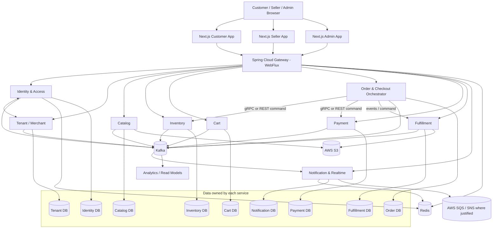
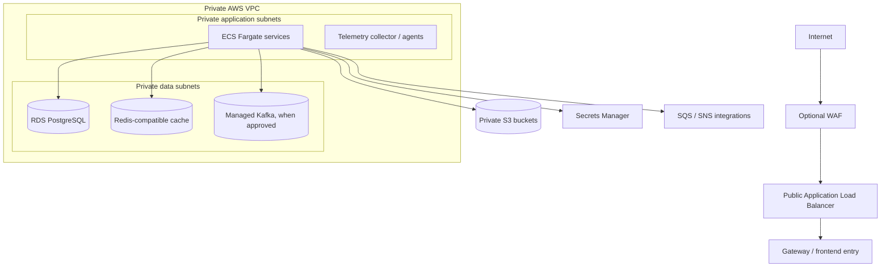

# APPENDIX A — SERVICE ARCHITECTURE & IMPLEMENTATION SPECIFICATION

**Document:** NexCart companion specification  
**Version:** 1.2  
**Purpose:** Define the runtime architecture, service boundaries, responsibility ownership, communication patterns, security, resilience and deployment model.

---

## A.1 Architecture principles

1. **Domain ownership first:** A service owns a business capability and its data. Do not split services only because a database table or entity exists.
2. **Data ownership:** Only the owning service can write its data. Other services use APIs, events or purpose-built read models.
3. **Local transactions:** Use ACID transactions inside a service. Do not try to create one database transaction across services.
4. **Eventual consistency:** Cross-service workflows use events and explicit state transitions.
5. **Reliable publication:** Use Transactional Outbox wherever a committed business change must produce an event.
6. **Idempotent consumers:** Assume events may be delivered more than once.
7. **Reactive discipline:** A WebFlux event-loop thread must not be blocked by JDBC, blocking SDKs, file I/O or `Thread.sleep`.
8. **Security at boundaries:** Gateway checks are useful but every service must enforce authorization for its own resources.
9. **Progressive complexity:** Build and verify a vertical slice before introducing more distributed components.
10. **Operability is a feature:** Health, logs, metrics, traces, migrations and runbooks are part of the service, not optional cleanup.
11. **Microservices from day one:** NexCart is a true microservices system from the first backend commit. Every business service has its own application entry point, build artifact, runtime configuration, database ownership and deployment unit. The monorepo is only a source-code organization choice.
12. **Scaffold progressively, deploy independently:** Create only foundational service skeletons at the start, then add each remaining deployable service just before its implementation phase. Do not combine multiple domains into one Spring Boot application.

## A.2 Recommended logical architecture



The diagram is logical, not a requirement to deploy every component on day one. The implementation roadmap deliberately adds runtime components progressively.

## A.3 Service decomposition decision

**Architecture decision: microservices from day one, organized in one Git monorepo.** This is not a modular monolith. Each service is a separate Spring Boot application and must be independently runnable, testable, buildable and deployable. The monorepo makes local development and documentation easier; it does not create shared runtime or shared business-database behavior.

### A.3.1 What “microservices from day one” means

- Each service owns one business capability and its database.
- Each service has its own `pom.xml` build configuration (it may inherit dependency versions/plugins from the backend parent POM).
- Each service has its own application entry point, configuration, tests, Flyway migration directory and Dockerfile.
- One service cannot import another service's domain model or repository implementation.
- Services communicate through REST, Kafka events or selected gRPC contracts; they do not call another service's repository or database.
- A service can be started and tested without starting every other service, using documented stubs/test doubles where required.
- CI can build and test an individual service and the whole backend workspace.
- Production deployment can roll out one service without rebuilding/releasing every other service, subject to contract compatibility.

### A.3.2 Initial scaffolding decision

Only these foundational skeletons are created in the first backend setup phase:

| Initial skeleton | Why it exists first | First implementation |
|---|---|---|
| API Gateway | Stable browser entry point and route boundary | Routing and health in Phase 1; auth integration after Identity |
| Identity Service | User accounts and authentication are prerequisites for protected flows | Email verification, login and sessions in Phase 3 |
| Tenant Service | Seller organizations and tenant ownership are foundational marketplace concepts | Seller application and approval in Phase 4 |
| Catalog Service | A simple product/category vertical slice proves API-to-database-to-frontend integration | Basic category/product vertical slice in Phase 2/5 |

All other services remain separate planned deployables, but are scaffolded just before their implementation phase: Inventory, Cart, Order, Payment, Fulfillment and Notification. Analytics is scaffolded only when analytics/read models are implemented. Notification Service is brought forward for mandatory verification email delivery when Phase 3 begins; it can start with a simple internal REST contract and add Kafka-driven notification handling later.

### A.3.3 Target service map

| Service | Primary domain | Owns | Scaffold / implementation timing |
|---|---|---|---|
| API Gateway | Edge routing and cross-cutting edge policies | Gateway configuration; no business database | Initial skeleton, Phase 1 routing |
| Identity & Access | User identity, email verification, credentials, sessions and initial authorization | Identity DB | Initial skeleton; Phase 3 |
| Tenant / Merchant | Seller organizations, stores, memberships and onboarding | Tenant DB | Initial skeleton; Phase 4 |
| Catalog | Products, variants, categories, publication/moderation policies and media metadata | Catalog DB | Initial skeleton; Phase 2 vertical slice, Phase 5 features |
| Inventory | Stock balances, reservations and movements | Inventory DB | Scaffold before Phase 6 |
| Cart | Customer cart and cart items | Cart DB | Scaffold before Phase 7 |
| Order & Checkout | Customer orders, seller order groups, checkout orchestration and Saga | Order DB | Scaffold before Phase 8 |
| Payment | Stripe/fake provider adapter, payment attempts, callbacks and refunds | Payment DB | Scaffold before Phase 10; contract design earlier |
| Fulfillment | Seller fulfillment and manual shipment tracking | Fulfillment DB | Scaffold before Phase 11 |
| Notification & Realtime | Verification email initially; later in-app notices, email/SMS and WebSocket fan-out | Notification DB | Scaffold before Phase 3 for verification delivery; expand in Phase 12 |
| Analytics / Read Model | Aggregations and exports | Analytics DB/read models | Later; scaffold when required |

Promotions and reviews can initially be modules inside the owning commerce domains until there is a strong reason to extract them. Admin is primarily a portal plus privileged use cases in the owning services; it does not automatically need a separate database-owning microservice.

### A.3.4 Local-first infrastructure decision

- Start local development with PostgreSQL only.
- Add Redis when its first durable use case is reached (rate limiting/cache/session acceleration and later WebSocket fan-out).
- Add Kafka in the event-driven workflow phase for Outbox/Saga/retries/DLQ.
- Do not make empty service skeletons depend on Redis or Kafka before those components are introduced.
- The target architecture includes these components, but the initial local stack remains intentionally small.

## A.4 Service responsibilities and boundaries

### A.4.1 API Gateway

**Responsibilities**
- Route `/api/v1/...` paths to the correct service.
- Enforce TLS at the public edge and apply request-size limits.
- Validate access tokens where appropriate, while services still validate the identity/claims they rely on.
- Apply coarse rate limits and request throttling.
- Generate or validate correlation/request IDs.
- Propagate trace context.
- Apply CORS policy for approved frontend origins.
- Apply timeouts and remove hop-by-hop headers.

**Must not do**
- Calculate final order prices.
- Reserve inventory.
- Decide seller ownership based on an untrusted header.
- Store authoritative order/payment data.
- Become a business-logic monolith.

### A.4.2 Identity & Access Service

**Responsibilities**
- Register user, send a mandatory email verification challenge, verify email, hash password and authenticate. Unverified accounts cannot perform authenticated commerce actions.
- Issue, rotate and revoke refresh sessions.
- Expose user identity/profile functions.
- Implement initial RBAC/ABAC policy checks or provide a clear authorization integration boundary.
- Publish relevant identity/security events.

**Owned data:** users, credentials, refresh sessions, verification challenges, role/permission assignments, security audit references.

**Critical behavior:** Token refresh must use rotation and reuse detection. Store only a safe hash/reference of refresh tokens where practical. Do not place sensitive secrets in JWT claims. JWT claims are snapshots and may be stale; high-risk actions still need live authorization/session policy where required.

### A.4.3 Tenant / Merchant Service

**Responsibilities**
- Create seller organization and store.
- Manage seller application and review state.
- Manage seller organization memberships and scoped role assignments (or coordinate with Identity & Access if that ownership is selected).
- Capture basic business/contact details and seller application review state. PAN, GSTIN and document/KYC collection are deferred from the learning MVP, but must be revisited before a real marketplace launch.
- Suspend/reactivate seller.
- Publish seller lifecycle events.

**Owned data:** organizations, stores, memberships, seller applications, verification metadata.

**Boundary rule:** Catalog and Inventory should store the seller/organization identifier as an ownership reference. They do not create or update tenant records.

### A.4.4 Catalog Service

**Responsibilities**
- Manage categories, products, variants, attributes and media metadata.
- Enforce seller ownership for writes.
- Apply category-level publication policy: direct seller publish by default; selected categories require admin moderation.
- Expose public published product read APIs.
- Generate product lifecycle events.

**Owned data:** categories, products, variants, product attributes, media object references.

**Search approach:** Start with PostgreSQL indexes and full-text/trigram features only where needed. Add a dedicated search engine only after measurement proves it is needed.

### A.4.5 Inventory Service

**Responsibilities**
- Maintain authoritative stock.
- Apply seller stock adjustments with reasons.
- Reserve and release stock.
- Expire reservations safely.
- Record movements and reservation state.
- Emit reservation and stock events.

**Owned data:** stock balances, reservations, movements.

**Concurrency choice:** Start with conditional SQL updates or optimistic locking. Use row locking where a transaction needs it and contention behavior has been tested. Redis is not the inventory source of truth.

### A.4.6 Cart Service

**Responsibilities**
- Maintain cart and cart items.
- Validate quantity rules and basic product purchasability.
- Return cart view with price estimates from Catalog/Promotion information.
- Support multiple sellers in one cart.

**Owned data:** carts and cart items. Cart data may be cached in Redis, but PostgreSQL is the durable source for authenticated carts.

**Boundary rule:** Cart does not reserve stock or create orders.

### A.4.7 Order & Checkout Service

**Responsibilities**
- Accept checkout commands.
- Validate customer and cart snapshot.
- Coordinate authoritative price/product checks.
- Create parent order, seller order groups and item price snapshots.
- Persist idempotency records.
- Orchestrate order Saga.
- Write outbox records in the same transaction as local state changes.
- Maintain order history and customer/seller-scoped order views.

**Owned data:** orders, seller orders, order items, order status history, Saga instances/steps, idempotency records, outbox events and processed-event records where applicable.

**Boundary rule:** Order Service does not directly update Inventory or Payment tables. It sends commands/requests and reacts to results.

### A.4.8 Payment Service

**Responsibilities**
- Provide a provider-independent `PaymentProviderPort`.
- Implement a deterministic fake provider for local tests and a Stripe adapter for Stripe test mode when account access is available.
- Create payment attempts and provider sessions.
- Validate provider callbacks.
- Query/reconcile uncertain provider states.
- Process refund commands.
- Publish payment outcome events.

**Owned data:** payment intents, attempts, transactions, webhook events, refunds, outbox.

**Security:** No raw card data. Provider credentials are runtime secrets. Webhook payloads are verified before use. Provider event IDs are deduplicated. Stripe is the selected learning/sandbox target, but India account eligibility and marketplace Connect limitations are a hard production gate; see Master BRD Section 10.1 and its official references. Seller settlement is out of MVP.

### A.4.9 Fulfillment Service

**Responsibilities**
- Create fulfillment work for seller orders.
- Manage shipment(s) and shipment items.
- Accept seller-entered carrier name, tracking reference and manual shipment status updates in the MVP.
- Add carrier adapters only in a later release.
- Normalize provider states.
- Maintain tracking history and proof-of-delivery references.
- Emit fulfillment events.

**Owned data:** fulfillment groups, shipments, shipment items, tracking events and delivery proof metadata.

### A.4.10 Notification & Realtime Service

**Responsibilities**
- Deliver mandatory identity verification emails through an internal REST interface in the early MVP (without Kafka dependency).
- Later consume relevant domain events.
- Create in-app notifications.
- Send email/SMS using adapters.
- Manage notification preferences and delivery outcomes.
- Maintain WebSocket connections/subscriptions and publish authorized updates.

**Owned data:** notifications, templates, preferences, delivery attempts.

**Important:** WebSocket payloads are non-authoritative. The client must refresh current domain state via REST.

### A.4.11 Analytics / Read Model Service

**Responsibilities**
- Consume domain events.
- Build reporting projections.
- Provide dashboard summaries.
- Create export jobs and store output in S3.
- Use Kafka Streams for selected windowed/aggregated event processing when the reporting use case benefits from stream processing; begin with a simple consumer/read model first and introduce Kafka Streams only after the event semantics and aggregation windows are understood.

**Boundary:** It does not write to transactional service databases. Reporting models may be eventually consistent.

## A.5 Communication decision matrix

| Source → target | Preferred mechanism | Reason / rule |
|---|---|---|
| Browser → Gateway | HTTPS REST | Public API contract |
| Gateway → service | HTTP | Routing, security and observable request context |
| Order → Inventory | gRPC or REST command initially; event response for long-running workflow | Use deadline and idempotent reservation ID; avoid waiting indefinitely |
| Order → Payment | REST/gRPC initiation plus payment outcome event | Provider workflow is asynchronous |
| Service → service domain notification | Kafka after Phase 9; internal REST only for early verification-email delivery | Add Kafka when Outbox/Saga is introduced; do not require Kafka in initial local setup |
| Service → Notification | Kafka | Notification must not block core transaction |
| Notification instances → connected clients | Redis Pub/Sub | Cross-instance WebSocket fan-out; ephemeral only |
| Service → S3 | AWS SDK via bounded/blocking-safe adapter | Object storage for files |
| Export worker → SQS | SQS where useful | Isolated job queue; not a duplicate of Kafka domain events |
| Operational fan-out → SNS | SNS where useful | AWS subscriber fan-out/alerts |

### A.5.1 Kafka versus SQS/SNS

Use Kafka as the main internal domain-event backbone. Use SQS for selected background jobs or integrations that benefit from a simple queue and visibility timeout. Use SNS for fan-out to AWS subscribers or operational notifications. Do not build two competing event systems for the same workflow. Document the owner, source of truth, retry model and replay model for each message path.

### A.5.2 Redis responsibility details

Use Redis for distributed rate-limiting state (initially a sliding-window or token-bucket design implemented atomically, for example with a Lua script/Redis Function), cache, selected session/revocation acceleration and cross-instance WebSocket Pub/Sub. PostgreSQL remains the durable source for refresh-session rotation/revocation records and critical idempotency outcomes. Redis may cache/accelerate these records, but a Redis flush must not silently make a revoked refresh token valid again. Define a fail-open/fail-closed policy per use case: authentication abuse controls and sensitive write limits should generally fail safely; ordinary product cache misses may fall back to PostgreSQL.

### A.5.3 gRPC adoption rule

Start with the business command contract and tests. A simple REST internal command is acceptable while learning the workflow. Once stable, implement a versioned gRPC contract for a clear synchronous operation (initial candidate: inventory reservation). The client must set an explicit deadline, propagate trace/correlation metadata, map gRPC status codes into domain outcomes and use an idempotent command key. Do not convert every service call to gRPC; Kafka remains the asynchronous event mechanism.

## A.6 Domain event ownership

| Event | Owner/producer | Typical consumers |
|---|---|---|
| UserRegistered | Identity | Notification, Analytics |
| SellerApplicationSubmitted | Tenant | Notification, Admin/read model |
| SellerApproved / SellerSuspended | Tenant | Catalog, Order, Notification |
| ProductPublished / ProductArchived | Catalog | Cart, Analytics, search/read model |
| StockAdjusted | Inventory | Analytics, Notification |
| InventoryReserved | Inventory | Order |
| InventoryReservationRejected | Inventory | Order |
| InventoryReleased | Inventory | Order, Analytics |
| OrderCreated | Order | Inventory/Analytics as workflow requires |
| OrderPaymentRequested | Order | Payment |
| PaymentSucceeded / PaymentFailed / PaymentUnknown | Payment | Order, Notification, Analytics |
| OrderConfirmed / OrderCancelled | Order | Fulfillment, Inventory, Notification |
| ShipmentCreated / ShipmentUpdated / ShipmentDelivered | Fulfillment | Order, Notification, Analytics |
| RefundCompleted / RefundFailed | Payment | Order, Notification |

The detailed contracts and versioning rules are in Appendix C.

## A.7 Transactional Outbox and Saga design

### A.7.1 Outbox rule

For any state change that must reliably publish an event:

1. Begin local database transaction.
2. Validate and update business records.
3. Insert outbox event record in the same transaction.
4. Commit transaction.
5. Relay publishes the event to Kafka.
6. Relay records publish state or uses CDC according to selected implementation.
7. Consumers deduplicate using event ID and/or business command ID.

A service must not commit a business change and then rely on an unrelated in-memory task to publish its event.

### A.7.2 Beginner implementation order

- First implement a simple polling outbox relay.
- Verify restart and duplicate-publication behavior.
- Add monitoring and cleanup policy.
- Consider CDC/connector-based relay only after the polling implementation is understood and measured.

### A.7.3 Order Saga

The Order Service acts as orchestrator for the initial checkout Saga. Persist current step, correlation identifiers, deadlines, attempt counts and terminal outcome.

Proposed steps:

1. Validate and create pending order.
2. Request inventory reservation per seller/item group.
3. Wait for definitive reservation outcomes.
4. If any required reservation fails, release successful reservations and cancel order.
5. If reservation succeeds, request payment initiation.
6. Await provider-verified payment outcome.
7. On payment success, confirm order and request fulfillment.
8. On confirmed payment failure, release inventory and cancel/fail order.
9. On unknown payment result, mark workflow `ACTION_REQUIRED`/reconciliation pending; do not blindly release stock or create fulfillment.
10. If fulfillment creation fails transiently, retry the fulfillment command idempotently; do not reverse a captured payment without an explicit cancellation/refund policy.

Compensation is a business action, not guaranteed rollback. A captured payment may require a refund; an in-transit shipment may require return-to-origin.

## A.8 Reactive programming requirements

### A.8.1 WebFlux rules

- Use `Mono<T>` for zero-or-one asynchronous result and `Flux<T>` for streams/multiple results.
- Avoid calling `.block()` in request paths.
- Do not use blocking JDBC access on WebFlux event-loop threads.
- Use R2DBC for reactive PostgreSQL access.
- Use reactive-compatible HTTP clients for service-to-service HTTP calls.
- If a third-party SDK is blocking, isolate it on a bounded scheduler or a dedicated worker and document resource limits.
- Do not create unbounded `parallel()` work or unbounded in-memory queues.
- Apply timeouts, backpressure and cancellation-aware resource handling.
- Handle errors explicitly; do not convert every failure into an empty result.

### A.8.2 R2DBC and migration separation

Flyway normally uses JDBC. Run Flyway as a migration step/job using a JDBC connection before application traffic is enabled. Runtime repositories may use R2DBC. Do not attempt to make Flyway operate over R2DBC.

## A.9 Security architecture

### A.9.1 Authentication

- Identity Service validates credentials and issues tokens.
- Gateway may perform initial JWT validation for routing/edge rejection.
- Each service validates the claims and security context it requires.
- Refresh tokens are rotated and revocable.
- Use short access-token lifetime and controlled key rotation.

### A.9.2 Authorization

Start with custom RBAC/ABAC in Spring Security to understand policies and establish behavior. Later integrate OpenFGA for relationships such as:

- user is member of organization;
- organization owns store;
- store owns product;
- store receives seller order;
- customer owns parent order;
- support agent is assigned to case.

Migrate by shadow-testing or comparing decisions before removing old policy checks. Keep emergency/admin permissions narrow and audited.

### A.9.3 Tenant context

A request's tenant scope must be established from authenticated memberships and validated resource ownership. Do not trust a client-provided tenant header as authorization. Where tenant ID is passed between services, include it as context only after the source service has validated the caller's right to act for that tenant.

### A.9.4 Service-to-service identity

For production, use workload identity/short-lived credentials or another managed service authentication approach. Local development may use clearly separated test credentials. Never reuse a human user's browser access token as a general service credential.

## A.10 Resilience and shutdown

### A.10.1 Resilience4j policies

Apply per dependency, not as a blanket configuration:

- Timeout/deadline for every remote call.
- Circuit breaker for unstable dependencies.
- Bulkhead for expensive/limited resources.
- Retry only transient errors and safe/idempotent operations.
- Exponential backoff with jitter and maximum attempts.
- Fallback only where business semantics allow it.

### A.10.2 Graceful shutdown sequence

1. Mark instance unready so the load balancer stops routing new requests.
2. Stop accepting new HTTP work.
3. Allow in-flight requests to finish within the configured shutdown grace period.
4. Stop receiving new Kafka records / pause consumers.
5. Finish in-flight processing or leave messages uncommitted for redelivery.
6. Commit offsets only after successful processing according to consumer semantics.
7. Close WebSocket sessions or send a reconnect notice.
8. Close database, Redis and other client resources.
9. Exit before container termination deadline.

Test this behavior under an actual container termination, not only with a unit test.

## A.11 Observability architecture

- Micrometer instruments application and JVM metrics.
- OpenTelemetry captures traces and propagates context through HTTP, gRPC and Kafka headers.
- JSON logs include service name, environment, correlation ID, trace ID and operation.
- Prometheus scrapes metrics; Grafana dashboards display service health, latency, errors, database pool, Kafka lag and DLQ depth.
- Centralized logging stores searchable application logs with retention and access policy.
- Alerts must be actionable and tied to a runbook.

Do not use user IDs, order IDs or other high-cardinality values as Prometheus labels. They belong in traces/logs where access is controlled.

## A.12 Repository and frontend/backend workspace structure

The source repository is a single Git monorepo named `nexcart`. The backend is grouped under `backend/` so frontend and backend concerns are visibly separated. This is a code organization decision only; every backend service remains an independent deployable microservice.

**Decision confirmed in Phase 0:** NexCart uses microservices from day one. The monorepo is only the source-control layout. Four foundational applications (Gateway, Identity, Tenant and Catalog) receive bootable skeletons in the initial setup; the remaining domain services are created as separate deployable projects immediately before their implementation phase. No phase may merge service business logic into one shared Spring Boot application.

### A.12.1 Recommended repository layout

```text
nexcart/
├── frontend/
│   ├── apps/
│   │   ├── web/                         # Customer storefront (independent Next.js app)
│   │   ├── seller/                      # Seller portal (independent Next.js app)
│   │   └── admin/                       # Admin portal (independent Next.js app)
│   │
│   └── shared/
│       ├── ui/                          # Accessible, reusable UI primitives/components
│       ├── api-client/                  # Typed API Gateway client and request helpers
│       ├── types/                       # Shared frontend/API TypeScript types
│       ├── utils/                       # Framework-agnostic frontend utilities
│       └── configs/
│           ├── eslint/                  # Shared ESLint configuration package
│           └── typescript/              # Shared TypeScript configuration package
│
├── backend/
│   ├── pom.xml                          # Maven parent/aggregator; shared versions and plugins
│   ├── services/
│   │   ├── api-gateway/                 # Independent Spring Boot deployable
│   │   ├── identity-service/            # Independent Spring Boot deployable
│   │   ├── tenant-service/              # Independent Spring Boot deployable
│   │   ├── catalog-service/             # Independent Spring Boot deployable
│   │   ├── inventory-service/           # Added before Phase 6
│   │   ├── cart-service/                # Added before Phase 7
│   │   ├── order-service/               # Added before Phase 8
│   │   ├── payment-service/             # Added before Phase 10
│   │   ├── fulfillment-service/         # Added before Phase 11
│   │   ├── notification-service/        # Added before Phase 3 for verification email
│   │   └── analytics-service/           # Added only when analytics is implemented
│   │
│   └── shared-libraries/
│       ├── observability-starter/        # Technical-only logging/metrics/tracing conventions
│       └── test-support/                 # Test utilities; no shared business models
│
├── contracts/
│   ├── openapi/                          # Published REST contracts
│   ├── proto/                            # Versioned gRPC .proto contracts
│   └── events/                           # Versioned Kafka JSON Schema/Avro schemas
├── infra/
│   ├── docker/
│   ├── compose/                          # PostgreSQL initially; Redis/Kafka added later
│   ├── aws/                              # Future cloud deployment assets
│   └── observability/
├── scripts/                              # Local setup, DB creation and developer scripts
├── docs/
│   ├── brd/
│   ├── architecture/
│   ├── adr/
│   └── runbooks/
├── .github/workflows/                    # CI and independent app/service deployment workflows
├── package.json                          # Root pnpm scripts and pinned packageManager
├── pnpm-workspace.yaml                   # Frontend workspace package globs
├── pnpm-lock.yaml                        # Single workspace lockfile
├── turbo.json                            # Frontend task graph and cache configuration
├── .editorconfig
├── .gitignore
└── README.md
```

**Workspace boundary:** pnpm discovers only the frontend applications and frontend shared libraries. The Java backend remains a Maven build rooted at `backend/pom.xml`; it is in the same Git repository but is not a pnpm workspace package. `frontend/shared/` contains reusable frontend libraries, not deployable applications. Keep portal-specific code in its app. A shared package should be created only when at least two apps need the capability or when a deliberate shared contract/configuration justifies it.

**Root workspace files:**

`pnpm-workspace.yaml`:

```yaml
packages:
  - "frontend/apps/*"
  - "frontend/shared/*"
  - "frontend/shared/configs/*"
```

Root `package.json` (illustrative; replace the package manager placeholder with the exact version pinned by the repository):

```json
{
  "name": "nexcart",
  "private": true,
  "packageManager": "pnpm@<PINNED_VERSION>",
  "scripts": {
    "dev": "turbo run dev",
    "build": "turbo run build",
    "lint": "turbo run lint",
    "test": "turbo run test",
    "check-types": "turbo run check-types",
    "check": "turbo run lint check-types test build"
  },
  "devDependencies": {
    "turbo": "<PINNED_VERSION>"
  }
}
```

`turbo.json` starter configuration:

```json
{
  "$schema": "https://turborepo.dev/schema.json",
  "tasks": {
    "build": {
      "dependsOn": ["^build"],
      "outputs": [".next/**", "!.next/cache/**", "dist/**"]
    },
    "dev": {
      "cache": false,
      "persistent": true
    },
    "lint": {
      "dependsOn": ["^lint"]
    },
    "check-types": {
      "dependsOn": ["^check-types"]
    },
    "test": {
      "outputs": ["coverage/**"]
    }
  }
}
```

Every app/shared package must define the scripts it supports in its own `package.json`. For Next.js apps, standard scripts are `dev`, `build`, `start`, `lint`, `check-types` and `test` (add `test` when the test runner is configured). Shared packages should declare workspace dependencies explicitly using `workspace:*`. Do not add a fake `build` script to a source-only package merely to satisfy Turborepo; either define the real task or omit it.

**Local development ports:** Customer `localhost:3000`, Seller `localhost:3001`, Admin `localhost:3002`, API Gateway `localhost:8080` (unless the local configuration assigns different ports). Production hostnames are deployment/configuration decisions and must be finalized before cookie/CORS configuration.

The first commit should contain the root workspace files, the three frontend app scaffolds, Maven root/parent, and the four foundational backend skeletons: API Gateway, Identity, Tenant and Catalog. Create other service folders and add them to the Maven aggregator just before their relevant implementation phase. Notification Service is created before Phase 3 email-verification delivery. Do not create dozens of placeholder files for future services.

### A.12.1.1 Frontend workspace and task commands

Run these from the Git repository root. Select and pin a supported Node.js LTS and exact pnpm version first; do not let developers or CI silently use different package-manager versions.

```bash
# Enable Corepack and pin the chosen pnpm version in package.json
# Create a private root package.json first if the repository does not have one yet
pnpm init
# Set "private": true in the root package.json before installing workspace tooling
corepack enable
corepack use pnpm@latest  # Corepack writes the exact selected pnpm version to package.json

# Create the root pnpm-workspace.yaml before adding workspace dependencies
cat > pnpm-workspace.yaml <<'YAML'
packages:
  - "frontend/apps/*"
  - "frontend/shared/*"
  - "frontend/shared/configs/*"
YAML

pnpm add -Dw turbo

# Create the three Next.js App Router applications
pnpm dlx create-next-app@latest frontend/apps/web --typescript --eslint --tailwind --app --src-dir --import-alias "@/*"
pnpm dlx create-next-app@latest frontend/apps/seller --typescript --eslint --tailwind --app --src-dir --import-alias "@/*"
pnpm dlx create-next-app@latest frontend/apps/admin --typescript --eslint --tailwind --app --src-dir --import-alias "@/*"

# After adding pnpm-workspace.yaml and root turbo.json/package.json
pnpm install

# Run all apps in parallel, or run one app at a time
pnpm dev
pnpm --filter @nexcart/web dev
pnpm --filter @nexcart/seller dev -- --port 3001
pnpm --filter @nexcart/admin dev -- --port 3002

# Workspace-wide quality gates
pnpm lint
pnpm check-types
pnpm test
pnpm build
pnpm check

# Target a single app (the app package.json name must match the filter)
pnpm exec turbo run lint check-types test build --filter=@nexcart/web
pnpm exec turbo run build --filter=@nexcart/seller

# Inspect the workspace graph and task plan
pnpm exec turbo run build --dry
pnpm -r list --depth -1
```

Set each app's `package.json` name to `@nexcart/web`, `@nexcart/seller` and `@nexcart/admin` respectively. Use the same pattern for shared packages, for example `@nexcart/ui` and `@nexcart/api-client`. The create-next-app commands create the app scaffolds; then verify/normalize each generated `package.json` name and scripts before the first root install/CI run.

**Important operating rules:**

- Commit only the root `pnpm-lock.yaml`; do not commit nested lockfiles or nested `node_modules`.
- Use `pnpm install --frozen-lockfile` in CI.
- Keep `.next/`, `node_modules/`, `.turbo/`, coverage and build outputs out of Git.
- Use `workspace:*` for internal package dependencies; do not publish internal libraries accidentally.
- Do not place secrets in `NEXT_PUBLIC_*` variables; those are exposed to browser code. Keep server-only secrets in the relevant app/server environment.
- Configure each app's API base URL and allowed origins per environment. Do not assume local ports or production domains are interchangeable.
- Use Turborepo caching for deterministic build/test/lint/type-check outputs. Do not cache secrets or environment-specific artifacts; declare relevant environment variables in Turborepo task configuration when they affect output.
- Remote caching is optional. Enable it only after local CI is reliable and access controls for the cache are understood.

### A.12.2 Standard Spring Boot service structure

Every service follows this package convention. `com.nexcart.<service>` is replaced by the service's own package root.

```text
<service-name>/
├── pom.xml
├── Dockerfile
├── README.md
└── src/
    ├── main/
    │   ├── java/com/nexcart/<service>/
    │   │   ├── <Service>Application.java
    │   │   ├── interfaces/
    │   │   │   └── rest/
    │   │   │       ├── controller/
    │   │   │       ├── request/
    │   │   │       ├── response/
    │   │   │       └── mapper/
    │   │   ├── application/
    │   │   │   ├── usecase/
    │   │   │   ├── command/
    │   │   │   ├── query/
    │   │   │   └── port/
    │   │   ├── domain/
    │   │   │   ├── model/
    │   │   │   ├── event/
    │   │   │   ├── exception/
    │   │   │   └── repository/
    │   │   ├── infrastructure/
    │   │   │   ├── persistence/
    │   │   │   │   ├── entity/
    │   │   │   │   ├── repository/
    │   │   │   │   └── adapter/
    │   │   │   ├── messaging/
    │   │   │   ├── client/
    │   │   │   └── config/
    │   └── resources/
    │       ├── application.yml
    │       └── db/migration/              # Flyway migrations owned by this service
    └── test/
        └── java/com/nexcart/<service>/
            ├── unit/
            ├── integration/
            └── contract/
```

Folder responsibilities:

- `interfaces`: HTTP controllers and input/output DTOs. Do not place business decisions here.
- `application`: use cases and orchestration. Coordinates domain operations through ports.
- `domain`: core business rules and domain types. Must not depend on Spring, R2DBC, Kafka or another service's code.
- `infrastructure`: implementations for R2DBC repositories, Flyway configuration/migration execution, HTTP/gRPC clients, Kafka, Redis and provider adapters.
- `resources/db/migration`: this service's own Flyway SQL files only.

Do not create empty packages just to match the diagram. Add packages when the service needs them. A service's public API and contracts belong in `contracts/` and/or are published from that service; other services must not import its internal classes.

### A.12.3 Maven build conventions

- Use Maven Wrapper (`mvnw`, `mvnw.cmd`) and commit the wrapper files so developers and CI use the same Maven distribution.
- `backend/pom.xml` is a Maven parent/aggregator with `packaging=pom`, centralized dependency versions, plugin versions and Java release configuration.
- Each service has its own `pom.xml`, `spring-boot-maven-plugin` configuration and executable artifact.
- Add a service to the aggregator only when its scaffold is created.
- Build the whole backend with `./mvnw -f backend/pom.xml verify`.
- Build one service with `./mvnw -f backend/pom.xml -pl services/identity-service -am verify` (adjust path if the aggregator uses a different module path).
- Build each service's Docker image from its own Dockerfile and artifact. Do not package every service into one image.
- Shared libraries may provide technical cross-cutting support only. Do not share JPA/R2DBC entities, repositories, service business logic or domain models across microservices.

### A.12.4 Database isolation decision

For local learning, run **one PostgreSQL server/container**, but create **one logical database and one least-privilege database role/credential set per service** (for example `nexcart_identity` + `nexcart_identity_app`, `nexcart_tenant` + `nexcart_tenant_app`, `nexcart_catalog` + `nexcart_catalog_app`). This is the recommended compromise between beginner-friendly local operations and real microservice data ownership.

Rules:

1. A service's DB role can connect only to its own database and has no privileges on another service's database.
2. Do not let services share tables or perform cross-service joins.
3. No cross-service foreign keys. Store external IDs and validate through API/event contracts.
4. Each service owns its Flyway migrations and runs them against its own database using a migration credential with DDL rights; runtime credentials should have only required DML rights.
5. A single PostgreSQL server does not mean a shared database. It is a local infrastructure convenience.
6. In a later production design, databases may move to separate RDS instances/clusters or isolated DBs based on failure, security, performance and cost requirements. Do not create a separate database server for every service in local development.

### A.12.5 Service independence checklist

A service is a real microservice only when it has:

- Its own application entry point and port/configuration.
- Its own buildable/deployable artifact and Docker image.
- Its own database/credential boundary if it owns transactional data.
- Its own migrations and test suite.
- Explicit API/event contracts with consumers.
- No direct dependency on another service's internal packages or tables.
- A health/readiness endpoint and structured logs.
- A CI build/test path that can run independently.

## A.13 Local, test, staging and production environments

| Environment | Purpose | Infrastructure expectation |
|---|---|---|
| Local Phase 1 | Beginner setup and first vertical slice | Docker Compose PostgreSQL only; separate DB/user per active service |
| Local later phases | Add infrastructure when a feature needs it | Add Kafka in Phase 9; add Redis in Phase 12; add a local mail catcher only when email delivery is implemented |
| CI | Repeatable automated checks | Maven/Node builds; ephemeral PostgreSQL and later Kafka/Redis through Testcontainers as required; no shared mutable test DB |
| QA/Staging | Future production-like acceptance | Not provisioned for the initial learning target; later isolated environment with sandbox payment provider |
| Production | Future real users and transactions | Not in initial scope; requires business/provider/legal gates, private networking, managed data services, secrets, backups, monitoring and runbooks |

The initial deployment target is local learning only. AWS appears in the later roadmap to preserve the path to production, but do not create cloud resources during early phases. Configuration must be environment-driven and validated at startup. Never commit production `.env` files.

## A.14 AWS target topology



Production baseline:
- One VPC with public and private subnets across availability zones where budget permits.
- Public ingress only through approved load balancer/security controls.
- ECS tasks, RDS and cache in private networking.
- Least-privilege security groups and task IAM roles.
- RDS backups, encryption and restore testing.
- S3 private buckets, encryption, lifecycle and access policies.
- Secrets Manager for sensitive configuration.
- GitHub Actions OIDC to AWS rather than long-lived AWS access keys where supported.
- Cost alarms, budget alerts and environment shutdown policy for non-production stacks.

Managed Kafka may be expensive for a small learning project. Use Kafka locally first. For cloud learning, compare Amazon MSK, a managed third-party Kafka service or a carefully operated small test cluster; document the operational and cost trade-off. Do not promise a free production Kafka environment.

## A.15 Architecture Decision Records to create

Create one short ADR for each decision below. An ADR should state context, options, decision, consequences and date.

- ADR-001: Monorepo with independently deployable microservices (approved).
- ADR-002: Initial service skeleton set and just-in-time service scaffolding (approved).
- ADR-003: WebFlux/R2DBC and blocking dependency policy.
- ADR-004: One local PostgreSQL server with database + DB role per service (approved).
- ADR-005: Kafka event format and schema compatibility approach.
- ADR-006: Outbox relay strategy (polling first, CDC later if justified).
- ADR-007: Order Saga orchestration approach.
- ADR-008: Payment provider and authorize/capture model.
- ADR-009: Inventory reservation expiry and concurrency strategy.
- ADR-010: RBAC/ABAC implementation and OpenFGA migration.
- ADR-011: WebSocket infrastructure and Redis Pub/Sub role.
- ADR-012: AWS deployment and managed-service choices.

**Completion check:** The architecture is ready for implementation when each service has a documented purpose, owned data, inbound/outbound contracts, security boundary, health/metrics plan and deployment method. Appendix D shows when each one is introduced.
