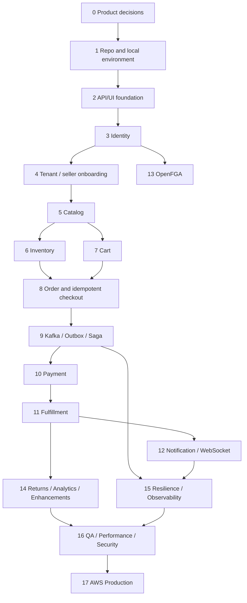

# APPENDIX D — DETAILED PHASE-WISE IMPLEMENTATION PLAN

**Document:** NexCart companion specification  
**Version:** 1.2  
**Purpose:** Give a beginner a sequenced, testable path from an empty repository to a production deployment.

---

## D.1 How to follow this plan

Treat this document as your development playbook. NexCart is a microservices architecture from the first backend commit, but the services and infrastructure are introduced progressively. Do not jump to Kafka, Saga, OpenFGA or AWS before you can run, understand and test the basic application.

For every task:

1. Read the linked requirement in the Master BRD.
2. Read the service/data/API design in Appendices A–C.
3. Create a small task with a clear outcome.
4. Implement the smallest working slice.
5. Add/update automated tests.
6. Run the full required checks locally.
7. Open a pull request and review the diff.
8. Merge only after required CI checks pass.
9. Update documentation and traceability.

A phase is **not complete** because code exists. It is complete only when its exit criteria and evidence are met.

## D.2 Beginner build strategy

### Build one vertical slice at a time

A vertical slice is a feature that works from browser through API and database, with validation and tests. For example, “seller creates a product” means:

- A seller screen exists.
- The form validates inputs.
- The frontend calls the correct API.
- The backend authenticates and authorizes the seller.
- Catalog Service validates business rules.
- PostgreSQL persists the product.
- The API returns a safe response.
- The UI shows success/error states.
- Tests prove ownership and validation behavior.

Do not build all frontend screens first and leave them with mock data for months. Do not build every database table before any workflow runs.

### Microservices from day one, implementation in phases

Use one Git monorepo, but do not build a modular monolith. Each backend service is a separate Spring Boot application, has its own Maven module/POM, configuration, Dockerfile, tests and database ownership. In the first setup phase, scaffold only API Gateway, Identity, Tenant and Catalog. Scaffold Inventory, Cart, Order, Payment, Fulfillment and Notification just before their planned implementation phases; scaffold Analytics later. Each service must remain independently runnable, testable and deployable. Use three independently deployable Next.js apps (`frontend/apps/web`, `frontend/apps/seller`, `frontend/apps/admin`) managed by one pnpm workspace and Turborepo. Shared frontend libraries live in `frontend/shared/`. They are separate frontend deployments, not backend services; the backend remains independent Spring Boot microservices.

### Use one source of truth

- Master BRD: scope and business rules.
- Appendix A: service boundaries.
- Appendix B: data ownership.
- Appendix C: APIs/events.
- Appendix D: implementation sequence.

When you discover a missing rule, write it down and update the relevant document before coding around an assumption.

---

# PHASE 0 — Product confirmation and development preparation

**Goal:** Remove avoidable ambiguity before creating code.  
**Primary outputs:** Approved MVP scope, initial policies, architecture decisions and a prioritized backlog.  
**Dependencies:** None.

## D0.1 Approved business and product decisions

These decisions were confirmed in Phase 0 and are inputs to the backlog. Do not ask the developer to decide them again during implementation.

| Area | Locked baseline | Implementation consequence |
|---|---|---|
| Market/currency | India, INR only in MVP; future countries/currencies | Store currency on every money value; reject non-INR checkout until multi-currency release |
| Customer email | Mandatory | Add email challenge lifecycle; block authenticated commerce access before verification |
| Seller verification | Basic business/contact details plus manual admin approval | No PAN/GSTIN/document collection in MVP; design extension points |
| Product publishing | Direct publish by default; configured categories require review | Add `categories.requires_approval`; API chooses direct publish or `PENDING_REVIEW` server-side |
| Cart/order | Multi-seller cart; split into parent order and seller orders | One parent-order payment attempt; preserve seller/item allocation snapshots |
| Payment provider | Stripe target | Provider-neutral adapter + fake local provider; Stripe sandbox only if eligible account/test access exists; production gate in Master BRD |
| Shipping | Manual seller-entered tracking/status | No carrier integration/webhook in initial release |
| Returns | Recommended configurable baseline | Cancellation before dispatch according to state; returns use configured window/category rules; legal review before public trading |
| Seller settlement | Entire settlement feature post-MVP | No payout ledger or real seller payout in MVP; no real marketplace funds flow until merchant-of-record/funds rules approved |
| Catalogue | Mixed/general marketplace | Flexible category attributes; category policy controls moderation |
| Deployment | Local learning only initially | No AWS provisioning in early phases; retain AWS as later optional production roadmap |

## D0.2 Approved technical architecture decisions

| Area | Locked baseline | Implementation consequence |
|---|---|---|
| Architecture | Microservices from day one | Separate Spring Boot deployable per service; not a modular monolith |
| Source control | One Git monorepo | Shared root docs/CI; service ownership and releases remain independent |
| Build | Maven | Maven Wrapper; `backend/pom.xml` parent/aggregator; each service has its own `pom.xml` |
| Initial skeletons | API Gateway, Identity, Tenant and Catalog only | Add remaining service projects just before their implementation phases |
| Local infrastructure | PostgreSQL first | No Redis/Kafka in initial Compose; add Kafka in Phase 9 and Redis in Phase 12 |
| Database isolation | One local PostgreSQL server; one database and DB role per service | No shared business DB, cross-service joins or cross-service foreign keys |
| Communication | REST + Kafka + selected gRPC | REST for initial APIs/commands; Kafka for async events from Phase 9; gRPC only for justified internal synchronous commands |
| Reactive stack | Spring Boot WebFlux + R2DBC | Keep blocking SDK/JDBC tasks off event-loop threads; Flyway runs via JDBC migration step |

The decisions are approved for the local learning MVP. They do not automatically approve a real production marketplace, real customer funds, tax treatment or legal compliance.

## D0.3 Production gates (tracked now; required before real-money/public launch)

These are not unresolved decisions blocking local learning development. Keep them open as release gates and close them before accepting real customer payments or opening the marketplace to the public.

- [ ] Confirm Stripe India account eligibility and obtain written confirmation of the exact parent-order payment and future marketplace Connect funds flow.
- [ ] Confirm the domestic payment methods required by the intended customer base and obtain account-specific confirmation from Stripe; its India support article and public UPI page appear to differ on UPI availability.
- [ ] Decide merchant of record, custody/holding of customer funds, commissions and seller settlement before real marketplace payments.
- [ ] Validate tax, invoice, consumer-protection, returns, privacy and data-retention obligations with qualified advisors.
- [ ] Confirm whether enhanced seller verification (PAN/GSTIN/documents) is required before public launch.
- [ ] Confirm production traffic, availability, RTO/RPO and budget before AWS sizing.

## D0.4 Create the initial product backlog

Create epics:

1. Project foundation and CI.
2. Identity and session management.
3. Seller onboarding and tenant isolation.
4. Product catalogue and media.
5. Inventory and reservation.
6. Cart and checkout.
7. Order and Saga orchestration.
8. Payment integration.
9. Fulfillment and shipping.
10. Notifications and real-time updates.
11. Admin operations.
12. Security, observability and operations.
13. Production deployment.

Each ticket must include: requirement ID, user story, preconditions, API/UI impact, data changes, acceptance criteria, test cases, dependencies and documentation updates.

## D0.5 Create Architecture Decision Records

Write short ADRs for monorepo, service boundaries, R2DBC/Flyway separation, Kafka use, outbox approach, payment provider model, inventory locking and tenant model.

### Phase 0 exit gate

- [x] India/INR MVP, mandatory email verification, seller basic verification, category-based product moderation, multi-seller cart, parent-order payment, manual tracking and settlement deferral are recorded.
- [x] Monorepo, Maven, microservices-from-day-one, foundational skeleton set, PostgreSQL-first and database-per-service decisions are recorded.
- [ ] Stripe India production eligibility/funds flow, tax/legal rules and public-launch policies remain tracked as explicit production gates.
- [ ] MVP backlog is prioritized and every P0 epic has a clear outcome before Phase 1 implementation work is considered complete.

---

# PHASE 1 — Developer environment, repository and CI foundation

**Goal:** Make the project reproducible on your computer and in CI.  
**Primary outputs:** Monorepo, local run instructions, Docker Compose, code checks and basic health endpoints.  
**Dependencies:** Phase 0.

## D1.1 Install and verify development tools

- [ ] Git.
- [ ] A currently supported Node.js LTS release.
- [ ] pnpm (pin the package manager version in the repository).
- [ ] A supported Java LTS release selected for the chosen Spring Boot release.
- [x] Maven selected; use the Maven Wrapper committed to the repository. Do not introduce Gradle.
- [ ] Docker Engine/Desktop and Docker Compose.
- [ ] IDE/editor with Java and TypeScript support.
- [ ] API client such as Postman or Bruno.
- [ ] Database client.
- [ ] Optional local AWS tooling for S3 integration tests.

Do not blindly copy version numbers from an old tutorial. Choose mutually compatible supported versions at project creation, pin them and record them in the README.

## D1.2 Create repository structure

Use the exact structure in Appendix A. Create `frontend/apps/{web,seller,admin}`, `frontend/shared/{ui,api-client,types,utils}`, `frontend/shared/configs/{eslint,typescript}`, `backend/services`, `backend/shared-libraries`, `contracts/openapi`, `contracts/proto`, `contracts/events`, `infra/compose`, `infra/docker`, `infra/aws`, `scripts`, `docs/brd`, `docs/architecture`, `docs/adr`, `docs/runbooks` and `.github/workflows`.

- [ ] Keep one Git repository and one root Node workspace; do not create nested Git repositories.
- [ ] Keep one root `package.json`, `pnpm-workspace.yaml`, `pnpm-lock.yaml` and `turbo.json`.
- [ ] Keep Maven independent under `backend/pom.xml`; do not add Java modules to pnpm workspace globs.
- [ ] Create `.npmrc` only for intentional, documented pnpm settings; do not create nested package-manager configs that change workspace behavior.

- [ ] Add root README with prerequisites and setup steps.
- [ ] Add `.editorconfig`.
- [ ] Add `.gitignore` for Java, Node, IDE and environment files.
- [ ] Add `.env.example` files containing placeholders only.
- [ ] Add branch/PR policy.
- [ ] Add conventional commit or agreed commit-message convention.
- [ ] Add code ownership rules if working with others.

## D1.3 Scaffold the frontend workspace and three Next.js apps

First select a supported Node.js LTS and pin an exact pnpm version. Corepack is used to make the package-manager version reproducible.

```bash
# From repository root
pnpm init                         # Create the root package.json if it does not exist
# Set "private": true in the root package.json before installing workspace tooling
corepack enable
corepack use pnpm@latest          # Pins the selected exact pnpm version in package.json
cat > pnpm-workspace.yaml <<'YAML'
packages:
  - "frontend/apps/*"
  - "frontend/shared/*"
  - "frontend/shared/configs/*"
YAML
pnpm add -Dw turbo

# Create the three independent Next.js App Router + TypeScript applications
pnpm dlx create-next-app@latest frontend/apps/web --typescript --eslint --tailwind --app --src-dir --import-alias "@/*"
pnpm dlx create-next-app@latest frontend/apps/seller --typescript --eslint --tailwind --app --src-dir --import-alias "@/*"
pnpm dlx create-next-app@latest frontend/apps/admin --typescript --eslint --tailwind --app --src-dir --import-alias "@/*"
```

Add `pnpm-workspace.yaml` at repository root:

```yaml
packages:
  - "frontend/apps/*"
  - "frontend/shared/*"
  - "frontend/shared/configs/*"
```

Add `turbo.json` at repository root:

```json
{
  "$schema": "https://turborepo.dev/schema.json",
  "tasks": {
    "build": { "dependsOn": ["^build"], "outputs": [".next/**", "!.next/cache/**", "dist/**"] },
    "dev": { "cache": false, "persistent": true },
    "lint": { "dependsOn": ["^lint"] },
    "check-types": { "dependsOn": ["^check-types"] },
    "test": { "outputs": ["coverage/**"] }
  }
}
```

Root `package.json` must be private, include the exact `packageManager` version, add Turborepo as a root dev dependency and expose scripts for `dev`, `build`, `lint`, `test`, `check-types` and `check`. Set each app's package name to `@nexcart/web`, `@nexcart/seller` and `@nexcart/admin`. Ensure each app defines the tasks it actually supports. Configure `lint` with ESLint, `check-types` with `tsc --noEmit`, `build` with `next build`, and `dev` with `next dev`; add `test` when Vitest/Jest and the relevant test setup are selected.

After the workspace files and app manifests are normalized, run:

```bash
pnpm install
pnpm --filter @nexcart/web dev
pnpm --filter @nexcart/seller dev -- --port 3001
pnpm --filter @nexcart/admin dev -- --port 3002
pnpm dev                         # Run all app dev tasks through Turborepo
pnpm lint
pnpm check-types
pnpm test
pnpm build
pnpm check
pnpm exec turbo run build --dry
```

- [ ] Add shared packages only for code/configuration genuinely reused by at least two apps: `ui`, `api-client`, `types`, `utils`, `configs/eslint`, `configs/typescript`.
- [ ] Give every shared package a unique `@nexcart/*` package name and its own `package.json`.
- [ ] Use `workspace:*` for internal workspace dependencies.
- [ ] Keep customer, seller and admin business flows, layouts and route trees inside their respective app.
- [ ] Give each app its own environment variables and API Gateway base URL configuration.
- [ ] Use ports web `3000`, seller `3001`, admin `3002`; Gateway `8080` unless local configuration differs.
- [ ] Do not implement real business flows yet.

## D1.4 Scaffold the first independent backend microservices

Create the Maven parent/aggregator at `backend/pom.xml` and scaffold only the four foundational deployables in the first setup phase:

1. `api-gateway` — independent Spring Cloud Gateway application.
2. `identity-service` — independent Spring Boot WebFlux application.
3. `tenant-service` — independent Spring Boot WebFlux application.
4. `catalog-service` — independent Spring Boot WebFlux application.

For each service:

- [ ] Create its own `pom.xml` and add it to the Maven aggregator.
- [ ] Create a unique `*Application.java` entry point.
- [ ] Create its own `application.yml` with environment-variable configuration.
- [ ] Configure a unique local port.
- [ ] Add service-specific health/readiness endpoints.
- [ ] Add a minimal unit-test and Spring context startup test.
- [ ] Add a Dockerfile that builds/runs only that service.
- [ ] Add a README with local run/test commands.
- [ ] Do not add Redis/Kafka dependencies until the relevant phase.
- [ ] Do not create business tables until the service's data-design phase.

Use Appendix A's package convention (`interfaces`, `application`, `domain`, `infrastructure`) as packages become necessary. Do not create empty package trees for every future concept.

Scaffold Inventory before Phase 6, Cart before Phase 7, Order before Phase 8, Payment before Phase 10, Fulfillment before Phase 11, and Notification before Phase 3 email delivery (it is the first just-in-time service because email verification is mandatory). Analytics is created only when its reporting phase begins. All remain separate deployables.

**Important:** The first four skeletons are not merged into one app. A service must be startable independently. The gateway may return a controlled unavailable response for routes whose downstream service has not yet been implemented.

## D1.5 Local infrastructure — PostgreSQL only at first

Create a small Docker Compose setup containing PostgreSQL only. Do not add Redis or Kafka to the initial Compose stack.

- [ ] PostgreSQL starts with a persistent local volume and health check.
- [ ] Create separate databases for the initially scaffolded data-owning services: `nexcart_identity`, `nexcart_tenant`, `nexcart_catalog`.
- [ ] Create a separate least-privilege runtime DB role for each service.
- [ ] Create separate migration roles/credentials for Flyway DDL.
- [ ] Ensure Identity credentials cannot connect to Tenant or Catalog databases, and vice versa.
- [ ] Keep secrets in ignored local `.env` files; commit only placeholders in `.env.example`.
- [ ] Add databases/roles for Inventory, Cart, Order, Payment, Fulfillment and Notification only when those services are scaffolded.
- [ ] Add Kafka in Phase 9 and Redis in Phase 12, with separate configuration and tests.
- [ ] Add a local mail catcher or test email adapter when Phase 3 implements mandatory verification email delivery.

A single local PostgreSQL server is not a shared application database. No service may query or write another service's database.

## D1.6 CI foundation

Create GitHub Actions pull-request workflow:

Frontend (all three apps for the initial reliable baseline):
- [ ] Install once from repository root using `pnpm install --frozen-lockfile`.
- [ ] Run `pnpm lint`, `pnpm check-types`, `pnpm test` and `pnpm build` through Turborepo.
- [ ] Verify each app can be built/deployed independently (`@nexcart/web`, `@nexcart/seller`, `@nexcart/admin`).
- [ ] Cache deterministic task outputs with Turborepo; remote cache is optional and must be access-controlled.
- [ ] After the baseline is stable, optimize CI to affected apps/packages using Turborepo's affected selection. Example: `pnpm exec turbo run lint check-types test build --affected`. Ensure the CI checkout has sufficient Git history and the correct base ref; otherwise run the full frontend checks.
- [ ] Root workspace/config/lockfile changes must trigger the full frontend check suite. Shared-package changes must trigger every dependent app's checks through declared workspace dependencies.
- [ ] Use separate deployment workflows/environments for customer, seller and admin; do not deploy all apps merely because one app changed.

Backend:
- [ ] Run Maven Wrapper validation for the changed service (`./mvnw -f backend/pom.xml -pl services/<service-name> -am verify`).
- [ ] Run unit tests and service startup/context tests.
- [ ] Run static/format checks configured in Maven.
- [ ] Build a separate bootable artifact for each changed service.
- [ ] Include a full backend aggregator build in scheduled/main-branch CI.

Repository:
- [ ] Validate formatting and changed contract files.
- [ ] Prevent accidental secret files from being committed using secret scanning where available.

### Phase 1 exit gate

- [ ] A new developer can follow README and run the frontend/backend locally.
- [ ] PostgreSQL starts from documented scripts.
- [ ] Basic health endpoints respond.
- [ ] A pull request automatically runs frontend/backend checks.
- [ ] A clean clone can install the single pnpm workspace with a frozen lockfile and run each Next.js app independently.
- [ ] Root Turborepo tasks correctly discover all frontend apps/shared packages; shared-package changes trigger dependent app checks.
- [ ] No nested pnpm lockfiles, nested Git repositories or frontend database access exist.
- [ ] No real secrets are committed.

---

# PHASE 2 — Design system, API conventions and first vertical slice

**Goal:** Prove that the browser, gateway, service, database and CI work together before building business complexity.  
**Primary outputs:** Shared UI foundation, error contract, first database migration and a tested sample read/write flow.  
**Dependencies:** Phase 1.

## D2.1 Frontend foundation

- [ ] Define typography, spacing, color tokens and responsive breakpoints.
- [ ] Build Button, Input, Select, Dialog, Table, Badge, Alert and Loading components.
- [ ] Create portal-specific navigation shells.
- [ ] Add accessible labels and keyboard behavior.
- [ ] Add global error boundary and not-found experience.

## D2.2 Backend API standards

- [ ] Implement RFC 9457 Problem Details error response.
- [ ] Implement request validation.
- [ ] Add request/correlation ID middleware/filter.
- [ ] Define date/time and money serialization standards.
- [ ] Define API version and OpenAPI generation/storage approach.
- [ ] Add pagination response contract.

## D2.3 First vertical slice

Create a simple protected or public resource (for example, a category read endpoint) end to end:

1. Create Flyway migration.
2. Create R2DBC entity/repository.
3. Implement service/use case.
4. Implement endpoint and DTO validation.
5. Add repository/service/controller tests.
6. Call it from Next.js.
7. Add loading/error/success UI.
8. Add a browser-level test if the flow is interactive.

### Phase 2 exit gate

- [ ] Frontend can call backend through the Gateway.
- [ ] API errors follow the standard contract.
- [ ] Database migration runs from a clean database.
- [ ] R2DBC operation is covered by an integration test.
- [ ] CI runs the new tests.

---

# PHASE 3 — Identity, authentication and sessions

**Goal:** Deliver secure user registration and authentication.  
**Services:** Identity & Access, API Gateway.  
**Dependencies:** Phase 2.

## D3.1 Identity database

- [ ] Create migrations for users, credentials, refresh sessions and verification challenges.
- [ ] Add unique normalized email constraint.
- [ ] Add status and timestamp fields.
- [ ] Seed only safe development test users through a local-only script.

## D3.2 Backend behavior

- [ ] Implement registration with account status `PENDING_VERIFICATION`.
- [ ] Generate a high-entropy, single-use, expiring email verification token; store only its hash.
- [ ] Send verification email through Notification Service's internal REST adapter (no Kafka dependency yet).
- [ ] Implement confirm and resend verification endpoints; rate-limit resend using the MVP-safe approach and later move distributed rate limiting to Redis.
- [ ] Block login or restrict account access until email is verified; unverified users cannot access cart, checkout, seller or order operations.
- [ ] Hash passwords with a suitable adaptive password hash.
- [ ] Implement login and generic credential error response.
- [ ] Issue short-lived access JWT.
- [ ] Design refresh token storage and rotation.
- [ ] Implement refresh token reuse detection.
- [ ] Implement logout/session revocation.
- [ ] Implement current-user endpoint.
- [ ] Add password reset only after a verified delivery channel exists.
- [ ] Add basic authentication-abuse controls without requiring Redis in this phase; implement distributed rate limiting when Redis is introduced in Phase 12.
- [ ] Add audit events for authentication-sensitive actions.

## D3.3 Frontend behavior

- [ ] Registration screen with email verification pending state.
- [ ] Verify-email screen and resend action.
- [ ] Login screen.
- [ ] Form validation.
- [ ] Authentication loading and error state.
- [ ] Protected route behavior.
- [ ] Logout.
- [ ] Session-expired handling.
- [ ] Select secure refresh-token transport (prefer HttpOnly/Secure/SameSite cookie design for browser sessions, with CSRF protection where required).

## D3.4 Security tests

- [ ] Password is not stored in plaintext.
- [ ] Invalid login does not leak sensitive account existence.
- [ ] Expired access token is rejected.
- [ ] Refresh rotation works.
- [ ] Reused refresh token is rejected and session family policy is applied.
- [ ] Logged-out refresh token cannot refresh.
- [ ] Suspended user cannot authenticate.
- [ ] Rate limits apply.

### Phase 3 exit gate

- [ ] User can register, verify email, login and logout end to end.
- [ ] Unverified users are blocked from protected commerce workflows.
- [ ] Token lifecycle and email-token expiry/single-use tests pass.
- [ ] No protected endpoint relies only on frontend route hiding.

---

# PHASE 4 — Tenant, seller onboarding and role foundations

**Goal:** Enable a user to apply as a seller and an administrator to approve the seller.  
**Services:** Tenant/Merchant, Identity & Access.  
**Dependencies:** Phase 3.

## D4.1 Data and backend

- [ ] Create organization, application, store and membership migrations.
- [ ] Capture basic legal/display business name, business type, contact name/email/phone and business address.
- [ ] Do not require PAN, GSTIN or document upload in the learning MVP; record enhanced seller verification as future scope.
- [ ] Implement seller application draft/submission.
- [ ] Implement admin application queue and detail.
- [ ] Implement approve/reject with mandatory reason.
- [ ] Implement seller active/suspended lifecycle.
- [ ] Implement store creation for approved sellers.
- [ ] Define how membership and role assignment ownership is split between Tenant and Identity services.
- [ ] Add events for application submitted, seller approved and seller suspended.

## D4.2 Authorization foundations

- [ ] Create permission catalogue (e.g. `seller.product.write`, `seller.inventory.write`, `seller.order.read`, `admin.seller.approve`).
- [ ] Add organization-scoped membership checks.
- [ ] Derive seller context from authenticated membership.
- [ ] Deny by default.
- [ ] Add cross-tenant negative tests.

## D4.3 Frontend

- [ ] Seller application form for basic business/contact details only.
- [ ] Application status screen.
- [ ] Seller store setup screen.
- [ ] Admin seller queue.
- [ ] Admin seller review detail with approve/reject reason.
- [ ] Seller dashboard shell and menu based on permission.

### Phase 4 exit gate

- [ ] A normal customer cannot create a store without seller approval.
- [ ] Admin can approve/reject and decisions are audited.
- [ ] Seller A cannot access Seller B's organization/store data.
- [ ] Suspension blocks new selling actions without deleting history.

---

# PHASE 5 — Product catalogue and media

**Goal:** Let approved sellers manage products and customers browse published products.  
**Services:** Catalog, Tenant, S3 adapter.  
**Dependencies:** Phase 4.

## D5.1 Catalogue schema and APIs

- [ ] Create categories, products, variants, attributes and product media tables.
- [ ] Define simple product/default variant behavior.
- [ ] Enforce seller-scoped unique SKU.
- [ ] Implement product draft create/update.
- [ ] Add category-level `requires_approval` policy (default false).
- [ ] Implement publish command: active seller + category not requiring review => immediate `PUBLISHED`; category requiring review => `PENDING_REVIEW`.
- [ ] Implement admin approve/reject only for products in categories requiring moderation.
- [ ] Implement public published-product listing/detail.
- [ ] Implement search, filter, sort and cursor pagination.
- [ ] Implement price validation using decimal types.

## D5.2 Media upload

- [ ] Create upload-intent endpoint.
- [ ] Authorize seller ownership before generating URL.
- [ ] Restrict bucket/object prefix, content type and file size.
- [ ] Upload directly to private S3 (or local S3-compatible service for development).
- [ ] Confirm upload and attach media metadata to product.
- [ ] Generate safe public delivery URL or CDN URL only for approved product media.
- [ ] Ensure private seller documents are not exposed through product media routes.

## D5.3 Frontend

- [ ] Product list and product detail customer screens.
- [ ] Product table/filter for seller.
- [ ] Create/edit product form.
- [ ] Variant editor.
- [ ] Image upload and preview.
- [ ] Product moderation queue for categories configured to require approval; non-moderated categories publish directly.
- [ ] Loading, empty, error and rejected states.

## D5.4 Tests

- [ ] Seller cannot modify another seller's product.
- [ ] Draft/unapproved products are not public.
- [ ] Suspended seller cannot publish.
- [ ] SKU uniqueness is enforced.
- [ ] Invalid file type/size is rejected.
- [ ] Product image references are authorized.
- [ ] Search/filter/cursor behavior is stable.

### Phase 5 exit gate

- [ ] Approved seller can create a product and submit it.
- [ ] Direct publish works for categories with `requires_approval=false`; admin review works for categories with `requires_approval=true`.
- [ ] Customer can browse only purchasable published products.
- [ ] Product images are stored in object storage, not as database blobs.

---

# PHASE 6 — Inventory and concurrency correctness

**Goal:** Create authoritative stock and safe reservations before checkout exists.  
**Services:** Inventory, Catalog, Tenant.  
**Dependencies:** Phase 5.

## D6.1 Inventory model

- [ ] Create stock balance, stock reservation and stock movement tables.
- [ ] Decide integer versus fractional quantities for the initial product category.
- [ ] Define stock calculation and allocation transition semantics.
- [ ] Add version column if optimistic locking is used.
- [ ] Add expiry index for reservation scheduler.

## D6.2 Backend operations

- [ ] Add stock adjustment command with reason code.
- [ ] Add seller inventory list/detail.
- [ ] Add public/safe availability read endpoint.
- [ ] Implement atomic reservation command.
- [ ] Make reservation command idempotent.
- [ ] Implement release command.
- [ ] Implement commit/allocation transition based on the agreed fulfillment point.
- [ ] Implement expiry worker with safe locking/claiming.
- [ ] Record stock movements in the same local transaction as stock changes.

## D6.3 Concurrency tests

Use PostgreSQL Testcontainers, not an in-memory mock, for concurrency behavior.

- [ ] Given stock 5, 10 concurrent requests for quantity 1 result in no more than 5 successful reservations.
- [ ] Duplicate reservation key does not reserve twice.
- [ ] Same reservation key with different quantity conflicts.
- [ ] Expired reservation releases only once.
- [ ] Release does not make stock negative.
- [ ] Seller cannot adjust another seller's stock.

### Phase 6 exit gate

- [ ] Inventory is authoritative in PostgreSQL.
- [ ] Concurrency tests prove no oversell under agreed scenarios.
- [ ] Movements are auditable.
- [ ] Reservation expiration is observable and safe.

---

# PHASE 7 — Cart and checkout preparation

**Goal:** Let customers assemble a cart and begin a validated checkout.  
**Services:** Cart, Catalog, Inventory (read only at cart stage).  
**Dependencies:** Phases 5–6.

## D7.1 Cart backend

- [ ] Create carts and cart_items.
- [ ] Implement get current cart.
- [ ] Implement add/update/remove/clear.
- [ ] Enforce customer ownership.
- [ ] Enforce valid positive quantity and max quantity rules.
- [ ] Support products from multiple sellers.
- [ ] Return estimated amounts and label them as estimates.
- [ ] Persist authenticated cart in PostgreSQL.
- [ ] Add Redis cache only if useful; never make it the only durable cart store.

## D7.2 Cart frontend

- [ ] Add-to-cart action from product listing/detail.
- [ ] Cart page.
- [ ] Quantity update.
- [ ] Remove item.
- [ ] Seller grouping in cart.
- [ ] Price estimate and stock warning.
- [ ] Empty-cart state.

## D7.3 Checkout preparation

- [ ] Add customer address model/ownership strategy.
- [ ] Build checkout review screen.
- [ ] Show item, seller, delivery address and price breakdown.
- [ ] Prepare idempotency-key generation in frontend.
- [ ] Do not create an order from frontend state alone.

### Phase 7 exit gate

- [ ] Authenticated customer can manage cart end to end.
- [ ] Cart supports several sellers.
- [ ] Cart does not promise/reserve stock.
- [ ] Checkout review is ready for server-side validation.

---

# PHASE 8 — Order service and idempotent checkout (before distributed Saga)

**Goal:** Create the local order domain correctly before introducing Kafka-based coordination.  
**Services:** Order, Cart, Catalog, Tenant.  
**Dependencies:** Phase 7.

## D8.1 Order data model

- [ ] Create parent orders.
- [ ] Create seller orders/fulfillment groups.
- [ ] Create order items with immutable product/price snapshots.
- [ ] Create order status history.
- [ ] Create idempotency records.
- [ ] Define allowed order-state transitions.
- [ ] Decide whether customer payment is aggregated at parent-order level for MVP.

## D8.2 Checkout use case

- [ ] Authenticate customer.
- [ ] Validate cart ownership.
- [ ] Re-read products and variants.
- [ ] Validate seller/store status.
- [ ] Revalidate price and product state.
- [ ] Validate requested quantities.
- [ ] Validate delivery address.
- [ ] Calculate subtotal, discount, shipping and taxes using agreed rules.
- [ ] Create parent order and seller order groups.
- [ ] Persist item price snapshots.
- [ ] Persist idempotency result.
- [ ] Return an accepted/pending order response.

At this stage, inventory reservation can be invoked directly as a controlled synchronous command for learning, but do not pretend the overall multi-service workflow is atomic. The next phase introduces reliable event coordination and compensation.

## D8.3 Idempotency implementation

- [ ] Require `Idempotency-Key` header.
- [ ] Scope key to user and operation.
- [ ] Store request hash.
- [ ] Store in-progress/completed state and resulting order reference.
- [ ] Return same result for duplicate same request.
- [ ] Return conflict for same key/different payload.
- [ ] Test two concurrent identical checkout requests.

## D8.4 Frontend

- [ ] Checkout submission.
- [ ] Disable repeated submit while pending, but rely on backend idempotency as true protection.
- [ ] Display pending order.
- [ ] Order confirmation/pending result screen.
- [ ] Customer order list and detail.
- [ ] Seller order list scoped to seller order groups.

### Phase 8 exit gate

- [ ] Parent order and seller order model works.
- [ ] Price snapshots are immutable.
- [ ] Idempotency concurrency tests pass.
- [ ] Customer and seller can see only their permitted order views.

---

# PHASE 9 — Kafka, Outbox, Saga, retries and DLQ

**Goal:** Make cross-service order processing reliable and recoverable.  
**Services:** Order, Inventory, Payment foundation, Notification foundation.  
**Dependencies:** Phase 8.

## D9.1 Kafka environment and fundamentals

- [ ] Add Kafka to Docker Compose or an approved local development stack.
- [ ] Learn producer, consumer, topic, partition, key, consumer group and offset behavior.
- [ ] Create a simple test event and consumer before applying it to checkout.
- [ ] Define event envelope and schema registry/compatibility choice.
- [ ] Document topic naming and partition key policy.
- [ ] Add one small versioned gRPC `.proto` contract for a stable internal command (for example, inventory reservation) after the REST/command semantics are understood.
- [ ] Configure explicit gRPC deadlines, error mapping and trace metadata propagation.
- [ ] Add a gRPC integration/contract test; do not convert every service call to gRPC.

## D9.2 Transactional Outbox

- [ ] Add outbox table to Order Service.
- [ ] Write order state and event record in one DB transaction.
- [ ] Implement polling relay.
- [ ] Claim pending rows safely when multiple relay instances run.
- [ ] Publish event with event ID and trace/correlation headers.
- [ ] Track publish attempts and safe errors.
- [ ] Implement cleanup/retention after publication.
- [ ] Test relay restart and duplicate publication.

## D9.3 Consumer idempotency

- [ ] Create processed-event/inbox table for consumers with side effects.
- [ ] Deduplicate event ID in local transaction.
- [ ] Apply business state and processed marker atomically where possible.
- [ ] Commit offsets only after processing outcome is safely persisted.
- [ ] Test duplicate delivery and consumer restart.

## D9.4 Inventory events

- [ ] Order emits inventory reservation command/event with stable reservation key.
- [ ] Inventory reserves stock and emits `inventory.reserved` or `inventory.reservation-rejected`.
- [ ] Order consumes result and updates Saga state.
- [ ] Implement release command/event.
- [ ] Ensure events are partitioned by a key that preserves required order for an order/aggregate.

## D9.5 Saga orchestration

- [ ] Create Saga instance and step tables.
- [ ] Persist state transitions.
- [ ] Define command IDs and timeouts.
- [ ] Implement successful reservation path.
- [ ] Implement rejected reservation compensation.
- [ ] Implement retryable failure path.
- [ ] Implement stuck Saga detection/operations view.
- [ ] Implement recovery after Order Service restart.
- [ ] Define payment-unknown state handling before adding real payment provider calls.

## D9.6 Retry and DLQ

- [ ] Classify transient, business and permanent errors.
- [ ] Configure bounded exponential backoff with jitter.
- [ ] Configure DLQ topic/route after retry exhaustion.
- [ ] Capture source topic, partition, offset, event ID and safe error metadata.
- [ ] Build an operator-only DLQ inspection/replay process.
- [ ] Test poison message and replay.

### Phase 9 exit gate

- [ ] Outbox write is atomic with order state.
- [ ] Event relay recovers after restart.
- [ ] Consumers tolerate duplicate events.
- [ ] Saga state survives process restart.
- [ ] Inventory compensation works.
- [ ] DLQ replay is controlled and idempotent.

---

# PHASE 10 — Payment provider integration and reconciliation

**Goal:** Process sandbox payments without trusting browser redirects or losing track of uncertain outcomes.  
**Services:** Payment, Order.  
**Dependencies:** Phase 9.

## D10.1 Payment adapter design

- [ ] Define provider-neutral interface (create intent/session, query status, authorize/capture/void if available, refund).
- [ ] Implement a fake provider for deterministic local tests first.
- [ ] Implement the Stripe adapter behind the provider-neutral port.
- [ ] Use Stripe test mode only if account/test access is available; otherwise keep local development on the fake provider.
- [ ] Record the selected Stripe API version, PaymentIntent/session model, webhook events and supported authorization/capture/refund capabilities after checking the actual account.
- [ ] Track Stripe India invite-only account access and Connect marketplace constraints as production go/no-go gates; do not assume seller transfers are supported.
- [ ] Store credentials in local environment for development and Secrets Manager in cloud.
- [ ] Implement provider request/response mapping without leaking vendor types into Order Service.

## D10.2 Payment data and operations

- [ ] Create payment intent/attempt/transaction tables.
- [ ] Implement idempotent payment initiation.
- [ ] Implement signed webhook validation.
- [ ] Persist provider event ID before processing.
- [ ] Deduplicate callbacks.
- [ ] Handle delayed and out-of-order events.
- [ ] Handle provider timeout as `UNKNOWN`/reconciliation pending.
- [ ] Implement provider status query/reconciliation job.
- [ ] Implement refund foundation with idempotency.

## D10.3 Order Saga integration

- [ ] Order emits payment request after successful inventory reservation.
- [ ] Payment creates provider session/intent.
- [ ] Customer completes sandbox payment.
- [ ] Provider callback is verified.
- [ ] Payment emits succeeded/failed/unknown event.
- [ ] Order consumes verified outcome.
- [ ] Success confirms order and starts fulfillment.
- [ ] Definitive failure triggers inventory release and order failure/cancellation.
- [ ] Unknown result pauses unsafe compensation and creates reconciliation action.

## D10.4 Payment frontend

- [ ] Start payment from checkout.
- [ ] Redirect or use provider SDK according to provider requirement.
- [ ] Handle return URL without trusting its success flag.
- [ ] Poll or subscribe to server-confirmed order/payment status.
- [ ] Show pending, success, failure and action-required screens.

## D10.5 Tests

- [ ] Payment success.
- [ ] Payment decline.
- [ ] Duplicate callback.
- [ ] Invalid signature.
- [ ] Delayed success callback.
- [ ] Provider timeout followed by success on reconciliation.
- [ ] Refund duplicate submission.
- [ ] Order compensation after definitive failure.

### Phase 10 exit gate

- [ ] Sandbox payment can complete end to end.
- [ ] Browser redirect cannot mark an order paid.
- [ ] Duplicate callbacks do not duplicate financial effects.
- [ ] Uncertain results are reconciled.
- [ ] Refund state is independently tracked.

---

# PHASE 11 — Fulfillment, shipping and order tracking

**Goal:** Allow sellers to fulfill their own items and customers to see delivery progress.  
**Services:** Fulfillment, Order, Notification.  
**Dependencies:** Phase 10.

## D11.1 Fulfillment model

- [ ] Create fulfillment groups linked to seller orders.
- [ ] Create shipments and shipment items.
- [ ] Allow multiple shipments for a seller order where needed.
- [ ] Create normalized shipment state model.
- [ ] Create tracking event table with provider event deduplication.

## D11.2 Fulfillment workflow

- [ ] Order emits `order.confirmed`.
- [ ] Fulfillment creates seller work idempotently.
- [ ] Seller sees own fulfillment list.
- [ ] Seller updates processing/packing status.
- [ ] Seller manually enters carrier name (optional), tracking reference (optional) and shipment status/time.
- [ ] Do not build carrier API integrations or carrier webhooks in the MVP.
- [ ] Add authenticated/deduplicated carrier webhooks only in a later carrier-integration phase.
- [ ] Tracking status updates are emitted.
- [ ] Parent order status is updated based on seller fulfillment progress.

## D11.3 Frontend

- [ ] Seller fulfillment queue.
- [ ] Seller order detail and action controls.
- [ ] Shipment create/update form.
- [ ] Customer shipment timeline.
- [ ] Multiple seller shipment display for one parent order.

## D11.4 Tests

- [ ] Seller A cannot see Seller B fulfillment work.
- [ ] One parent order can have multiple seller fulfillment groups.
- [ ] Duplicate shipment-created event does not duplicate shipment.
- [ ] Out-of-order carrier event does not regress a terminal state incorrectly.
- [ ] Customer sees safe tracking data only.

### Phase 11 exit gate

- [ ] Confirmed order creates fulfillment work.
- [ ] Sellers process only their own groups.
- [ ] Shipment history and tracking are persisted.
- [ ] Customer order page presents all seller shipments coherently.

---

# PHASE 12 — Notifications, Redis, WebSockets and background work

**Goal:** Deliver useful notifications and authorized real-time updates.  
**Services:** Notification & Realtime, Redis, Kafka; optional SQS/SNS.  
**Dependencies:** Phases 9–11.

## D12.1 Redis uses

Introduce Redis for clear use cases:

- [ ] Sliding-window or token-bucket rate limit state.
- [ ] Product/category cache if measurements justify it.
- [ ] Refresh-session/revocation support if selected in Identity design.
- [ ] WebSocket Pub/Sub fan-out across service instances.
- [ ] Optional short-lived idempotency coordination/cache, while durable business idempotency remains in PostgreSQL.

Define key prefixes, TTL, serialization format, eviction policy and behavior during outage. Do not store the sole copy of orders, payments or stock in Redis.

## D12.2 Notification workflow

- [ ] Consume domain events.
- [ ] Create in-app notification records.
- [ ] Add email adapter.
- [ ] Add SMS adapter only if required.
- [ ] Record delivery attempts and outcomes.
- [ ] Add bounded retry.
- [ ] Add notification preferences.
- [ ] Make notification failure independent of order transaction outcome.

## D12.3 WebSocket

- [ ] Add authenticated WebSocket endpoint.
- [ ] Authorize subscriptions by resource ownership/permission.
- [ ] Define connection lifecycle, heartbeat, idle timeout and max frame size.
- [ ] Publish event updates across instances through Redis Pub/Sub.
- [ ] Add frontend connection manager and reconnect strategy.
- [ ] Refresh authoritative order state after reconnect.
- [ ] Add connection/subscription limits and observability.

## D12.4 SQS/SNS decision

- [ ] Add SQS only for a specific background queue/integration job with documented retry/visibility/DLQ behavior.
- [ ] Add SNS only for a specific fan-out requirement.
- [ ] Document why Kafka is not the better fit for each selected AWS messaging workflow.
- [ ] Do not duplicate all Kafka events into SQS/SNS without a clear consumer requirement.

### Phase 12 exit gate

- [ ] Customer/seller receive relevant notifications.
- [ ] WebSocket subscription authorization is tested.
- [ ] Multiple application instances can fan out updates.
- [ ] Reconnect restores authoritative state.
- [ ] Redis failure behavior is documented and tested.

---

# PHASE 13 — Advanced authorization and OpenFGA

**Goal:** Move from basic custom roles/attributes to relationship-based access where it adds value.  
**Services:** Identity & Access, Tenant, relevant domain services, OpenFGA.  
**Dependencies:** Phases 3–12 have stable identity and ownership concepts.

## D13.1 Stabilize existing policies

- [ ] List permission keys and current authorization rules.
- [ ] Create a policy matrix for customer, seller, staff, support and admin.
- [ ] Add tests for all high-risk resources.
- [ ] Identify relationship checks that are cumbersome with custom code.

## D13.2 OpenFGA model

- [ ] Define user, organization, store, product, seller order, parent order and support case relations.
- [ ] Define allowed relations/actions.
- [ ] Create representative tuples in development.
- [ ] Add authorization client with deadlines/timeouts.
- [ ] Add a safe fallback policy (normally deny for protected actions if the authorization service is unavailable).

## D13.3 Migration

- [ ] Run OpenFGA checks in a non-enforcing/shadow comparison mode where appropriate.
- [ ] Compare custom-policy decision and OpenFGA decision.
- [ ] Resolve mismatches.
- [ ] Enable enforcement for one domain at a time.
- [ ] Retain audit traces for high-risk decisions.
- [ ] Remove duplicated custom logic only after verified migration.

### Phase 13 exit gate

- [ ] Customer, seller and support relationships are represented.
- [ ] Cross-tenant tests pass.
- [ ] Authorization service failure does not fail open.
- [ ] Policy model and tuple update procedure are documented.

---

# PHASE 14 — Admin maturity, returns, promotions, reviews and analytics

**Goal:** Complete non-core marketplace operations and post-MVP capabilities.  
**Services:** Existing owning services plus Analytics when required.  
**Dependencies:** Core order, payment and fulfillment flows are stable.

## D14.1 Admin and support maturity

- [ ] Seller suspension/reactivation UI.
- [ ] Product moderation queue.
- [ ] Order search and safe inspection.
- [ ] Payment/refund operational view.
- [ ] Support case assignment and access constraints.
- [ ] Audit log search.

## D14.2 Returns and refunds

- [ ] Define return window and item eligibility.
- [ ] Add return request data and state transitions.
- [ ] Add approval/rejection with reason.
- [ ] Add return shipment if required.
- [ ] Add inspection decision.
- [ ] Trigger idempotent refund.
- [ ] Restock only after policy says returned goods are sellable.
- [ ] Test partial refund and duplicate refund attempts.

## D14.3 Promotions

- [ ] Define discount types and allocation rules.
- [ ] Build coupon and usage-limit data.
- [ ] Validate coupon server-side at checkout.
- [ ] Prevent race conditions on limited-use coupons.
- [ ] Store discount allocation snapshots on order items/seller orders.

## D14.4 Reviews

- [ ] Verify purchase eligibility.
- [ ] Prevent duplicate review as policy requires.
- [ ] Add moderation/report actions.
- [ ] Restrict public review fields and protect reviewer privacy.

## D14.5 Analytics

- [ ] Consume domain events into read models.
- [ ] Define metric semantics (gross sales, discounts, refunds, taxes, net revenue).
- [ ] Add seller-scoped dashboards.
- [ ] Add marketplace operations dashboard.
- [ ] Build one controlled Kafka Streams aggregation (for example, daily seller order totals) to learn event-time/windowed aggregation; compare it with a simpler consumer projection and retain Kafka Streams only if the use case benefits.
- [ ] Add S3 export job for large reports.
- [ ] Add freshness timestamps and eventual-consistency explanation.

### Phase 14 exit gate

- [ ] P1/P2 functionality is accepted or formally deferred.
- [ ] Admin actions are permission-controlled and audited.
- [ ] Financial reports have documented definitions.
- [ ] Analytics work does not overload transaction databases.

---

# PHASE 15 — Resilience, observability and graceful shutdown

**Goal:** Make the platform diagnosable and able to handle common dependency failures.  
**Services:** All backend services.  
**Dependencies:** A working multi-service workflow.

## D15.1 Resilience policies

For each remote dependency, document:
- Timeout/deadline.
- Circuit breaker threshold/window.
- Bulkhead limit.
- Retryable error classes.
- Max attempts/backoff/jitter.
- Fallback behavior.
- Whether request is idempotent.

Implement Resilience4j deliberately. Avoid retrying business rejections or non-idempotent operations.

## D15.2 Health and shutdown

- [ ] Add liveness and readiness probes.
- [ ] Configure termination grace period.
- [ ] Stop new HTTP requests during shutdown.
- [ ] Drain/close WebSockets safely.
- [ ] Pause Kafka consumption and handle in-flight records.
- [ ] Commit offsets only after successful processing.
- [ ] Close connection pools.
- [ ] Test SIGTERM in Docker/ECS-like environment.

## D15.3 Observability

- [ ] Add structured JSON logs.
- [ ] Add correlation IDs.
- [ ] Add Micrometer metrics.
- [ ] Add OpenTelemetry traces.
- [ ] Propagate context through HTTP, gRPC and Kafka.
- [ ] Deploy OpenTelemetry Collector.
- [ ] Set up Prometheus/Grafana or approved managed equivalents.
- [ ] Create dashboards for API latency/errors, DB pools, Kafka lag, DLQ, Saga age, payment unknowns and WebSocket connections.
- [ ] Define alerts with severity, owner and runbook.

## D15.4 Operational runbooks

Write and test runbooks for service outage, database outage, Redis outage, Kafka lag, DLQ, stuck Saga, payment reconciliation, secret rotation, rollback and restore.

### Phase 15 exit gate

- [ ] Critical workflows are traceable across service boundaries.
- [ ] Key operational metrics and alerts exist.
- [ ] A service handles SIGTERM without avoidable message loss.
- [ ] Circuit-breaker and timeout behavior is tested.
- [ ] Runbooks are reviewed and usable by someone other than the author.

---

# PHASE 16 — Test engineering, performance and security hardening

**Goal:** Prove the platform works under expected load and fails safely.  
**Dependencies:** Core functionality and observability are implemented.

## D16.1 Test pyramid

### Unit tests
- Domain calculations.
- Validation.
- State transition rules.
- Discount calculations.
- Authorization policy helpers.
- Retry classification.

### Service integration tests
- R2DBC + PostgreSQL Testcontainers.
- Kafka producer/consumer Testcontainers.
- Redis Testcontainers.
- Flyway migration tests.
- WebTestClient endpoint tests.

### Contract tests
- OpenAPI compatibility.
- gRPC proto compatibility.
- Event schema compatibility.
- Provider adapter contract tests.

### End-to-end tests
- Registration and login.
- Seller onboarding and approval.
- Product publish.
- Inventory adjustment.
- Customer cart/checkout.
- Payment success/failure.
- Seller fulfillment.
- Customer tracking.

## D16.2 Mandatory failure tests

- [ ] Database unavailable during a read/write.
- [ ] Redis unavailable.
- [ ] Kafka unavailable while outbox is accumulating.
- [ ] Consumer crashes after database commit but before offset commit.
- [ ] Duplicate event delivered.
- [ ] Outbox relay publishes the same record again.
- [ ] Payment provider times out but later reports success.
- [ ] Webhook arrives twice and out of order.
- [ ] Inventory is requested concurrently beyond available stock.
- [ ] Tenant ID is tampered in request.
- [ ] User attempts to download another seller's private document.
- [ ] SIGTERM occurs while a consumer is processing.

## D16.3 Performance tests

Use k6 or Gatling for:
- Product browse/search.
- Product detail.
- Login/session refresh.
- Cart operations.
- Checkout initiation.
- Order list/detail.
- WebSocket concurrent connections where relevant.

Record workload model, data size, environment size, p50/p95/p99, error rate, throughput and resource utilization. Do not report a performance number without test conditions.

## D16.4 Security checks

- [ ] Dependency and container image scanning.
- [ ] Secret scanning.
- [ ] Authentication and authorization negative tests.
- [ ] Input validation and injection testing.
- [ ] Upload validation and object access testing.
- [ ] Webhook signature/replay tests.
- [ ] CORS/CSRF review.
- [ ] Rate-limit testing.
- [ ] Secure headers and TLS review.
- [ ] OWASP ZAP or equivalent DAST scan against staging.
- [ ] Manual review of high-risk financial and tenant flows.

### Phase 16 exit gate

- [ ] No unresolved critical/high security defects for production scope.
- [ ] Load test meets agreed targets or deviations are accepted.
- [ ] Failure scenarios have expected recovery behavior.
- [ ] Test reports and evidence are stored with release candidate.

---

# PHASE 17 — AWS staging and production deployment (future milestone)

**Scope note:** The approved initial deployment target is local learning only. This phase is retained to provide a complete route from local development to production, but it is not part of the initial local MVP and must not cause AWS resources to be provisioned early. Start this phase only after the Stripe, funds flow, tax, privacy, seller verification, returns and operational gates are approved.


**Goal:** Deploy a repeatable, secure, observable environment and perform a controlled release.  
**Dependencies:** Phases 15–16 and confirmed provider/business decisions.

## D17.1 AWS account and network foundation

- [ ] Use separate AWS accounts or strong environment separation for dev/staging/prod where practical.
- [ ] Define VPC and CIDR ranges.
- [ ] Create public and private subnets across availability zones according to budget/availability target.
- [ ] Configure route tables and NAT strategy.
- [ ] Configure security groups with least privilege.
- [ ] Use private networking for RDS, cache and application tasks.
- [ ] Configure load balancer and HTTPS certificate.
- [ ] Consider WAF/rate controls based on exposure and budget.
- [ ] Enable cost budgets and alerts before deploying managed services.

## D17.2 Containerization

- [ ] Create multi-stage Dockerfile for frontend and each backend service.
- [ ] Run containers as non-root where possible.
- [ ] Use minimal runtime images.
- [ ] Do not bake secrets into image layers.
- [ ] Add health check support.
- [ ] Tag images immutably with commit/build identifier.
- [ ] Scan images for vulnerabilities.

## D17.3 AWS data and messaging

- [ ] Provision RDS PostgreSQL with encryption, private access, backups and monitoring.
- [ ] Provision Redis-compatible cache if required.
- [ ] Select managed Kafka approach after cost/operations review.
- [ ] Create private S3 buckets and policies.
- [ ] Create Secrets Manager entries.
- [ ] Create SQS/SNS only for documented use cases.
- [ ] Validate backups and restore process.
- [ ] Configure database migration job and release ordering.

## D17.4 ECS/Fargate deployment

- [ ] Create ECR repositories.
- [ ] Create task execution/task roles with least privilege.
- [ ] Create ECS cluster and service/task definitions.
- [ ] Configure service discovery or internal load balancing for service calls.
- [ ] Configure autoscaling thresholds based on CPU/memory/request/queue metrics as appropriate.
- [ ] Configure rolling deployment and health checks.
- [ ] Configure secrets injection from Secrets Manager.
- [ ] Configure logs and metrics export.

## D17.5 CI/CD deployment pipeline

Recommended flow:

1. Pull request: lint, typecheck, compile, unit tests, contract checks.
2. Merge to development branch: build immutable images and deploy development environment.
3. Promote release candidate: deploy QA/staging.
4. Run migrations in controlled step.
5. Run smoke and E2E tests.
6. Obtain release approval.
7. Deploy production using rolling/blue-green strategy where available.
8. Run smoke tests and monitor error/latency/business metrics.
9. Roll back application if required; database rollback strategy must be separately designed because destructive schema rollback may not be safe.

Use GitHub Actions OIDC to assume AWS roles rather than storing long-lived AWS credentials in repository secrets where supported.

## D17.6 Production readiness

Before enabling real customer payments, the platform owner must have an approved merchant-of-record/funds-flow model, seller settlement design, tax/invoice policy, consumer returns policy and payment-provider approval. Seller settlement is deliberately excluded from the learning MVP; do not hold or distribute real seller funds as an improvised manual process.


- [ ] Production domain and TLS are configured.
- [ ] CORS allowlist is explicit.
- [ ] Secrets are stored and rotated safely.
- [ ] Database backups and restore tested.
- [ ] RDS, cache and Kafka access are private.
- [ ] Monitoring dashboards and alerts are enabled.
- [ ] On-call/incident owner is identified.
- [ ] Runbooks are published.
- [ ] Payment and shipping production credentials have been approved.
- [ ] Legal/tax/privacy/consumer obligations are reviewed by appropriate professionals.
- [ ] Seller agreement, privacy notice, terms and support process are ready.
- [ ] Seller settlement and refund responsibilities are documented.
- [ ] A controlled pilot or limited seller/customer rollout is planned.

### Phase 17 exit gate

- [ ] Staging deployment is repeatable from CI.
- [ ] Production deployment is repeatable and auditable.
- [ ] Smoke tests pass.
- [ ] Monitoring shows healthy services and business workflows.
- [ ] Backup/restore and rollback procedures have been exercised.
- [ ] All launch-blocking open decisions are resolved.

---

## 17.7 Initial local-only release boundary

The first end-to-end learning release is considered complete when it runs locally and passes the MVP acceptance scenarios. AWS deployment, production Stripe activation, seller settlement, multi-currency, enhanced seller KYC and carrier integrations are follow-on milestones that require separate approval. Do not label the local learning build as a production marketplace.

# 18. Cross-phase dependency map



Some work can overlap after its prerequisites are met, but the diagram shows the recommended learning sequence.

---

# 19. Definition of Done — required for every feature

A feature is done only when all applicable points are complete:

- [ ] Requirement ID and user story are linked.
- [ ] Business rule and state transition are understood.
- [ ] API contract is documented and reviewed.
- [ ] Database migration is added (if needed) and tested.
- [ ] Authentication and authorization are enforced on the backend.
- [ ] Input validation and error responses are implemented.
- [ ] Unit tests cover domain logic.
- [ ] Integration tests cover database/message/provider behavior where relevant.
- [ ] Frontend has loading, empty, success and failure states.
- [ ] Logs/metrics/traces are added for operationally important paths.
- [ ] No secret or sensitive data is exposed.
- [ ] CI checks pass.
- [ ] Documentation and traceability matrix are updated.
- [ ] Reviewer has checked edge cases and maintainability.

# 20. Suggested issue / ticket template

Use this template for each development ticket:

```markdown
## Title
[Service/Portal] Verb + outcome

## Requirement IDs
FR-XXX-001, NFR-XXX-002

## User story
As a [role], I want [capability], so that [business value].

## Preconditions
- ...

## Scope
- In scope:
- Out of scope:

## Business rules
- ...

## API / event / screen impact
- ...

## Data changes
- ...

## Acceptance criteria
- Given ... When ... Then ...

## Test cases
- Happy path:
- Validation:
- Authorization:
- Failure/retry:

## Dependencies
- ...

## Definition of done
- Tests, docs, CI and review completed.
```

# 21. Recommended weekly development routine

For a solo beginner developer, use a repeatable routine rather than trying to code for long periods without checkpoints:

1. **Plan:** Select one small outcome from the current phase.
2. **Understand:** Read the requirement, service boundary and data/API contract before coding.
3. **Sketch:** Write request/response, state transition and database change on paper or in a short design note.
4. **Build backend:** Implement domain rule and test first where practical.
5. **Build frontend:** Connect the real endpoint and handle all UI states.
6. **Verify:** Run unit, integration and manual acceptance checks.
7. **Review:** Inspect logs, authorization boundaries and failure cases.
8. **Document:** Update API docs, ADRs and the task tracker.
9. **Commit:** Use a small, focused commit and open a PR.

Do not move to the next phase just because a tutorial says the next technology is interesting. Move when the current feature is verified.

---

# 22. Requirement-to-phase traceability

Use this mapping to find the implementation phase for each Master BRD requirement group. The detailed task list in the phase is the execution checklist; this table is the navigation index.

| Requirement group | Main implementation phase(s) | Companion detail |
|---|---|---|
| ID-001 to ID-010 | Phase 3; security hardening in 15–16 | Appendix A Identity; Appendix B Identity DB; Appendix C Identity APIs |
| MER-001 to MER-008 | Phase 4; admin maturity in 14 | Appendix A Tenant; Appendix B Tenant DB; Appendix C Tenant APIs |
| CAT-001 to CAT-011 | Phase 5 | Appendix A Catalog; Appendix B Catalog DB; Appendix C Catalog APIs |
| INV-001 to INV-009 | Phase 6; Kafka workflow in 9 | Appendix A Inventory; Appendix B Inventory DB; Appendix C Inventory APIs/events |
| CART-001 to CART-007 | Phase 7 | Appendix A Cart; Appendix B Cart DB; Appendix C Cart APIs |
| ORD-001 to ORD-012 | Phases 8–9; payment/fulfillment in 10–11 | Appendix A Order; Appendix B Order DB; Appendix C Order APIs/events |
| PAY-001 to PAY-009 | Phase 10; hardening in 15–16 | Appendix A Payment; Appendix B Payment DB; Appendix C Payment APIs/webhooks/events |
| FUL-001 to FUL-008 | Phase 11 | Appendix A Fulfillment; Appendix B Fulfillment DB; Appendix C Fulfillment APIs/events |
| NOT-001 to NOT-007 | Phase 12 | Appendix A Notification; Appendix B Notification DB; Appendix C WebSocket/notification contracts |
| RET-001 to RET-006 | Phase 14 | Appendix B Payment/Fulfillment data; Appendix C refund APIs/events |
| Promotions and reviews | Phase 14 | Master BRD modules; extend Catalog/Checkout data and APIs |
| ADM-001 to ADM-007 | Phases 4, 5 and 14 | Master BRD roles; Appendix A service ownership |
| NFR performance/reliability/security | Phases 15–17 | Appendix A resilience/observability; Appendix C contracts |

# 23. Final production checklist

## Product and business
- [ ] P0/P1 acceptance criteria satisfied.
- [ ] Payment, seller settlement, shipping, return, tax and privacy decisions approved.
- [ ] Terms, privacy notice and customer support process ready.

## Application
- [ ] Registration, seller onboarding, catalogue, inventory, checkout, payment, fulfillment and tracking work end to end.
- [ ] All services enforce backend authorization.
- [ ] No cross-tenant leakage in automated tests.
- [ ] API and event contracts are versioned.

## Data and messaging
- [ ] Flyway migration process is tested.
- [ ] Transactional Outbox is verified.
- [ ] Saga recovery and compensation are verified.
- [ ] Idempotency and duplicate event processing are verified.
- [ ] DLQ inspection/replay is controlled.
- [ ] Backups and restore are tested.

## Quality and operations
- [ ] Unit/integration/E2E/contract tests pass.
- [ ] Load and security testing reviewed.
- [ ] Logs, metrics, traces and alerts exist.
- [ ] Graceful shutdown works.
- [ ] Runbooks and incident ownership exist.

## Cloud and release
- [ ] Network/security groups are least privilege.
- [ ] Secrets Manager is used.
- [ ] Images are scanned and immutable.
- [ ] ECS health checks and rollback are configured.
- [ ] Cost alerts are enabled.
- [ ] Pilot rollout and support plan are ready.

**End of Appendix D.**
