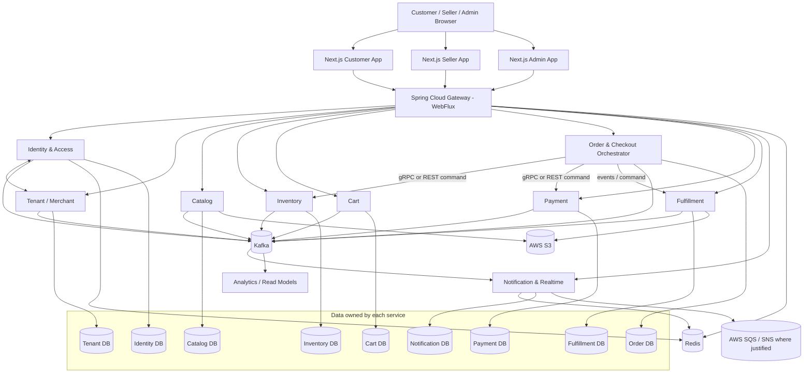
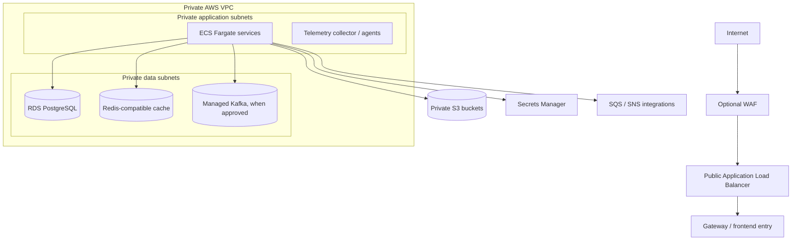
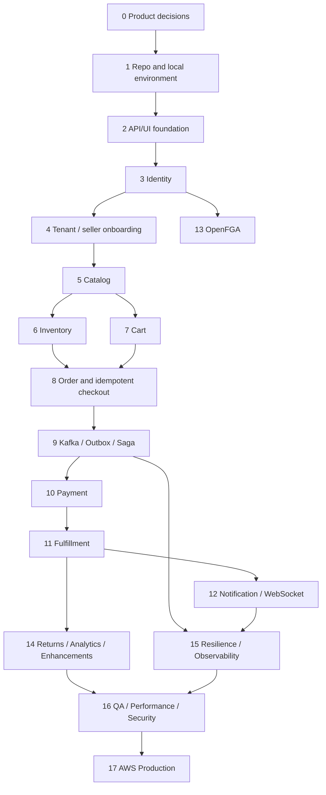

# NEXCART — MASTER BUSINESS REQUIREMENTS DOCUMENT

**Product:** NexCart — Multi-Seller E-commerce Marketplace  
**Document type:** Master BRD and Product Requirements Specification  
**Version:** 1.2
**Status:** Phase 0 decisions approved; launch-specific items remain gated
**Audience:** Product owner, beginner developer, frontend/backend engineers, QA, DevOps and future maintainers  
**Primary companion documents:** Appendices A–D in this package  

---

## 0. How to use this document

This document is intended to be followed by someone building the product from the beginning. Read it in order once before coding. During development, use the requirement IDs and the companion documents as working references.

- **This Master BRD answers:** What problem are we solving? Who uses the product? What must the product do? What rules must it follow? How will we know it works?
- **Appendix A answers:** Which service owns each responsibility, and how do services communicate?
- **Appendix B answers:** Which service owns which data, and what entities and fields are needed?
- **Appendix C answers:** What API and event contracts do clients and services use?
- **Appendix D answers:** In what order should a beginner implement the work, and what must pass before moving forward?

### 0.1 Requirement language

The words **MUST**, **MUST NOT**, **SHOULD**, **SHOULD NOT** and **MAY** express requirement strength. A MUST requirement is mandatory for the release to which it is assigned. A SHOULD requirement is strongly recommended but can be deferred with a documented reason.

### 0.2 Priority definitions

| Priority | Meaning | Release expectation |
|---|---|---|
| P0 — Must | Required for a usable, secure MVP | Must pass before MVP acceptance |
| P1 — Should | Required for a credible production-ready marketplace | Must pass before general production launch unless formally deferred |
| P2 — Could | Valuable enhancement | May be delivered after the first production release |
| P3 — Future | Not planned for the initial roadmap | Future product consideration |

### 0.3 Status definitions

| Status | Meaning |
|---|---|
| Proposed | Included in this baseline but needs product-owner confirmation |
| Approved | Accepted by the product owner / stakeholders |
| In Progress | Implementation has started |
| Implemented | Code has been completed but may not have passed all tests |
| Verified | Acceptance criteria and required tests have passed |
| Deferred | Intentionally moved to a later release with a reason |

### 0.4 Approved Phase 0 decisions (baseline v1.2)

The following decisions were confirmed by the product owner and are no longer open Phase 0 questions. They may change only through the change-control process in Section 12.3.

| Area | Approved decision | Scope / timing |
|---|---|---|
| Initial market | India | Initial marketplace market |
| Initial currency | INR | Only INR checkout in the MVP; every monetary record still stores an explicit ISO currency code |
| Future markets | Multi-country and multi-currency support | Future release; no FX conversion in MVP |
| Customer email | Mandatory verification | Unverified accounts cannot access authenticated shopping/checkout features |
| Seller onboarding | Basic business and contact details; marketplace admin review/approval | PAN, GSTIN and document/KYC collection deferred to a later release, subject to legal/provider requirements |
| Product publishing | Sellers may publish directly by default | Categories marked `requires_approval = true` enter admin moderation before publication |
| Cart | One cart may contain multiple sellers | One parent order at checkout, split into seller orders/fulfillment groups |
| Payment | One payment for the parent order | MVP payment is platform-level; seller settlement is not implemented in MVP |
| Payment provider | Stripe is the selected provider target | Build a provider adapter and local fake provider; Stripe sandbox is conditional on account/test access |
| Shipping | Manual seller-entered tracking/status initially | Carrier integrations are future work |
| Cancellation/returns | Use the recommended baseline policy in Section 5.5–5.6 | Configurable by product/category; legal/consumer-policy review required before public trading |
| Seller settlement | Entire settlement/payout feature deferred | No real marketplace launch until merchant-of-record, fund flow and seller payout treatment are approved |
| Catalogue | Mixed/general marketplace | Category policy drives moderation and later tax/product attributes |
| Initial deployment | Local learning environment only | AWS production deployment remains a later roadmap phase, not an initial release requirement |
| Repository | One Git monorepo | Frontend workspace and independently deployable Spring Boot microservices coexist in one repository |
| Frontend topology | Three independent Next.js applications managed by pnpm workspaces and Turborepo | `frontend/apps/web`, `frontend/apps/seller`, `frontend/apps/admin`; shared frontend libraries under `frontend/shared/` |
| Frontend deployment | Independent application builds and deployments | Each portal has its own build, environment configuration, CI checks and deployment target; all consume versioned API Gateway contracts |
| Backend build | Maven | Maven Wrapper and parent/aggregator conventions |
| Initial service scaffolding | Foundational skeletons only | Gateway, Identity, Tenant and Catalog first; other services scaffolded just before their implementation phase |
| Local infrastructure | PostgreSQL first | Redis and Kafka are added only when their roadmap phases start |
| Database isolation | One local PostgreSQL server, separate database and DB role per service | Production can move services to separate managed instances when justified |
| Service communication | REST + Kafka + selected gRPC | REST first; Kafka introduced for event workflows; gRPC only for selected synchronous calls |

**Provider qualification:** Stripe remains the chosen learning/sandbox integration target, not a confirmed production payment and marketplace-settlement approval. As checked on 25 November 2026, Stripe states that new Indian accounts are invite-only. Stripe's India marketplace documentation also describes restrictions on Connect capabilities, including limitations on separate charges and transfers. See Section 10.1 and the official references there. The implementation must not assume that a single parent-order charge automatically provides a compliant seller payout mechanism.

---

# 1. Document control

## 1.1 Purpose

The purpose of this BRD is to define the business, functional, operational and quality requirements for NexCart. It also establishes a shared reference for implementation planning and acceptance.

## 1.2 Product summary

NexCart is a multi-seller e-commerce marketplace. Customers discover and purchase products from different sellers through one customer experience. Sellers register their businesses, operate stores, publish products, maintain stock and fulfill their own order items. Marketplace administrators oversee seller onboarding, product moderation, customer support, orders, disputes and platform operations.

The platform will be built with a Next.js frontend and Java/Spring Boot backend. The backend will use reactive APIs where they provide a clear benefit, domain-oriented services, PostgreSQL, Redis, Kafka, WebSockets, selected gRPC communication and AWS infrastructure.

## 1.3 Business problem

A marketplace has several interconnected business processes. A single customer order can contain products from multiple sellers. Each seller owns different stock and fulfillment work. Payment may succeed or fail independently of inventory operations. Networks and external providers may be unavailable. Messages may be delivered more than once. Customers expect accurate order status even when internal services are recovering.

NexCart must address these problems through:

- Clear ownership of seller, product, stock, order, payment and fulfillment data.
- Controlled multi-seller checkout and order splitting.
- Concurrency-safe inventory reservation.
- Idempotent payment and order operations.
- Reliable asynchronous workflows and recoverable failures.
- Fine-grained seller, customer and administrator access controls.
- Useful real-time updates without treating WebSocket delivery as the source of truth.
- Monitoring, audit trails, testing and documented operational procedures.

## 1.4 Product vision

Provide a trustworthy marketplace where customers can buy from multiple sellers in a single experience and each seller can operate independently, while the marketplace owner retains visibility and governance.

## 1.5 Product goals

| Goal ID | Goal | Measurement / evidence |
|---|---|---|
| BG-001 | Enable multi-seller commerce | At least two approved sellers can publish products and receive separate fulfillment work |
| BG-002 | Make checkout reliable | Duplicate checkout submissions do not create duplicate orders |
| BG-003 | Protect inventory correctness | Concurrent reservations cannot sell more units than available stock |
| BG-004 | Make order processing recoverable | Payment, inventory and fulfillment failures produce documented compensating or recovery actions |
| BG-005 | Protect seller and customer data | Automated negative tests prove cross-seller and cross-customer access is denied |
| BG-006 | Improve visibility | Operators can inspect order status, event failures, traces and service health |
| BG-007 | Support independent scaling | Services can be deployed and scaled independently where workload requires it |

## 1.6 Success metrics

These are proposed initial targets, not guarantees. Measure them in a representative staging environment and revise them when realistic traffic and infrastructure costs are understood.

| Metric | Initial target | Measurement method |
|---|---|---|
| Product list API latency | p95 ≤ 500 ms under agreed test load | Load test and application metrics |
| Normal API error rate | < 1% excluding expected business rejections | Metrics / logs |
| Checkout duplicate protection | 100% of tested duplicate-key scenarios return the original result or a safe conflict | Automated integration tests |
| Inventory correctness | No overselling in concurrency test scenarios | Testcontainers integration tests |
| Event consumer recovery | Consumer resumes after restart without losing committed business work | Kafka integration tests |
| Tenant isolation | 100% of defined cross-tenant negative tests denied | Authorization integration tests |
| Critical journey coverage | Registration, seller approval, product publishing, checkout and order tracking covered by E2E tests | Playwright test report |
| Production recovery | Restore procedure demonstrated against agreed RTO/RPO | Recovery exercise |

---

# 2. Product definition and scope

## 2.1 Product model and terminology

NexCart is one marketplace operated by a platform owner. Multiple seller organizations sell through that marketplace.

For this product, a **tenant** means a seller organization and its protected business data. A seller organization may operate one or more stores in a later release. A marketplace administrator has platform-level privileges, but those privileges must be explicit and audited. A customer can purchase products from multiple seller organizations and does not become a seller tenant merely by registering.

This definition is important: tenant isolation is primarily a seller-data boundary. It does not mean every customer gets a separate database or that every request can choose an arbitrary tenant ID.

## 2.2 In-scope capabilities

### Customer experience

- Registration, mandatory email verification, login, logout, profile and address management.
- Browse, search, filter and sort published products.
- View product details, images, variants, seller and availability information.
- Add, update and remove cart items.
- Checkout with delivery address and order review.
- Pay through an integrated payment-provider sandbox initially.
- View parent order and seller-specific fulfillment progress.
- Cancel eligible orders and request eligible returns.
- Receive in-app and real-time order updates.
- Submit a review for an eligible purchased product when review functionality is released.

### Seller experience

- Apply to become a seller using basic business and contact details.
- View application status and respond to review feedback.
- PAN, GSTIN and document/KYC collection are deferred beyond the initial learning MVP, but may be required before a real marketplace launch.
- Set up and manage a store after approval.
- Invite or manage seller staff according to permissions.
- Create and maintain products, product variants and media.
- Publish products directly when their category does not require moderation; submit products for admin approval only in categories configured to require it.
- Add and adjust inventory with a reason recorded.
- View seller-specific orders and process fulfillment.
- Add carrier name, tracking reference and manual shipment status updates. Carrier integrations are deferred.
- View sales and operational summaries.

### Marketplace administration

- Review seller applications and documents.
- Approve, reject or suspend sellers with reasons.
- Moderate product submissions.
- Search and inspect marketplace orders.
- Review payment and refund status without exposing sensitive payment credentials.
- Investigate disputes and support cases.
- Manage users and administrative roles.
- View audit records, operational metrics and reports.

## 2.3 Out of scope for the first release

The following items must not block the initial marketplace build unless the product owner changes scope:

- Native iOS and Android apps.
- International expansion, FX conversion and multi-currency checkout (data structures must retain currency codes for future support).
- Seller settlement, commission accounting, connected-account onboarding and automated seller payouts.
- Advanced commission, withholding and tax automation.
- AI product recommendations and dynamic pricing.
- Auction or bidding functionality.
- Subscription commerce.
- Warehouse-management hardware integrations.
- Multiple shipping-carrier integrations beyond the first adapter.
- Full-text search infrastructure such as a dedicated search cluster; PostgreSQL search is sufficient initially.
- A complete ERP or accounting system.

## 2.4 Release boundaries

| Release | Included scope |
|---|---|
| Local learning MVP | Identity with mandatory email verification, basic seller onboarding and manual approval, mixed catalogue with category-based moderation, stock, multi-seller cart, one parent order/payment, Stripe adapter/fake provider, manual tracking, basic admin essentials. Local-only deployment. |
| Production v1 (future target) | Reliable outbox/Saga, DLQ/retry, WebSockets, stronger authorization, observability, security hardening, backups and AWS deployment after business/provider/legal gates are approved |
| Post-v1 | Promotions, reviews, richer analytics, seller staff permissions, more carriers, seller settlement/payouts, multi-currency, advanced search and enhanced seller verification |

## 2.5 Approved decisions and remaining assumptions

| ID | Decision / assumption | Current baseline | Status / timing |
|---|---|---|---|
| ASM-001 | Initial market | India | Approved for learning MVP |
| ASM-002 | Initial currency | INR only | Approved; future currency-ready data model |
| ASM-003 | Payment provider | Stripe adapter target; fake provider for deterministic local tests | Approved for learning; production access/capability gate remains |
| ASM-004 | Card data | NexCart does not store raw card number or CVV | Mandatory security rule |
| ASM-005 | Seller onboarding | Basic business/contact details plus manual marketplace-admin approval | Approved for MVP; enhanced KYC later |
| ASM-006 | Product moderation | Direct publish by default; admin approval for selected configured categories | Approved for MVP |
| ASM-007 | Shipping | Seller-entered manual tracking initially | Approved for MVP |
| ASM-008 | Reservation expiry | 15 minutes, configurable | Initial engineering default; validate against payment flow |
| ASM-009 | Customer identity | Email/password with mandatory email verification | Approved for MVP |
| ASM-010 | Seller settlement | Entire settlement feature deferred beyond MVP | Must be designed before any real marketplace funds flow |
| ASM-011 | Currency expansion | Multiple countries/currencies in future | No FX or non-INR checkout in MVP |
| ASM-012 | Initial deployment | Local developer environment only | Approved; AWS deployment remains future roadmap |
| ASM-013 | Database isolation | Separate logical PostgreSQL database and DB role per service on one local server | Approved architecture recommendation |
| ASM-014 | Tax/invoice behavior | Persist currency and tax snapshot fields; do not invent tax rates | Qualified tax/legal review before public trading |
| ASM-015 | Returns | Recommended configurable baseline in Sections 5.5–5.6 | Product baseline; verify legal/category obligations before public trading |

## 2.6 Constraints

- The project is being developed as a learning project by a beginner; complexity must be introduced progressively.
- The selected stack includes reactive programming, messaging and distributed systems. These technologies create operational overhead and must be justified by use cases.
- A payment gateway, carrier and AWS account may require separate onboarding and costs.
- A production marketplace may have legal, tax, privacy, consumer-protection and payment obligations that cannot be resolved by engineering design alone.
- The initial delivery target is local learning only. AWS is a later roadmap milestone and must not be provisioned during the initial phases.
- Cloud resource costs must be monitored; managed Kafka and always-on environments can be expensive.

---

# 3. Stakeholders, users and permissions

## 3.1 Stakeholders

| Stakeholder | Responsibility | Primary decisions |
|---|---|---|
| Product owner / marketplace owner | Owns business model, priorities and policies | Scope, commercial rules, release approval |
| Marketplace administrator | Operates marketplace | Seller/product decisions, disputes, operational controls |
| Seller owner | Operates a seller organization | Products, stock, staff and fulfillment |
| Seller staff | Performs delegated seller work | Depends on assigned permissions |
| Customer | Purchases products | Cart, checkout, account, returns and reviews |
| Support agent | Assists users | Limited order and case access |
| Engineering team | Builds and maintains product | Technical implementation and quality |
| QA | Validates requirements | Test coverage and release evidence |
| DevOps / operator | Runs environments and deployments | Infrastructure, monitoring and recovery |

## 3.2 Roles

Initial roles:

- `CUSTOMER`
- `SELLER_OWNER`
- `SELLER_ADMIN`
- `PRODUCT_MANAGER`
- `INVENTORY_MANAGER`
- `ORDER_MANAGER`
- `SUPPORT_AGENT`
- `PLATFORM_ADMIN`
- `PLATFORM_SUPPORT`

A user may have more than one role only where the business policy allows it. Seller roles are scoped to a specific seller organization/store. Platform roles are separate and must not be inferred from a seller role.

## 3.3 Permission principles

1. Deny by default.
2. Validate access on the backend for every protected operation.
3. Do not trust `tenantId`, `sellerId`, `userId` or role values supplied by the browser without server-side verification.
4. Seller staff can access only resources belonging to their organization and only actions permitted by their role.
5. Customers can access only their profile, cart, orders, addresses and eligible reviews.
6. Support users receive limited, auditable access; they do not automatically receive unrestricted payment or credential access.
7. Platform-admin actions require explicit permission and audit logging.
8. Authorization must be applied to WebSocket subscriptions and file-upload/download access, not only REST APIs.

## 3.4 Initial role matrix

| Capability | Customer | Seller Owner/Admin | Seller Staff | Support | Platform Admin |
|---|---:|---:|---:|---:|---:|
| Browse published products | Yes | Yes | Yes | Yes | Yes |
| Manage customer profile | Own only | Own only | Own only | No | Limited support action |
| Create seller products | No | Yes | If granted | No | Moderation only |
| Adjust seller inventory | No | Yes | If granted | No | Audited override only |
| View seller orders | No | Own seller only | If granted | Assigned case only | Yes, audited |
| Place an order | Yes | Only as a customer account | Only as a customer account | No | No by default |
| Approve sellers | No | No | No | No | Yes |
| Moderate products | No | No | No | No | Yes |
| Process refunds | Request only | Request/approve according to policy | No by default | Limited case workflow | Authorized role |
| View audit logs | Own activity summary | Own organization scope | No by default | Assigned case scope | Authorized admin |

This matrix is a starting point. Before launch, convert it into explicit permission keys and automated authorization tests.

---

# 4. Product modules and functional requirements

The following requirements are the product-level source of truth. Detailed implementation and endpoint mapping are in Appendices A–C.

## 4.1 Identity and account management — `MOD-ID`

| ID | Requirement | Priority |
|---|---|---|
| ID-001 | A visitor MUST be able to register with the required identity fields. | P0 |
| ID-002 | The system MUST verify the user's email address before enabling authenticated shopping and checkout. | P0 |
| ID-003 | A user MUST be able to log in and log out. | P0 |
| ID-004 | The system MUST issue short-lived access tokens and rotating refresh tokens. | P0 |
| ID-005 | The system MUST revoke refresh sessions on logout and account suspension. | P0 |
| ID-006 | The system MUST detect refresh-token reuse and revoke the affected token family/session. | P1 |
| ID-007 | Users SHOULD be able to request a password reset through a verified channel. | P1 |
| ID-008 | The system MUST hash passwords using a modern password-hashing algorithm and never store plaintext passwords. | P0 |
| ID-009 | Authentication attempts MUST be rate-limited and security-relevant failures audited. | P1 |
| ID-010 | Users MUST be able to retrieve and update permitted profile information. | P0 |

**Business rules:** Registration creates a `PENDING_VERIFICATION` account and sends a time-limited, single-use email verification challenge. Login may be allowed only to a restricted verification-pending session; unverified users MUST NOT access seller, cart, checkout or order operations. Account identifiers must be unique under a defined normalization policy. Error messages must not expose whether a sensitive account exists where that would enable account enumeration. Token secrets must be protected and rotated operationally. A JWT is not a substitute for authorization checks.

## 4.2 Seller onboarding and organization management — `MOD-MER`

| ID | Requirement | Priority |
|---|---|---|
| MER-001 | An authenticated user MUST be able to submit a seller application. | P0 |
| MER-002 | The application MUST capture required organization and contact information. | P0 |
| MER-003 | The seller application MUST capture basic business and contact details in the MVP. PAN, GSTIN and verification-document upload are deferred to a later release. | P0 |
| MER-004 | A marketplace administrator MUST be able to approve or reject an application with a reason. | P0 |
| MER-005 | Only approved/active sellers MUST be able to publish products and process seller orders. | P0 |
| MER-006 | A seller owner SHOULD be able to invite staff and assign scoped roles. | P1 |
| MER-007 | The system MUST support seller suspension and reactivation with an audit record. | P1 |
| MER-008 | A seller MUST be able to view its own application, organization and store information. | P0 |

**MVP seller fields:** legal/display business name, business type, contact name, email, phone, and business address. Do not require PAN, GSTIN or document uploads in the learning MVP. Add these fields later through versioned migrations and policy review.

**Seller application states:** `DRAFT → SUBMITTED → UNDER_REVIEW → APPROVED` or `REJECTED`. A rejected application may be resubmitted after correction according to policy. An approved seller may be `ACTIVE` or `SUSPENDED`. Suspension must block new selling actions but must not delete historical orders or financial records.

## 4.3 Store and catalogue management — `MOD-CAT`

| ID | Requirement | Priority |
|---|---|---|
| CAT-001 | An approved seller MUST be able to create and maintain store information. | P0 |
| CAT-002 | A seller MUST be able to create a product with name, description, category, SKU, price and status. | P0 |
| CAT-003 | A product MAY have variants such as size, color or other defined attributes. | P1 |
| CAT-004 | A product MAY have multiple images/media assets. | P0 |
| CAT-005 | A seller MUST be able to save a product as a draft. | P0 |
| CAT-006 | The system MUST apply category-level moderation policy: direct seller publishing by default, with admin approval required only for categories flagged for review. | P0 |
| CAT-007 | Only approved and published products MUST appear in public search/browse results. | P0 |
| CAT-008 | Customers MUST be able to search, filter, sort and paginate published products. | P0 |
| CAT-009 | Product detail responses MUST identify the seller and available variants. | P0 |
| CAT-010 | Product price changes MUST NOT silently change an already accepted order's price snapshot. | P0 |
| CAT-011 | Product deletion MUST be controlled; products referenced by historical orders must remain referentially understandable. | P0 |

**Product states:** `DRAFT`, `PENDING_REVIEW`, `PUBLISHED`, `REJECTED`, `ARCHIVED`. On publish, Catalog checks the category policy. If `requires_approval = false`, an eligible active seller can publish directly. If `requires_approval = true`, the product enters `PENDING_REVIEW` and is visible publicly only after admin approval. Publication always requires an active seller, valid price, valid category and all mandatory product fields. Product media must be validated and stored outside the relational database as object storage references.

## 4.4 Inventory — `MOD-INV`

| ID | Requirement | Priority |
|---|---|---|
| INV-001 | Sellers MUST be able to add stock for products/variants they own. | P0 |
| INV-002 | Sellers MUST be able to adjust stock with a reason and actor recorded. | P0 |
| INV-003 | The system MUST calculate available quantity from authoritative inventory records. | P0 |
| INV-004 | The system MUST reserve stock as part of checkout before an order can be confirmed. | P0 |
| INV-005 | The system MUST release reservations when checkout definitively fails, expires or is cancelled according to workflow policy. | P0 |
| INV-006 | Concurrent requests MUST NOT reserve more stock than is available. | P0 |
| INV-007 | The system MUST maintain stock movement and reservation history. | P1 |
| INV-008 | The system SHOULD generate low-stock alerts based on seller-configured thresholds. | P1 |
| INV-009 | Inventory changes MUST be idempotent where triggered by retried commands/events. | P0 |

**Business rules:** PostgreSQL is the source of truth for stock. Redis may cache availability for display but cannot authorize a sale. The reservation expiry baseline is 15 minutes and must be configurable. The exact stock formula and allocation states are defined in Appendix B. A reservation must be associated with an order and must have a unique business identity.

## 4.5 Cart — `MOD-CART`

| ID | Requirement | Priority |
|---|---|---|
| CART-001 | A customer MUST be able to add a published product/variant to a cart. | P0 |
| CART-002 | A customer MUST be able to change quantity and remove items. | P0 |
| CART-003 | A cart MUST support items from multiple sellers. | P0 |
| CART-004 | The system MUST validate that products remain purchasable when cart is read and at checkout. | P0 |
| CART-005 | The system SHOULD preserve an authenticated customer's cart across sessions. | P0 |
| CART-006 | Cart totals MUST be presented as estimates until checkout revalidates pricing, promotions and shipping. | P0 |
| CART-007 | The system SHOULD merge guest-cart items into the authenticated cart using documented conflict rules. | P2 |

Cart quantity is a requested quantity, not a stock reservation. Adding to cart does not guarantee stock will be available later.

## 4.6 Checkout and order management — `MOD-ORD`

| ID | Requirement | Priority |
|---|---|---|
| ORD-001 | An authenticated customer MUST be able to submit checkout for a valid cart. | P0 |
| ORD-002 | Checkout MUST revalidate product status, price, quantity, seller status and delivery eligibility. | P0 |
| ORD-003 | Checkout MUST calculate an immutable price snapshot for the order. | P0 |
| ORD-004 | A cart with products from multiple sellers MUST create one customer-facing parent order and seller-specific fulfillment groups. | P0 |
| ORD-005 | The system MUST require an idempotency key for order-creation requests. | P0 |
| ORD-006 | Duplicate requests using the same key and same request MUST not create a second order. | P0 |
| ORD-007 | Reuse of the same key with a materially different request MUST return a conflict. | P0 |
| ORD-008 | The customer MUST be able to view order details and status history. | P0 |
| ORD-009 | Sellers MUST see only their own fulfillment groups and relevant order items. | P0 |
| ORD-010 | A customer MUST be able to request cancellation while the order is in an eligible state. | P1 |
| ORD-011 | The order workflow MUST persist its progress so it can recover after a service restart. | P0 |
| ORD-012 | The system MUST publish order events through a reliable outbox mechanism. | P0 |

**Order model:** One customer order may contain multiple seller orders/fulfillment groups. The MVP uses exactly one parent-order payment attempt for the customer checkout. The parent order is split into seller orders/fulfillment groups for operations, but payment is not split by seller in the MVP. Order-item and seller-order financial allocations must still be stored so later partial refunds and settlement can be designed. One parent payment does not itself settle or allocate funds to sellers.

## 4.7 Payment — `MOD-PAY`

| ID | Requirement | Priority |
|---|---|---|
| PAY-001 | The system MUST create a payment attempt linked to an order. | P0 |
| PAY-002 | Payment initiation MUST be idempotent. | P0 |
| PAY-003 | The system MUST verify provider webhook signatures before accepting callback data. | P0 |
| PAY-004 | The system MUST handle duplicate, delayed and out-of-order provider callbacks safely. | P0 |
| PAY-005 | The system MUST keep payment state separate from order state. | P0 |
| PAY-006 | Payment status MUST be reconciled against the provider for uncertain outcomes. | P1 |
| PAY-007 | Refunds MUST reference the original payment and have their own state and audit history. | P1 |
| PAY-008 | The system MUST NOT store raw card number, CVV or other prohibited payment credentials. | P0 |
| PAY-009 | Provider credentials MUST be stored in a secrets manager, not source control. | P0 |

**Payment states:** `CREATED`, `PENDING_PROVIDER`, `AUTHORIZED`, `CAPTURED`, `FAILED`, `VOID_PENDING`, `VOIDED`, `REFUND_PENDING`, `PARTIALLY_REFUNDED`, `REFUNDED`, `UNKNOWN_RECONCILIATION_REQUIRED`.

Stripe is the selected provider adapter target. The local MVP must include a fake provider for deterministic tests and a Stripe sandbox adapter when account/test access is available. The exact authorization/capture/void capabilities must be verified against the eligible Stripe account and integration model. India account eligibility and Stripe Connect marketplace capability are production go/no-go items. If separate authorization/capture is unavailable for the selected integration, the Saga must use an explicitly documented alternative. A payment timeout is not proof of payment failure; query/reconcile the provider before releasing stock when the result is uncertain.

## 4.8 Fulfillment and shipping — `MOD-FUL`

| ID | Requirement | Priority |
|---|---|---|
| FUL-001 | The system MUST create fulfillment work for confirmed seller orders. | P0 |
| FUL-002 | A seller MUST be able to view and process its own fulfillment work. | P0 |
| FUL-003 | A shipment MUST identify the seller order/items it fulfills. | P0 |
| FUL-004 | The system MUST record tracking identifiers and carrier information when available. | P0 |
| FUL-005 | Shipment updates MUST be recorded as timestamped tracking events. | P0 |
| FUL-006 | Customers MUST be able to view relevant shipment progress. | P0 |
| FUL-007 | The system SHOULD support proof-of-delivery attachments. | P1 |
| FUL-008 | Partial shipment and multiple shipments for a seller order SHOULD be supported in the data model. | P1 |

**Shipment states:** `CREATED`, `READY_FOR_PICKUP`, `PICKED_UP`, `IN_TRANSIT`, `OUT_FOR_DELIVERY`, `DELIVERED`, `DELIVERY_FAILED`, `RETURN_TO_ORIGIN`, `CANCELLED`. For the MVP, sellers manually enter carrier name (optional), tracking reference (optional), status and status timestamp. No carrier API/webhook integration is required. Future carrier integrations may use different statuses; normalize them and retain provider status for audit/troubleshooting.

## 4.9 Notifications and real-time experience — `MOD-NOT`

| ID | Requirement | Priority |
|---|---|---|
| NOT-001 | The system MUST notify customers of order confirmation and material payment failures. | P0 |
| NOT-002 | Sellers MUST be notified of new fulfillment work. | P0 |
| NOT-003 | The system SHOULD support email and in-app notifications. | P1 |
| NOT-004 | The system SHOULD broadcast order and shipment changes to authorized connected clients through WebSockets. | P1 |
| NOT-005 | Notification delivery attempts and outcomes MUST be recorded. | P1 |
| NOT-006 | Failed notification delivery MUST be retried according to a bounded policy. | P1 |
| NOT-007 | Users SHOULD be able to configure non-critical notification preferences. | P2 |

WebSocket messages are notifications, not the authoritative order record. On reconnect, clients must fetch current state from REST APIs.

## 4.10 Returns and refunds — `MOD-RET`

| ID | Requirement | Priority |
|---|---|---|
| RET-001 | Customers MUST be able to request a return for an eligible order item within the configured return window. | P1 |
| RET-002 | A return request MUST record item, quantity, reason and supporting information. | P1 |
| RET-003 | Authorized seller/admin users MUST approve or reject the request with a reason. | P1 |
| RET-004 | Refund processing MUST be idempotent and traceable to the original payment. | P1 |
| RET-005 | Inventory MUST only be restocked after the applicable inspection/return policy allows it. | P1 |
| RET-006 | Customer and seller MUST be able to view return/refund status. | P1 |

## 4.11 Promotions — `MOD-PRO`

Promotions are P2 unless the product owner makes them a launch requirement. The system may support coupon code, active dates, usage limits, minimum basket, seller scope and fixed/percentage discount. Coupon validation must occur on the server during checkout. Discount allocation across sellers/order items must be deterministic and stored in the order price snapshot.

## 4.12 Reviews and ratings — `MOD-REV`

Reviews are P2. Only eligible verified purchasers may review the relevant product/order item. The system must prevent duplicate reviews according to policy, support moderation/reporting and avoid exposing private order details through public review APIs.

## 4.13 Administration and support — `MOD-ADM`

| ID | Requirement | Priority |
|---|---|---|
| ADM-001 | Platform administrators MUST be able to search seller applications and review status. | P0 |
| ADM-002 | Authorized administrators MUST be able to approve/reject/suspend sellers with reasons. | P0 |
| ADM-003 | Authorized administrators MUST be able to moderate products. | P1 |
| ADM-004 | Authorized support users MUST be able to find an order using safe identifiers. | P1 |
| ADM-005 | Sensitive administrative actions MUST create audit records. | P0 |
| ADM-006 | Administrators MUST be able to inspect payment status without viewing prohibited payment secrets. | P0 |
| ADM-007 | Administrative access MUST be permission-scoped and tested. | P0 |

## 4.14 Reporting and analytics — `MOD-ANA`

Initial MVP dashboards may use service APIs and pre-aggregated data where appropriate. Analytics must not issue uncontrolled heavy queries against transactional databases. Later, Kafka events can feed read models or export jobs.

Initial reports:

- Customer order history.
- Seller order summary.
- Seller sales totals.
- Product stock summary.
- Platform order/payment operational summary.

Revenue reporting must distinguish order gross value, discounts, shipping, tax, refunds, provider fees and seller settlement. Do not label gross order value as net revenue.

---

# 5. End-to-end business workflows

## 5.1 Seller onboarding

**Primary actor:** Seller owner  
**Supporting actor:** Marketplace administrator  
**Preconditions:** User is registered and authenticated.

1. Seller selects “Become a seller”.
2. Seller enters the MVP business/contact fields: business name, business type, contact name, email, phone and business address.
3. Seller submits the application; PAN, GSTIN and document uploads are not required in the learning MVP.
4. Application changes to `SUBMITTED` / `UNDER_REVIEW`.
5. Marketplace Admin reviews the submitted business details and approves or rejects with a reason.
6. On approval, the seller organization becomes eligible to create/activate a store.
7. Seller receives the outcome notification.

**Alternate paths:** Missing required fields prevent submission; an administrator may request corrections; the seller resubmits; an approved seller may later be suspended. Historical application decisions remain auditable. Enhanced PAN/GSTIN/document verification is a future scope and may be required before public launch based on legal/provider advice.

**Acceptance:** An unapproved seller cannot publish products or receive new seller fulfillment work.

## 5.2 Product publishing

1. An approved/active seller creates a product draft.
2. Seller supplies required product details, category, price, variants (if applicable) and media.
3. Catalog validates product fields, seller ownership and category policy.
4. Product is saved as `DRAFT`.
5. Seller invokes publish.
6. If the selected category has `requires_approval = false` (the default), Catalog publishes the product directly as `PUBLISHED`.
7. If `requires_approval = true`, Catalog changes the product to `PENDING_REVIEW`; an authorized administrator approves or rejects it with a reason.
8. Public catalogue/search APIs return only `PUBLISHED` products belonging to active sellers.
9. Inventory is maintained by Inventory Service, not by a product `stock` field as the sole authority.

**Acceptance:** Draft/rejected/suspended-seller products are not purchasable.

## 5.3 Multi-seller checkout

**Primary actor:** Customer  
**Preconditions:** Customer is authenticated; cart contains at least one valid item.

1. Customer reviews cart and selects a delivery address.
2. Frontend sends checkout request with an idempotency key.
3. Order Service validates the authenticated customer and request.
4. Order Service obtains authoritative product, price and seller eligibility data using documented APIs/events or a controlled checkout snapshot strategy.
5. Order Service calculates subtotal, discounts, shipping estimate and total according to confirmed business rules.
6. Order Service creates a pending parent order, seller order groups and item price snapshots, and an outbox event in one local database transaction.
7. Order workflow requests stock reservation for each seller/item group.
8. If reservation is definitively rejected, workflow initiates cancellation and releases any successful reservations.
9. If reservations succeed, workflow initiates payment.
10. Payment Service creates a provider payment attempt and returns a safe client hand-off/redirect or payment-session response.
11. Provider outcome is verified by signed webhook and/or server-side status query.
12. On confirmed payment success, Order Service confirms the order and requests fulfillment creation.
13. On confirmed payment failure, workflow releases stock and marks the order failed/cancelled.
14. Customer and sellers receive appropriate notifications.
15. Frontend displays the current order status and can refresh it from the API.

**Important uncertainty rule:** A network timeout while calling the payment provider is an unknown outcome, not automatically a failed payment. Reconcile the provider before performing a compensation that could create an unpaid shipment or release stock while payment is captured.

**Acceptance:** The same checkout request retried with the same idempotency key does not create another parent order or another charge.

## 5.4 Seller fulfillment

1. Seller receives a new fulfillment notification.
2. Seller views only its own seller order and items.
3. Seller accepts/processes the order according to policy.
4. Seller packs items and creates or updates shipment details.
5. Seller records manual carrier/tracking details and permitted shipment status updates; carrier API/webhook integrations are deferred.
6. Fulfillment Service normalizes provider states and stores a timeline.
7. Customer can see each seller shipment independently.
8. When all required seller orders are delivered or otherwise closed, parent order status is derived/updated according to business policy.

## 5.5 Cancellation

1. Customer submits a cancellation request for an eligible order/item.
2. Order Service checks the current order and fulfillment state.
3. If inventory is reserved but not shipped, a release command is issued.
4. If payment is authorized but not captured, request void/authorization reversal where supported.
5. If payment has already been captured, create a refund workflow; do not mark refund complete until provider confirmation.
6. If shipment is already in transit, cancellation may be rejected or routed through a return-to-origin/return process.
7. All state transitions and reasons are recorded.

## 5.6 Return and refund

**Recommended initial policy baseline (configurable; not legal advice):**

- Before the seller begins processing: customer may cancel eligible items directly; release inventory reservation and initiate refund if payment was captured.
- After processing starts but before dispatch: cancellation requires seller/admin workflow approval.
- After dispatch: do not treat the request as an ordinary cancellation; route it through delivery refusal/return-to-origin or the return workflow.
- For eligible delivered items: use a configurable 7-calendar-day request window as an initial product default, subject to category-specific exclusions and applicable law. Defective, damaged or incorrect-item claims must use a separate reason/policy path and must not be rejected solely by a generic change-of-mind window.
- Refund only after the appropriate return/inspection decision, or earlier when required by law/provider policy. Restock only after the return has passed the required inspection.
- For a multi-seller parent order, cancellation/return/refund is item- or seller-order-scoped even though the customer made one parent-order payment.

Before real trading, a qualified advisor must validate the policy against applicable Indian consumer-protection, e-commerce, product-category and payment requirements.

1. Customer requests return for eligible items.
2. System validates return window, quantity and item eligibility.
3. Seller/admin reviews the request.
4. Return instructions and shipment are arranged where required.
5. Returned goods are received and inspected.
6. Refund is requested from Payment Service with an idempotency key.
7. Provider result is verified/reconciled.
8. Inventory is restocked only after approved inspection.
9. Order/return status and notifications are updated.

---

# 6. Business state models

The system must not use one status field to represent unrelated business concepts. At minimum, maintain separate order, payment, inventory reservation and shipment state.

## 6.1 Parent order state (proposed)

`PENDING` → `RESERVING_INVENTORY` → `PAYMENT_PENDING` → `CONFIRMED` → `FULFILLING` → `PARTIALLY_FULFILLED` / `FULFILLED` → `COMPLETED`

Alternative terminal or exception states: `CANCELLED`, `FAILED`, `ACTION_REQUIRED`.

This is a conceptual model. Define precise permitted transitions and whether `COMPLETED` means all shipments delivered and return window closed before implementation.

## 6.2 Payment state

Use the states in Section 4.7. Payment state is owned by Payment Service. Order Service consumes payment outcome events; it must not edit payment tables.

## 6.3 Inventory reservation state

`REQUESTED` → `RESERVED` → `COMMITTED` or `RELEASED` / `EXPIRED` / `REJECTED`.

The exact meaning of `COMMITTED` must be defined: it may mean stock is permanently allocated/consumed at the agreed fulfillment point. Ensure the same unit is not both reserved and available.

## 6.4 Shipment state

Use the states in Section 4.8. Provider-specific events must be normalized without losing the original provider status and event timestamp.

---

# 7. Business rules catalogue

| Rule ID | Rule |
|---|---|
| BR-001 | A seller must be approved and active before publishing purchasable products. |
| BR-002 | A seller can manage only products, stock, seller orders and staff within its own organization. |
| BR-003 | Customers can access only their own protected account and order information. |
| BR-004 | A product must be published and purchasable before checkout. |
| BR-005 | Cart contents do not reserve inventory. |
| BR-006 | Checkout must revalidate price, seller, product, variant and availability. |
| BR-007 | The order stores a price snapshot; later product price changes do not rewrite it. |
| BR-008 | One parent order may contain multiple seller orders/fulfillment groups. |
| BR-009 | Inventory availability is determined by Inventory Service and authoritative database state. |
| BR-010 | Reservations must be unique/idempotent per order/item or reservation command identity. |
| BR-011 | A payment provider callback must be authenticated and deduplicated. |
| BR-012 | Payment timeout/unknown state must be reconciled before unsafe compensation. |
| BR-013 | An order cannot be marked paid solely because the browser says payment succeeded. |
| BR-014 | A refund is complete only after a verified provider result or approved provider reconciliation. |
| BR-015 | A shipment can be created only when the relevant seller order reaches the required state. |
| BR-016 | WebSocket messages are ephemeral hints; REST/domain storage remains authoritative. |
| BR-017 | Cross-service data is accessed by API/events/read models, not direct database writes. |
| BR-018 | Event consumers must tolerate at-least-once delivery. |
| BR-019 | All state-changing operations must be authorized server-side. |
| BR-020 | Sensitive administrative and inventory adjustments must be audited. |
| BR-021 | Monetary values use decimal arithmetic and an explicit currency code; floating-point arithmetic is prohibited for money. |
| BR-022 | All persisted timestamps are stored consistently in UTC; user-facing display uses the user's configured locale/time zone. |
| BR-023 | Product/order/payment history needed for audit must not be erased by ordinary soft-delete operations. |
| BR-024 | External provider credentials and signing keys must not be stored in source code or frontend bundles. |

---

# 8. Frontend product requirements

## 8.1 Application approach

NexCart uses **three independently deployable Next.js applications** in one frontend workspace:

- `frontend/apps/web` — customer storefront and customer account experiences.
- `frontend/apps/seller` — seller onboarding, store operations, catalogue, inventory, order and fulfillment experiences.
- `frontend/apps/admin` — marketplace administration, moderation, support and operational experiences.

The applications share reusable frontend libraries from `frontend/shared/` (for example UI components, API client, TypeScript types, utilities and lint/TypeScript configurations). Application-specific business flows, layouts, navigation and authorization-aware presentation remain inside the relevant app. A shared library must not become a dumping ground for portal-specific code.

Use **pnpm workspaces** for JavaScript/TypeScript dependency and lockfile management and **Turborepo** for task orchestration, dependency-aware execution and local/optional remote caching. Keep one root `package.json`, one `pnpm-workspace.yaml`, one `pnpm-lock.yaml` and one `turbo.json`. Do not create nested Git repositories, per-app lockfiles or a second package-manager workspace inside an app.

Each app MUST have its own build output, runtime configuration, environment variables, CI checks and deployment pipeline. A change to one app should not require deploying the other two unless a shared package or common contract change affects them. All apps consume versioned API contracts through the API Gateway; no app connects directly to another service's database or internal repository.

The frontend is an untrusted client. It must never be the authority for price, permission, stock, payment status or order-state transitions. Backend services MUST enforce authentication, tenant/resource authorization and business invariants regardless of frontend route guards or hidden controls.

## 8.2 Customer screens

| Screen ID | Screen | Required behavior |
|---|---|---|
| UI-C-001 | Home | Display published products/categories and curated content |
| UI-C-002 | Register/Login | Validate fields and show safe error states; route unverified accounts to verification |
| UI-C-003 | Email verification | Confirm email using a single-use, expiring verification challenge and allow safe resend |
| UI-C-004 | Product listing | Search, filter, sort and cursor pagination |
| UI-C-004 | Product detail | Show images, price, variants, seller and availability |
| UI-C-005 | Cart | Add/update/remove items and show estimated total |
| UI-C-006 | Checkout | Select address, revalidate cart, show final amount and submit idempotently |
| UI-C-007 | Payment return/result | Show pending/success/failure based on server-confirmed status |
| UI-C-008 | Order list | Show customer-owned orders and statuses |
| UI-C-009 | Order detail | Show seller groups, items, price snapshot and history |
| UI-C-010 | Tracking | Show each shipment timeline and latest status |
| UI-C-011 | Profile/address | Manage allowed personal details and addresses |
| UI-C-012 | Return request | Request return for eligible items and view status |

## 8.3 Seller screens

| Screen ID | Screen | Required behavior |
|---|---|---|
| UI-S-001 | Seller application | Enter basic business and contact details; document upload is future scope |
| UI-S-002 | Seller dashboard | Show seller-scoped operational summary |
| UI-S-003 | Store profile | Manage permitted store details |
| UI-S-004 | Product list | Search/filter seller-owned products |
| UI-S-005 | Product editor | Create/update drafts, variants and media |
| UI-S-006 | Inventory | Show stock, reservations and movements |
| UI-S-007 | Orders | Show only seller-specific order groups |
| UI-S-008 | Fulfillment | Process orders and shipment status |
| UI-S-009 | Staff | Invite staff and assign permitted roles when P1 is enabled |
| UI-S-010 | Reports | Show seller-scoped metrics |

## 8.4 Admin screens

| Screen ID | Screen | Required behavior |
|---|---|---|
| UI-A-001 | Admin dashboard | Show platform operational indicators |
| UI-A-002 | Seller applications | Review documents and approve/reject with reason |
| UI-A-003 | Seller management | Suspend/reactivate with audit trail |
| UI-A-004 | Product moderation | Review pending products |
| UI-A-005 | Order search | Find and inspect orders with appropriate redaction |
| UI-A-006 | Payment/refund monitor | View safe transaction states and reconciliation flags |
| UI-A-007 | Support/disputes | Manage assigned cases |
| UI-A-008 | Audit log | Search privileged actions |
| UI-A-009 | Platform reports | View aggregated platform metrics |

## 8.5 UI behavior requirements

Every data-backed screen must handle loading, empty, success, error, unauthorized and stale-data states. Forms must display field-level validation. Destructive operations require confirmation and appropriate reason capture. Pagination must not load an unbounded dataset. Keyboard navigation and accessible labels are required. A WebSocket disconnect must not make the page appear to have current data; show reconnect state and refresh authoritative data.

---

# 9. Non-functional requirements

## 9.1 Performance and capacity

Initial engineering targets, to be validated:

| ID | Requirement | Proposed target |
|---|---|---|
| NFR-P-001 | Product listing read latency | p95 ≤ 500 ms under agreed staging load |
| NFR-P-002 | Typical internal API latency | p95 ≤ 300 ms excluding external provider operations |
| NFR-P-003 | Checkout API response | Return accepted/pending outcome promptly; long workflows must not hold an HTTP connection open while waiting on all external systems |
| NFR-P-004 | Pagination | No unbounded list endpoint; default page size ≤ 20, max ≤ 100 unless documented |
| NFR-P-005 | Database connection usage | Each service has an explicit bounded pool and monitored utilization |
| NFR-P-006 | Event processing | Consumer lag and processing delay are measured; target is defined after a baseline load test |

## 9.2 Availability and recovery

Proposed initial production targets:

- Critical customer-facing availability: 99.9% monthly after production infrastructure is stable.
- RTO: 4 hours.
- RPO: 15 minutes for agreed critical data.

These targets require backup, restore, replication and operational exercises. Do not claim them until demonstrated.

## 9.3 Security and privacy

- Use HTTPS externally and authenticated service communication internally.
- Apply least privilege to AWS IAM, database users and application permissions.
- Hash passwords using a suitable adaptive algorithm.
- Protect token signing keys and provider credentials.
- Validate upload file size/type and scan uploads where appropriate.
- Enforce tenant and resource ownership at backend boundaries.
- Protect against injection, XSS, CSRF where applicable, SSRF, broken access control and insecure direct object references.
- Do not log authentication secrets, payment secrets or unnecessary personal data.
- Define a privacy notice, retention policy, deletion/export process and incident response before public launch.
- Obtain qualified advice for applicable Indian privacy, consumer, tax and payment obligations.

## 9.4 Reliability and consistency

- Use local ACID transactions inside each service.
- Use Transactional Outbox for state change plus event publication intent.
- Expect at-least-once event delivery; make consumers idempotent.
- Use Saga for cross-service workflows that need compensation/recovery.
- Do not claim global exactly-once processing.
- Use deadlines/timeouts for remote calls.
- Retry only transient and safe operations with bounded exponential backoff and jitter.
- Send exhausted/poison messages to a DLQ and provide an audited replay procedure.

## 9.5 Maintainability

- Use explicit service ownership, package boundaries and naming conventions.
- Document architecture decisions.
- Use code formatting, linting, static analysis and automated tests.
- Keep API/event contracts versioned.
- Keep local development reproducible through scripts and Docker Compose.
- Update documentation when behavior or interfaces change.

## 9.6 Accessibility and compatibility

- Responsive design for desktop, tablet and mobile browser widths.
- Keyboard-accessible forms and navigation.
- Semantic HTML and accessible labels.
- Current supported browsers defined in release policy.
- Avoid relying only on color to communicate status.

---

# 10. Integrations

## 10.1 Payment provider

Stripe is the selected provider target. Implement a provider-neutral `PaymentProviderPort` and a deterministic `FakePaymentProvider` first so local development and tests do not depend on internet access or a real account. Implement the Stripe adapter for Stripe test mode when the account has access.

**India production gate (checked 25 November 2026):** Stripe states that new Indian accounts are invite-only. Stripe's India marketplace guidance also notes limitations for Stripe Connect, including that separate charges and transfers are currently not supported for Indian platforms and that manual payouts are limited to certain use cases. Stripe's India support article says local payment methods such as UPI, netbanking, BNPL and EMI are not supported for Indian businesses, while Stripe's public UPI product page advertises UPI for India. These official pages appear inconsistent or describe different account/product availability; do not assume UPI availability until Stripe confirms it for the specific eligible India account and integration. Therefore:

1. Do not assume the project can create a new Stripe India account immediately.
2. Do not assume Stripe Connect supports the intended multi-seller platform funds flow.
3. Before production, get written confirmation from Stripe for account eligibility, domestic INR payment methods, parent-order charge handling, connected-account onboarding and later seller payouts.
4. Until confirmed, Stripe remains a learning/sandbox adapter target only. No real customer payments or seller fund custody/payouts are in scope.

Official references:
- [Stripe: Accounts are invite-only in India](https://support.stripe.com/questions/moving-to-invite-only-in-india)
- [Stripe: India support for marketplaces / Connect limitations](https://support.stripe.com/questions/stripe-india-support-for-marketplaces)
- [Stripe: Supported methods, currencies and businesses in India](https://support.stripe.com/questions/supported-payment-methods-currencies-and-businesses-for-stripe-accounts-in-india)
- [Stripe: Public UPI payment-method page](https://stripe.com/in/payment-method/upi)
- [Stripe: India onboarding and video KYC](https://support.stripe.com/questions/video-kyc-for-india-onboarding)

Required adapter capabilities: payment session/intent creation, status query, signed webhook verification, refund operation and reconciliation. Confirm provider support for authorization/capture/void before finalizing Saga steps.

## 10.2 Shipping provider

MVP shipping is manual seller-entered tracking only. Seller users with fulfillment permission can enter an optional carrier name, tracking reference, shipment status and timestamp. There are no carrier API integrations or carrier webhooks in the MVP. Keep a future carrier-adapter boundary so later integrations can normalize external statuses into NexCart shipment states and deduplicate provider callbacks.

## 10.3 Email/SMS provider

Use a notification adapter. Provider credentials must come from Secrets Manager. Notification failure must not roll back a paid order; it should be retried and observable.

## 10.4 AWS services

- **S3:** Product media, verification documents, delivery proof and generated exports; private buckets and pre-signed URLs.
- **RDS PostgreSQL:** Managed transactional storage, private networking and backups.
- **ElastiCache Redis (or approved Redis-compatible service):** Cache, rate-limiting and Pub/Sub infrastructure.
- **ECS/Fargate:** Run containerized services.
- **ALB:** Public HTTP entry point to gateway/frontend as designed.
- **Secrets Manager:** Runtime secrets.
- **SQS:** Isolated background jobs or external integration queues where a queue is more suitable than Kafka.
- **SNS:** Fan-out to selected AWS subscribers/operational notifications.
- **Kafka:** Core internal domain-event backbone; use a managed Kafka option (for example, Amazon MSK) only when cost and operations are understood.

Do not publish the same event independently to Kafka, SNS and SQS without a clear delivery/ownership requirement.

---

# 11. Observability and operations

## 11.1 Logging

All backend services must emit structured JSON logs with timestamp, severity, service, environment, correlation ID and trace ID. Add tenant/user references only where necessary and safe. Never log secrets or raw payment credentials.

## 11.2 Metrics

Monitor request count, latency, error rate, database pool use, Kafka consumer lag, event failure count, DLQ depth, Redis health, WebSocket connections, payment failure/unknown states, order workflow duration and shipment update delay.

## 11.3 Tracing

Use OpenTelemetry context propagation across HTTP, gRPC and Kafka. Record trace IDs in logs. Avoid high-cardinality or personal data as metric labels.

## 11.4 Health endpoints

Expose liveness and readiness separately. Liveness checks whether the process is alive. Readiness checks whether the service can safely receive traffic. Do not make a transient optional dependency failure restart every service unnecessarily.

## 11.5 Operational runbooks

Before production, create runbooks for:

- API/service outage.
- Database connectivity/connection pool exhaustion.
- Redis outage.
- Kafka broker/consumer lag.
- DLQ investigation and replay.
- Payment provider timeout or reconciliation mismatch.
- Stuck order Saga.
- S3 upload failure or unauthorized object access.
- Deployment rollback.
- Database backup restoration.
- Compromised secret rotation.

---

# 12. Acceptance and release governance

## 12.1 MVP acceptance

MVP is accepted when all P0 workflows pass in a shared test environment:

1. Customer registration and login.
2. Seller application and admin approval.
3. Seller store and product creation.
4. Product publication and customer browsing.
5. Inventory adjustment and reservation.
6. Cart and checkout.
7. Idempotent order creation.
8. Sandbox payment success and failure handling.
9. Seller-specific fulfillment view.
10. Customer order history and status.
11. Tenant/customer authorization negative tests.
12. Automated CI checks and documented local setup.

## 12.2 Production v1 acceptance

In addition to MVP acceptance:

- Transactional Outbox and Saga recovery demonstrated.
- Consumer deduplication, retry and DLQ replay tested.
- Payment webhook verification and reconciliation implemented.
- WebSocket authorization/reconnect behavior tested.
- Fine-grained authorization policy and tenant tests passed.
- Observability dashboards and alerts configured.
- Graceful shutdown tested.
- Backup/restore and rollback exercises completed.
- Security and performance tests reviewed.
- AWS production deployment and runbooks completed.
- Legal, tax, seller settlement, privacy and provider decisions approved by relevant owners.

## 12.3 Change control

Any change to a P0/P1 requirement, order/payment/inventory rule, API contract, event schema or service data ownership must be documented. Update this BRD, the relevant appendix, acceptance tests and traceability matrix together.

## 12.4 Open decisions before real public launch

| Decision ID | Remaining production gate | Owner | Why it matters |
|---|---|---|---|
| OD-001 | Confirm Stripe India account eligibility and exact payment-method support for NexCart's business | Product owner + Stripe | Stripe India access is invite-only; domestic methods may be limited |
| OD-002 | Confirm Stripe Connect charge/transfer model for one parent charge across multiple Indian sellers | Product owner + Stripe + finance/legal | Current India marketplace restrictions may not support the intended later payouts |
| OD-003 | Decide merchant of record, custody/holding of funds, seller commission and settlement/payout rules | Business/legal/finance | Must be resolved before real marketplace funds flow |
| OD-004 | Confirm authorization/capture/void capabilities for selected Stripe integration | Engineering + Stripe | Determines payment Saga steps and compensation |
| OD-005 | Approve tax, invoice and marketplace reporting rules | Business/legal/accounting | Legal correctness and financial reporting |
| OD-006 | Define category-specific return/refund and cancellation policy against applicable rules | Business/legal/operations | Consumer rights and refunds |
| OD-007 | Define enhanced seller verification, including PAN/GSTIN/documents if required | Business/legal | Onboarding and fraud/compliance requirements |
| OD-008 | Select shipping carriers/serviceability rules after manual tracking MVP | Operations | Carrier integration design |
| OD-009 | Set production traffic, availability, RTO/RPO and budget targets | Product/DevOps | Cloud sizing and cost control |
| OD-010 | Approve customer data retention/deletion and privacy notices | Business/legal/security | Privacy and audit design |
| OD-011 | Decide multi-country currency, FX, localization and tax behavior | Product/finance/legal | Future international expansion |

---

# 13. Glossary

| Term | Definition |
|---|---|
| Marketplace | The platform through which multiple sellers sell products to customers |
| Seller organization / tenant | A business account whose data and operations are isolated from other sellers |
| Store | A seller-facing commercial presence within the marketplace |
| Parent order | Customer-facing order that may include items from multiple sellers |
| Seller order / fulfillment group | Portion of a parent order that a specific seller fulfills |
| SKU | Seller/product stock-keeping identifier |
| Variant | A purchasable product option such as size or color |
| Reservation | Temporary hold on inventory for an order |
| Idempotency key | Client/business-provided identifier that makes repeated submission safe |
| Outbox | A database record written in the same transaction as business data to reliably publish an event later |
| Saga | A sequence of local transactions across services with recovery/compensation behavior |
| Compensation | A business action that counteracts a prior step; not necessarily a literal rollback |
| DLQ | Dead Letter Queue for messages that exhausted retry or cannot be processed automatically |
| ReBAC | Relationship-based access control |
| RBAC | Role-based access control |
| ABAC | Attribute-based access control |
| RTO | Recovery Time Objective: target time to restore a service |
| RPO | Recovery Point Objective: acceptable data-loss window |
| p95 | 95th percentile latency; 95% of measured requests complete at or below this value |
| Provider webhook | Callback sent by an external provider to report an event/result |

---

# 14. Document map and traceability

| Artifact | Purpose | Authoritative for |
|---|---|---|
| Master BRD | Business and product requirements | Scope, user behavior, rules, quality goals and acceptance |
| Appendix A | Service architecture | Service boundaries, interactions and infrastructure |
| Appendix B | Data design | Entities, ownership, fields, indexes and migrations |
| Appendix C | API and event contracts | REST, gRPC and Kafka interfaces |
| Appendix D | Implementation plan | Task sequence, dependencies, test gates and production rollout |

**End of Master BRD.** The companion documents provide the implementation detail required to turn this product definition into working software.

---

# APPENDIX A — SERVICE ARCHITECTURE & IMPLEMENTATION SPECIFICATION

**Document:** NexCart companion specification  
**Version:** 1.2  
**Purpose:** Define the runtime architecture, service boundaries, responsibility ownership, communication patterns, security, resilience and deployment model.

---

## A.1 Architecture principles

1. **Domain ownership first:** A service owns a business capability and its data. Do not split services only because a database table or entity exists.
2. **Data ownership:** Only the owning service can write its data. Other services use APIs, events or purpose-built read models.
3. **Local transactions:** Use ACID transactions inside a service. Do not try to create one database transaction across services.
4. **Eventual consistency:** Cross-service workflows use events and explicit state transitions.
5. **Reliable publication:** Use Transactional Outbox wherever a committed business change must produce an event.
6. **Idempotent consumers:** Assume events may be delivered more than once.
7. **Reactive discipline:** A WebFlux event-loop thread must not be blocked by JDBC, blocking SDKs, file I/O or `Thread.sleep`.
8. **Security at boundaries:** Gateway checks are useful but every service must enforce authorization for its own resources.
9. **Progressive complexity:** Build and verify a vertical slice before introducing more distributed components.
10. **Operability is a feature:** Health, logs, metrics, traces, migrations and runbooks are part of the service, not optional cleanup.
11. **Microservices from day one:** NexCart is a true microservices system from the first backend commit. Every business service has its own application entry point, build artifact, runtime configuration, database ownership and deployment unit. The monorepo is only a source-code organization choice.
12. **Scaffold progressively, deploy independently:** Create only foundational service skeletons at the start, then add each remaining deployable service just before its implementation phase. Do not combine multiple domains into one Spring Boot application.

## A.2 Recommended logical architecture



The diagram is logical, not a requirement to deploy every component on day one. The implementation roadmap deliberately adds runtime components progressively.

## A.3 Service decomposition decision

**Architecture decision: microservices from day one, organized in one Git monorepo.** This is not a modular monolith. Each service is a separate Spring Boot application and must be independently runnable, testable, buildable and deployable. The monorepo makes local development and documentation easier; it does not create shared runtime or shared business-database behavior.

### A.3.1 What “microservices from day one” means

- Each service owns one business capability and its database.
- Each service has its own `pom.xml` build configuration (it may inherit dependency versions/plugins from the backend parent POM).
- Each service has its own application entry point, configuration, tests, Flyway migration directory and Dockerfile.
- One service cannot import another service's domain model or repository implementation.
- Services communicate through REST, Kafka events or selected gRPC contracts; they do not call another service's repository or database.
- A service can be started and tested without starting every other service, using documented stubs/test doubles where required.
- CI can build and test an individual service and the whole backend workspace.
- Production deployment can roll out one service without rebuilding/releasing every other service, subject to contract compatibility.

### A.3.2 Initial scaffolding decision

Only these foundational skeletons are created in the first backend setup phase:

| Initial skeleton | Why it exists first | First implementation |
|---|---|---|
| API Gateway | Stable browser entry point and route boundary | Routing and health in Phase 1; auth integration after Identity |
| Identity Service | User accounts and authentication are prerequisites for protected flows | Email verification, login and sessions in Phase 3 |
| Tenant Service | Seller organizations and tenant ownership are foundational marketplace concepts | Seller application and approval in Phase 4 |
| Catalog Service | A simple product/category vertical slice proves API-to-database-to-frontend integration | Basic category/product vertical slice in Phase 2/5 |

All other services remain separate planned deployables, but are scaffolded just before their implementation phase: Inventory, Cart, Order, Payment, Fulfillment and Notification. Analytics is scaffolded only when analytics/read models are implemented. Notification Service is brought forward for mandatory verification email delivery when Phase 3 begins; it can start with a simple internal REST contract and add Kafka-driven notification handling later.

### A.3.3 Target service map

| Service | Primary domain | Owns | Scaffold / implementation timing |
|---|---|---|---|
| API Gateway | Edge routing and cross-cutting edge policies | Gateway configuration; no business database | Initial skeleton, Phase 1 routing |
| Identity & Access | User identity, email verification, credentials, sessions and initial authorization | Identity DB | Initial skeleton; Phase 3 |
| Tenant / Merchant | Seller organizations, stores, memberships and onboarding | Tenant DB | Initial skeleton; Phase 4 |
| Catalog | Products, variants, categories, publication/moderation policies and media metadata | Catalog DB | Initial skeleton; Phase 2 vertical slice, Phase 5 features |
| Inventory | Stock balances, reservations and movements | Inventory DB | Scaffold before Phase 6 |
| Cart | Customer cart and cart items | Cart DB | Scaffold before Phase 7 |
| Order & Checkout | Customer orders, seller order groups, checkout orchestration and Saga | Order DB | Scaffold before Phase 8 |
| Payment | Stripe/fake provider adapter, payment attempts, callbacks and refunds | Payment DB | Scaffold before Phase 10; contract design earlier |
| Fulfillment | Seller fulfillment and manual shipment tracking | Fulfillment DB | Scaffold before Phase 11 |
| Notification & Realtime | Verification email initially; later in-app notices, email/SMS and WebSocket fan-out | Notification DB | Scaffold before Phase 3 for verification delivery; expand in Phase 12 |
| Analytics / Read Model | Aggregations and exports | Analytics DB/read models | Later; scaffold when required |

Promotions and reviews can initially be modules inside the owning commerce domains until there is a strong reason to extract them. Admin is primarily a portal plus privileged use cases in the owning services; it does not automatically need a separate database-owning microservice.

### A.3.4 Local-first infrastructure decision

- Start local development with PostgreSQL only.
- Add Redis when its first durable use case is reached (rate limiting/cache/session acceleration and later WebSocket fan-out).
- Add Kafka in the event-driven workflow phase for Outbox/Saga/retries/DLQ.
- Do not make empty service skeletons depend on Redis or Kafka before those components are introduced.
- The target architecture includes these components, but the initial local stack remains intentionally small.

## A.4 Service responsibilities and boundaries

### A.4.1 API Gateway

**Responsibilities**
- Route `/api/v1/...` paths to the correct service.
- Enforce TLS at the public edge and apply request-size limits.
- Validate access tokens where appropriate, while services still validate the identity/claims they rely on.
- Apply coarse rate limits and request throttling.
- Generate or validate correlation/request IDs.
- Propagate trace context.
- Apply CORS policy for approved frontend origins.
- Apply timeouts and remove hop-by-hop headers.

**Must not do**
- Calculate final order prices.
- Reserve inventory.
- Decide seller ownership based on an untrusted header.
- Store authoritative order/payment data.
- Become a business-logic monolith.

### A.4.2 Identity & Access Service

**Responsibilities**
- Register user, send a mandatory email verification challenge, verify email, hash password and authenticate. Unverified accounts cannot perform authenticated commerce actions.
- Issue, rotate and revoke refresh sessions.
- Expose user identity/profile functions.
- Implement initial RBAC/ABAC policy checks or provide a clear authorization integration boundary.
- Publish relevant identity/security events.

**Owned data:** users, credentials, refresh sessions, verification challenges, role/permission assignments, security audit references.

**Critical behavior:** Token refresh must use rotation and reuse detection. Store only a safe hash/reference of refresh tokens where practical. Do not place sensitive secrets in JWT claims. JWT claims are snapshots and may be stale; high-risk actions still need live authorization/session policy where required.

### A.4.3 Tenant / Merchant Service

**Responsibilities**
- Create seller organization and store.
- Manage seller application and review state.
- Manage seller organization memberships and scoped role assignments (or coordinate with Identity & Access if that ownership is selected).
- Capture basic business/contact details and seller application review state. PAN, GSTIN and document/KYC collection are deferred from the learning MVP, but must be revisited before a real marketplace launch.
- Suspend/reactivate seller.
- Publish seller lifecycle events.

**Owned data:** organizations, stores, memberships, seller applications, verification metadata.

**Boundary rule:** Catalog and Inventory should store the seller/organization identifier as an ownership reference. They do not create or update tenant records.

### A.4.4 Catalog Service

**Responsibilities**
- Manage categories, products, variants, attributes and media metadata.
- Enforce seller ownership for writes.
- Apply category-level publication policy: direct seller publish by default; selected categories require admin moderation.
- Expose public published product read APIs.
- Generate product lifecycle events.

**Owned data:** categories, products, variants, product attributes, media object references.

**Search approach:** Start with PostgreSQL indexes and full-text/trigram features only where needed. Add a dedicated search engine only after measurement proves it is needed.

### A.4.5 Inventory Service

**Responsibilities**
- Maintain authoritative stock.
- Apply seller stock adjustments with reasons.
- Reserve and release stock.
- Expire reservations safely.
- Record movements and reservation state.
- Emit reservation and stock events.

**Owned data:** stock balances, reservations, movements.

**Concurrency choice:** Start with conditional SQL updates or optimistic locking. Use row locking where a transaction needs it and contention behavior has been tested. Redis is not the inventory source of truth.

### A.4.6 Cart Service

**Responsibilities**
- Maintain cart and cart items.
- Validate quantity rules and basic product purchasability.
- Return cart view with price estimates from Catalog/Promotion information.
- Support multiple sellers in one cart.

**Owned data:** carts and cart items. Cart data may be cached in Redis, but PostgreSQL is the durable source for authenticated carts.

**Boundary rule:** Cart does not reserve stock or create orders.

### A.4.7 Order & Checkout Service

**Responsibilities**
- Accept checkout commands.
- Validate customer and cart snapshot.
- Coordinate authoritative price/product checks.
- Create parent order, seller order groups and item price snapshots.
- Persist idempotency records.
- Orchestrate order Saga.
- Write outbox records in the same transaction as local state changes.
- Maintain order history and customer/seller-scoped order views.

**Owned data:** orders, seller orders, order items, order status history, Saga instances/steps, idempotency records, outbox events and processed-event records where applicable.

**Boundary rule:** Order Service does not directly update Inventory or Payment tables. It sends commands/requests and reacts to results.

### A.4.8 Payment Service

**Responsibilities**
- Provide a provider-independent `PaymentProviderPort`.
- Implement a deterministic fake provider for local tests and a Stripe adapter for Stripe test mode when account access is available.
- Create payment attempts and provider sessions.
- Validate provider callbacks.
- Query/reconcile uncertain provider states.
- Process refund commands.
- Publish payment outcome events.

**Owned data:** payment intents, attempts, transactions, webhook events, refunds, outbox.

**Security:** No raw card data. Provider credentials are runtime secrets. Webhook payloads are verified before use. Provider event IDs are deduplicated. Stripe is the selected learning/sandbox target, but India account eligibility and marketplace Connect limitations are a hard production gate; see Master BRD Section 10.1 and its official references. Seller settlement is out of MVP.

### A.4.9 Fulfillment Service

**Responsibilities**
- Create fulfillment work for seller orders.
- Manage shipment(s) and shipment items.
- Accept seller-entered carrier name, tracking reference and manual shipment status updates in the MVP.
- Add carrier adapters only in a later release.
- Normalize provider states.
- Maintain tracking history and proof-of-delivery references.
- Emit fulfillment events.

**Owned data:** fulfillment groups, shipments, shipment items, tracking events and delivery proof metadata.

### A.4.10 Notification & Realtime Service

**Responsibilities**
- Deliver mandatory identity verification emails through an internal REST interface in the early MVP (without Kafka dependency).
- Later consume relevant domain events.
- Create in-app notifications.
- Send email/SMS using adapters.
- Manage notification preferences and delivery outcomes.
- Maintain WebSocket connections/subscriptions and publish authorized updates.

**Owned data:** notifications, templates, preferences, delivery attempts.

**Important:** WebSocket payloads are non-authoritative. The client must refresh current domain state via REST.

### A.4.11 Analytics / Read Model Service

**Responsibilities**
- Consume domain events.
- Build reporting projections.
- Provide dashboard summaries.
- Create export jobs and store output in S3.
- Use Kafka Streams for selected windowed/aggregated event processing when the reporting use case benefits from stream processing; begin with a simple consumer/read model first and introduce Kafka Streams only after the event semantics and aggregation windows are understood.

**Boundary:** It does not write to transactional service databases. Reporting models may be eventually consistent.

## A.5 Communication decision matrix

| Source → target | Preferred mechanism | Reason / rule |
|---|---|---|
| Browser → Gateway | HTTPS REST | Public API contract |
| Gateway → service | HTTP | Routing, security and observable request context |
| Order → Inventory | gRPC or REST command initially; event response for long-running workflow | Use deadline and idempotent reservation ID; avoid waiting indefinitely |
| Order → Payment | REST/gRPC initiation plus payment outcome event | Provider workflow is asynchronous |
| Service → service domain notification | Kafka after Phase 9; internal REST only for early verification-email delivery | Add Kafka when Outbox/Saga is introduced; do not require Kafka in initial local setup |
| Service → Notification | Kafka | Notification must not block core transaction |
| Notification instances → connected clients | Redis Pub/Sub | Cross-instance WebSocket fan-out; ephemeral only |
| Service → S3 | AWS SDK via bounded/blocking-safe adapter | Object storage for files |
| Export worker → SQS | SQS where useful | Isolated job queue; not a duplicate of Kafka domain events |
| Operational fan-out → SNS | SNS where useful | AWS subscriber fan-out/alerts |

### A.5.1 Kafka versus SQS/SNS

Use Kafka as the main internal domain-event backbone. Use SQS for selected background jobs or integrations that benefit from a simple queue and visibility timeout. Use SNS for fan-out to AWS subscribers or operational notifications. Do not build two competing event systems for the same workflow. Document the owner, source of truth, retry model and replay model for each message path.

### A.5.2 Redis responsibility details

Use Redis for distributed rate-limiting state (initially a sliding-window or token-bucket design implemented atomically, for example with a Lua script/Redis Function), cache, selected session/revocation acceleration and cross-instance WebSocket Pub/Sub. PostgreSQL remains the durable source for refresh-session rotation/revocation records and critical idempotency outcomes. Redis may cache/accelerate these records, but a Redis flush must not silently make a revoked refresh token valid again. Define a fail-open/fail-closed policy per use case: authentication abuse controls and sensitive write limits should generally fail safely; ordinary product cache misses may fall back to PostgreSQL.

### A.5.3 gRPC adoption rule

Start with the business command contract and tests. A simple REST internal command is acceptable while learning the workflow. Once stable, implement a versioned gRPC contract for a clear synchronous operation (initial candidate: inventory reservation). The client must set an explicit deadline, propagate trace/correlation metadata, map gRPC status codes into domain outcomes and use an idempotent command key. Do not convert every service call to gRPC; Kafka remains the asynchronous event mechanism.

## A.6 Domain event ownership

| Event | Owner/producer | Typical consumers |
|---|---|---|
| UserRegistered | Identity | Notification, Analytics |
| SellerApplicationSubmitted | Tenant | Notification, Admin/read model |
| SellerApproved / SellerSuspended | Tenant | Catalog, Order, Notification |
| ProductPublished / ProductArchived | Catalog | Cart, Analytics, search/read model |
| StockAdjusted | Inventory | Analytics, Notification |
| InventoryReserved | Inventory | Order |
| InventoryReservationRejected | Inventory | Order |
| InventoryReleased | Inventory | Order, Analytics |
| OrderCreated | Order | Inventory/Analytics as workflow requires |
| OrderPaymentRequested | Order | Payment |
| PaymentSucceeded / PaymentFailed / PaymentUnknown | Payment | Order, Notification, Analytics |
| OrderConfirmed / OrderCancelled | Order | Fulfillment, Inventory, Notification |
| ShipmentCreated / ShipmentUpdated / ShipmentDelivered | Fulfillment | Order, Notification, Analytics |
| RefundCompleted / RefundFailed | Payment | Order, Notification |

The detailed contracts and versioning rules are in Appendix C.

## A.7 Transactional Outbox and Saga design

### A.7.1 Outbox rule

For any state change that must reliably publish an event:

1. Begin local database transaction.
2. Validate and update business records.
3. Insert outbox event record in the same transaction.
4. Commit transaction.
5. Relay publishes the event to Kafka.
6. Relay records publish state or uses CDC according to selected implementation.
7. Consumers deduplicate using event ID and/or business command ID.

A service must not commit a business change and then rely on an unrelated in-memory task to publish its event.

### A.7.2 Beginner implementation order

- First implement a simple polling outbox relay.
- Verify restart and duplicate-publication behavior.
- Add monitoring and cleanup policy.
- Consider CDC/connector-based relay only after the polling implementation is understood and measured.

### A.7.3 Order Saga

The Order Service acts as orchestrator for the initial checkout Saga. Persist current step, correlation identifiers, deadlines, attempt counts and terminal outcome.

Proposed steps:

1. Validate and create pending order.
2. Request inventory reservation per seller/item group.
3. Wait for definitive reservation outcomes.
4. If any required reservation fails, release successful reservations and cancel order.
5. If reservation succeeds, request payment initiation.
6. Await provider-verified payment outcome.
7. On payment success, confirm order and request fulfillment.
8. On confirmed payment failure, release inventory and cancel/fail order.
9. On unknown payment result, mark workflow `ACTION_REQUIRED`/reconciliation pending; do not blindly release stock or create fulfillment.
10. If fulfillment creation fails transiently, retry the fulfillment command idempotently; do not reverse a captured payment without an explicit cancellation/refund policy.

Compensation is a business action, not guaranteed rollback. A captured payment may require a refund; an in-transit shipment may require return-to-origin.

## A.8 Reactive programming requirements

### A.8.1 WebFlux rules

- Use `Mono<T>` for zero-or-one asynchronous result and `Flux<T>` for streams/multiple results.
- Avoid calling `.block()` in request paths.
- Do not use blocking JDBC access on WebFlux event-loop threads.
- Use R2DBC for reactive PostgreSQL access.
- Use reactive-compatible HTTP clients for service-to-service HTTP calls.
- If a third-party SDK is blocking, isolate it on a bounded scheduler or a dedicated worker and document resource limits.
- Do not create unbounded `parallel()` work or unbounded in-memory queues.
- Apply timeouts, backpressure and cancellation-aware resource handling.
- Handle errors explicitly; do not convert every failure into an empty result.

### A.8.2 R2DBC and migration separation

Flyway normally uses JDBC. Run Flyway as a migration step/job using a JDBC connection before application traffic is enabled. Runtime repositories may use R2DBC. Do not attempt to make Flyway operate over R2DBC.

## A.9 Security architecture

### A.9.1 Authentication

- Identity Service validates credentials and issues tokens.
- Gateway may perform initial JWT validation for routing/edge rejection.
- Each service validates the claims and security context it requires.
- Refresh tokens are rotated and revocable.
- Use short access-token lifetime and controlled key rotation.

### A.9.2 Authorization

Start with custom RBAC/ABAC in Spring Security to understand policies and establish behavior. Later integrate OpenFGA for relationships such as:

- user is member of organization;
- organization owns store;
- store owns product;
- store receives seller order;
- customer owns parent order;
- support agent is assigned to case.

Migrate by shadow-testing or comparing decisions before removing old policy checks. Keep emergency/admin permissions narrow and audited.

### A.9.3 Tenant context

A request's tenant scope must be established from authenticated memberships and validated resource ownership. Do not trust a client-provided tenant header as authorization. Where tenant ID is passed between services, include it as context only after the source service has validated the caller's right to act for that tenant.

### A.9.4 Service-to-service identity

For production, use workload identity/short-lived credentials or another managed service authentication approach. Local development may use clearly separated test credentials. Never reuse a human user's browser access token as a general service credential.

## A.10 Resilience and shutdown

### A.10.1 Resilience4j policies

Apply per dependency, not as a blanket configuration:

- Timeout/deadline for every remote call.
- Circuit breaker for unstable dependencies.
- Bulkhead for expensive/limited resources.
- Retry only transient errors and safe/idempotent operations.
- Exponential backoff with jitter and maximum attempts.
- Fallback only where business semantics allow it.

### A.10.2 Graceful shutdown sequence

1. Mark instance unready so the load balancer stops routing new requests.
2. Stop accepting new HTTP work.
3. Allow in-flight requests to finish within the configured shutdown grace period.
4. Stop receiving new Kafka records / pause consumers.
5. Finish in-flight processing or leave messages uncommitted for redelivery.
6. Commit offsets only after successful processing according to consumer semantics.
7. Close WebSocket sessions or send a reconnect notice.
8. Close database, Redis and other client resources.
9. Exit before container termination deadline.

Test this behavior under an actual container termination, not only with a unit test.

## A.11 Observability architecture

- Micrometer instruments application and JVM metrics.
- OpenTelemetry captures traces and propagates context through HTTP, gRPC and Kafka headers.
- JSON logs include service name, environment, correlation ID, trace ID and operation.
- Prometheus scrapes metrics; Grafana dashboards display service health, latency, errors, database pool, Kafka lag and DLQ depth.
- Centralized logging stores searchable application logs with retention and access policy.
- Alerts must be actionable and tied to a runbook.

Do not use user IDs, order IDs or other high-cardinality values as Prometheus labels. They belong in traces/logs where access is controlled.

## A.12 Repository and frontend/backend workspace structure

The source repository is a single Git monorepo named `nexcart`. The backend is grouped under `backend/` so frontend and backend concerns are visibly separated. This is a code organization decision only; every backend service remains an independent deployable microservice.

**Decision confirmed in Phase 0:** NexCart uses microservices from day one. The monorepo is only the source-control layout. Four foundational applications (Gateway, Identity, Tenant and Catalog) receive bootable skeletons in the initial setup; the remaining domain services are created as separate deployable projects immediately before their implementation phase. No phase may merge service business logic into one shared Spring Boot application.

### A.12.1 Recommended repository layout

```text
nexcart/
├── frontend/
│   ├── apps/
│   │   ├── web/                         # Customer storefront (independent Next.js app)
│   │   ├── seller/                      # Seller portal (independent Next.js app)
│   │   └── admin/                       # Admin portal (independent Next.js app)
│   │
│   └── shared/
│       ├── ui/                          # Accessible, reusable UI primitives/components
│       ├── api-client/                  # Typed API Gateway client and request helpers
│       ├── types/                       # Shared frontend/API TypeScript types
│       ├── utils/                       # Framework-agnostic frontend utilities
│       └── configs/
│           ├── eslint/                  # Shared ESLint configuration package
│           └── typescript/              # Shared TypeScript configuration package
│
├── backend/
│   ├── pom.xml                          # Maven parent/aggregator; shared versions and plugins
│   ├── services/
│   │   ├── api-gateway/                 # Independent Spring Boot deployable
│   │   ├── identity-service/            # Independent Spring Boot deployable
│   │   ├── tenant-service/              # Independent Spring Boot deployable
│   │   ├── catalog-service/             # Independent Spring Boot deployable
│   │   ├── inventory-service/           # Added before Phase 6
│   │   ├── cart-service/                # Added before Phase 7
│   │   ├── order-service/               # Added before Phase 8
│   │   ├── payment-service/             # Added before Phase 10
│   │   ├── fulfillment-service/         # Added before Phase 11
│   │   ├── notification-service/        # Added before Phase 3 for verification email
│   │   └── analytics-service/           # Added only when analytics is implemented
│   │
│   └── shared-libraries/
│       ├── observability-starter/        # Technical-only logging/metrics/tracing conventions
│       └── test-support/                 # Test utilities; no shared business models
│
├── contracts/
│   ├── openapi/                          # Published REST contracts
│   ├── proto/                            # Versioned gRPC .proto contracts
│   └── events/                           # Versioned Kafka JSON Schema/Avro schemas
├── infra/
│   ├── docker/
│   ├── compose/                          # PostgreSQL initially; Redis/Kafka added later
│   ├── aws/                              # Future cloud deployment assets
│   └── observability/
├── scripts/                              # Local setup, DB creation and developer scripts
├── docs/
│   ├── brd/
│   ├── architecture/
│   ├── adr/
│   └── runbooks/
├── .github/workflows/                    # CI and independent app/service deployment workflows
├── package.json                          # Root pnpm scripts and pinned packageManager
├── pnpm-workspace.yaml                   # Frontend workspace package globs
├── pnpm-lock.yaml                        # Single workspace lockfile
├── turbo.json                            # Frontend task graph and cache configuration
├── .editorconfig
├── .gitignore
└── README.md
```

**Workspace boundary:** pnpm discovers only the frontend applications and frontend shared libraries. The Java backend remains a Maven build rooted at `backend/pom.xml`; it is in the same Git repository but is not a pnpm workspace package. `frontend/shared/` contains reusable frontend libraries, not deployable applications. Keep portal-specific code in its app. A shared package should be created only when at least two apps need the capability or when a deliberate shared contract/configuration justifies it.

**Root workspace files:**

`pnpm-workspace.yaml`:

```yaml
packages:
  - "frontend/apps/*"
  - "frontend/shared/*"
  - "frontend/shared/configs/*"
```

Root `package.json` (illustrative; replace the package manager placeholder with the exact version pinned by the repository):

```json
{
  "name": "nexcart",
  "private": true,
  "packageManager": "pnpm@<PINNED_VERSION>",
  "scripts": {
    "dev": "turbo run dev",
    "build": "turbo run build",
    "lint": "turbo run lint",
    "test": "turbo run test",
    "check-types": "turbo run check-types",
    "check": "turbo run lint check-types test build"
  },
  "devDependencies": {
    "turbo": "<PINNED_VERSION>"
  }
}
```

`turbo.json` starter configuration:

```json
{
  "$schema": "https://turborepo.dev/schema.json",
  "tasks": {
    "build": {
      "dependsOn": ["^build"],
      "outputs": [".next/**", "!.next/cache/**", "dist/**"]
    },
    "dev": {
      "cache": false,
      "persistent": true
    },
    "lint": {
      "dependsOn": ["^lint"]
    },
    "check-types": {
      "dependsOn": ["^check-types"]
    },
    "test": {
      "outputs": ["coverage/**"]
    }
  }
}
```

Every app/shared package must define the scripts it supports in its own `package.json`. For Next.js apps, standard scripts are `dev`, `build`, `start`, `lint`, `check-types` and `test` (add `test` when the test runner is configured). Shared packages should declare workspace dependencies explicitly using `workspace:*`. Do not add a fake `build` script to a source-only package merely to satisfy Turborepo; either define the real task or omit it.

**Local development ports:** Customer `localhost:3000`, Seller `localhost:3001`, Admin `localhost:3002`, API Gateway `localhost:8080` (unless the local configuration assigns different ports). Production hostnames are deployment/configuration decisions and must be finalized before cookie/CORS configuration.

The first commit should contain the root workspace files, the three frontend app scaffolds, Maven root/parent, and the four foundational backend skeletons: API Gateway, Identity, Tenant and Catalog. Create other service folders and add them to the Maven aggregator just before their relevant implementation phase. Notification Service is created before Phase 3 email-verification delivery. Do not create dozens of placeholder files for future services.

### A.12.1.1 Frontend workspace and task commands

Run these from the Git repository root. Select and pin a supported Node.js LTS and exact pnpm version first; do not let developers or CI silently use different package-manager versions.

```bash
# Enable Corepack and pin the chosen pnpm version in package.json
# Create a private root package.json first if the repository does not have one yet
pnpm init
# Set "private": true in the root package.json before installing workspace tooling
corepack enable
corepack use pnpm@latest  # Corepack writes the exact selected pnpm version to package.json

# Create the root pnpm-workspace.yaml before adding workspace dependencies
cat > pnpm-workspace.yaml <<'YAML'
packages:
  - "frontend/apps/*"
  - "frontend/shared/*"
  - "frontend/shared/configs/*"
YAML

pnpm add -Dw turbo

# Create the three Next.js App Router applications
pnpm dlx create-next-app@latest frontend/apps/web --typescript --eslint --tailwind --app --src-dir --import-alias "@/*"
pnpm dlx create-next-app@latest frontend/apps/seller --typescript --eslint --tailwind --app --src-dir --import-alias "@/*"
pnpm dlx create-next-app@latest frontend/apps/admin --typescript --eslint --tailwind --app --src-dir --import-alias "@/*"

# After adding pnpm-workspace.yaml and root turbo.json/package.json
pnpm install

# Run all apps in parallel, or run one app at a time
pnpm dev
pnpm --filter @nexcart/web dev
pnpm --filter @nexcart/seller dev -- --port 3001
pnpm --filter @nexcart/admin dev -- --port 3002

# Workspace-wide quality gates
pnpm lint
pnpm check-types
pnpm test
pnpm build
pnpm check

# Target a single app (the app package.json name must match the filter)
pnpm exec turbo run lint check-types test build --filter=@nexcart/web
pnpm exec turbo run build --filter=@nexcart/seller

# Inspect the workspace graph and task plan
pnpm exec turbo run build --dry
pnpm -r list --depth -1
```

Set each app's `package.json` name to `@nexcart/web`, `@nexcart/seller` and `@nexcart/admin` respectively. Use the same pattern for shared packages, for example `@nexcart/ui` and `@nexcart/api-client`. The create-next-app commands create the app scaffolds; then verify/normalize each generated `package.json` name and scripts before the first root install/CI run.

**Important operating rules:**

- Commit only the root `pnpm-lock.yaml`; do not commit nested lockfiles or nested `node_modules`.
- Use `pnpm install --frozen-lockfile` in CI.
- Keep `.next/`, `node_modules/`, `.turbo/`, coverage and build outputs out of Git.
- Use `workspace:*` for internal package dependencies; do not publish internal libraries accidentally.
- Do not place secrets in `NEXT_PUBLIC_*` variables; those are exposed to browser code. Keep server-only secrets in the relevant app/server environment.
- Configure each app's API base URL and allowed origins per environment. Do not assume local ports or production domains are interchangeable.
- Use Turborepo caching for deterministic build/test/lint/type-check outputs. Do not cache secrets or environment-specific artifacts; declare relevant environment variables in Turborepo task configuration when they affect output.
- Remote caching is optional. Enable it only after local CI is reliable and access controls for the cache are understood.

### A.12.2 Standard Spring Boot service structure

Every service follows this package convention. `com.nexcart.<service>` is replaced by the service's own package root.

```text
<service-name>/
├── pom.xml
├── Dockerfile
├── README.md
└── src/
    ├── main/
    │   ├── java/com/nexcart/<service>/
    │   │   ├── <Service>Application.java
    │   │   ├── interfaces/
    │   │   │   └── rest/
    │   │   │       ├── controller/
    │   │   │       ├── request/
    │   │   │       ├── response/
    │   │   │       └── mapper/
    │   │   ├── application/
    │   │   │   ├── usecase/
    │   │   │   ├── command/
    │   │   │   ├── query/
    │   │   │   └── port/
    │   │   ├── domain/
    │   │   │   ├── model/
    │   │   │   ├── event/
    │   │   │   ├── exception/
    │   │   │   └── repository/
    │   │   ├── infrastructure/
    │   │   │   ├── persistence/
    │   │   │   │   ├── entity/
    │   │   │   │   ├── repository/
    │   │   │   │   └── adapter/
    │   │   │   ├── messaging/
    │   │   │   ├── client/
    │   │   │   └── config/
    │   └── resources/
    │       ├── application.yml
    │       └── db/migration/              # Flyway migrations owned by this service
    └── test/
        └── java/com/nexcart/<service>/
            ├── unit/
            ├── integration/
            └── contract/
```

Folder responsibilities:

- `interfaces`: HTTP controllers and input/output DTOs. Do not place business decisions here.
- `application`: use cases and orchestration. Coordinates domain operations through ports.
- `domain`: core business rules and domain types. Must not depend on Spring, R2DBC, Kafka or another service's code.
- `infrastructure`: implementations for R2DBC repositories, Flyway configuration/migration execution, HTTP/gRPC clients, Kafka, Redis and provider adapters.
- `resources/db/migration`: this service's own Flyway SQL files only.

Do not create empty packages just to match the diagram. Add packages when the service needs them. A service's public API and contracts belong in `contracts/` and/or are published from that service; other services must not import its internal classes.

### A.12.3 Maven build conventions

- Use Maven Wrapper (`mvnw`, `mvnw.cmd`) and commit the wrapper files so developers and CI use the same Maven distribution.
- `backend/pom.xml` is a Maven parent/aggregator with `packaging=pom`, centralized dependency versions, plugin versions and Java release configuration.
- Each service has its own `pom.xml`, `spring-boot-maven-plugin` configuration and executable artifact.
- Add a service to the aggregator only when its scaffold is created.
- Build the whole backend with `./mvnw -f backend/pom.xml verify`.
- Build one service with `./mvnw -f backend/pom.xml -pl services/identity-service -am verify` (adjust path if the aggregator uses a different module path).
- Build each service's Docker image from its own Dockerfile and artifact. Do not package every service into one image.
- Shared libraries may provide technical cross-cutting support only. Do not share JPA/R2DBC entities, repositories, service business logic or domain models across microservices.

### A.12.4 Database isolation decision

For local learning, run **one PostgreSQL server/container**, but create **one logical database and one least-privilege database role/credential set per service** (for example `nexcart_identity` + `nexcart_identity_app`, `nexcart_tenant` + `nexcart_tenant_app`, `nexcart_catalog` + `nexcart_catalog_app`). This is the recommended compromise between beginner-friendly local operations and real microservice data ownership.

Rules:

1. A service's DB role can connect only to its own database and has no privileges on another service's database.
2. Do not let services share tables or perform cross-service joins.
3. No cross-service foreign keys. Store external IDs and validate through API/event contracts.
4. Each service owns its Flyway migrations and runs them against its own database using a migration credential with DDL rights; runtime credentials should have only required DML rights.
5. A single PostgreSQL server does not mean a shared database. It is a local infrastructure convenience.
6. In a later production design, databases may move to separate RDS instances/clusters or isolated DBs based on failure, security, performance and cost requirements. Do not create a separate database server for every service in local development.

### A.12.5 Service independence checklist

A service is a real microservice only when it has:

- Its own application entry point and port/configuration.
- Its own buildable/deployable artifact and Docker image.
- Its own database/credential boundary if it owns transactional data.
- Its own migrations and test suite.
- Explicit API/event contracts with consumers.
- No direct dependency on another service's internal packages or tables.
- A health/readiness endpoint and structured logs.
- A CI build/test path that can run independently.

## A.13 Local, test, staging and production environments

| Environment | Purpose | Infrastructure expectation |
|---|---|---|
| Local Phase 1 | Beginner setup and first vertical slice | Docker Compose PostgreSQL only; separate DB/user per active service |
| Local later phases | Add infrastructure when a feature needs it | Add Kafka in Phase 9; add Redis in Phase 12; add a local mail catcher only when email delivery is implemented |
| CI | Repeatable automated checks | Maven/Node builds; ephemeral PostgreSQL and later Kafka/Redis through Testcontainers as required; no shared mutable test DB |
| QA/Staging | Future production-like acceptance | Not provisioned for the initial learning target; later isolated environment with sandbox payment provider |
| Production | Future real users and transactions | Not in initial scope; requires business/provider/legal gates, private networking, managed data services, secrets, backups, monitoring and runbooks |

The initial deployment target is local learning only. AWS appears in the later roadmap to preserve the path to production, but do not create cloud resources during early phases. Configuration must be environment-driven and validated at startup. Never commit production `.env` files.

## A.14 AWS target topology



Production baseline:
- One VPC with public and private subnets across availability zones where budget permits.
- Public ingress only through approved load balancer/security controls.
- ECS tasks, RDS and cache in private networking.
- Least-privilege security groups and task IAM roles.
- RDS backups, encryption and restore testing.
- S3 private buckets, encryption, lifecycle and access policies.
- Secrets Manager for sensitive configuration.
- GitHub Actions OIDC to AWS rather than long-lived AWS access keys where supported.
- Cost alarms, budget alerts and environment shutdown policy for non-production stacks.

Managed Kafka may be expensive for a small learning project. Use Kafka locally first. For cloud learning, compare Amazon MSK, a managed third-party Kafka service or a carefully operated small test cluster; document the operational and cost trade-off. Do not promise a free production Kafka environment.

## A.15 Architecture Decision Records to create

Create one short ADR for each decision below. An ADR should state context, options, decision, consequences and date.

- ADR-001: Monorepo with independently deployable microservices (approved).
- ADR-002: Initial service skeleton set and just-in-time service scaffolding (approved).
- ADR-003: WebFlux/R2DBC and blocking dependency policy.
- ADR-004: One local PostgreSQL server with database + DB role per service (approved).
- ADR-005: Kafka event format and schema compatibility approach.
- ADR-006: Outbox relay strategy (polling first, CDC later if justified).
- ADR-007: Order Saga orchestration approach.
- ADR-008: Payment provider and authorize/capture model.
- ADR-009: Inventory reservation expiry and concurrency strategy.
- ADR-010: RBAC/ABAC implementation and OpenFGA migration.
- ADR-011: WebSocket infrastructure and Redis Pub/Sub role.
- ADR-012: AWS deployment and managed-service choices.

**Completion check:** The architecture is ready for implementation when each service has a documented purpose, owned data, inbound/outbound contracts, security boundary, health/metrics plan and deployment method. Appendix D shows when each one is introduced.

---

# APPENDIX B — DATABASE DESIGN & DATA DICTIONARY

**Document:** NexCart companion specification  
**Version:** 1.2  
**Purpose:** Define service-owned data, initial relational entities, key fields, constraints, indexes, retention and migration approach.

> This is a logical starting model. Final physical DDL must be created as versioned Flyway migrations and reviewed against actual query patterns. Do not copy every table into one shared schema and allow all services to write it.

---

## B.1 Data design principles

1. Each service owns a separate logical PostgreSQL database and is the only writer to its tables. One local PostgreSQL server may host multiple service databases for learning; this does not weaken database ownership.
2. Use UUID identifiers for public-facing/domain records unless a documented reason requires another identifier.
3. Never use sequential database IDs as public identifiers.
4. Store timestamps in UTC using PostgreSQL `timestamptz`.
5. Store money using `numeric`, never `float`, `real` or binary floating point.
6. Store currency code with every monetary amount. Do not assume all future amounts are INR.
7. Use database constraints for invariants that the database can enforce.
8. Use idempotency and deduplication records for operations/events that may be retried.
9. Never create cross-service foreign keys. Use IDs and API/event contracts across service boundaries.
10. Avoid excessive JSON blobs for core searchable business fields. JSONB is appropriate for flexible attributes or provider payload snapshots with retention/redaction controls.
11. Keep PII, credentials and payment-provider details protected and access-limited.
12. Add indexes based on query needs; every index has write and storage cost.

## B.2 Database ownership map

| Service | Database | Owns |
|---|---|---|
| Identity | `nexcart_identity` | Users, credentials, refresh sessions, email verification challenges, local roles/permissions |
| Tenant | `nexcart_tenant` | Seller organizations, stores, memberships and basic seller applications; document metadata is future |
| Catalog | `nexcart_catalog` | Categories, per-category moderation policy, products, variants, attributes, media references |
| Inventory | `nexcart_inventory` | Stock balances, reservations, stock movements |
| Cart | `nexcart_cart` | Carts and cart items |
| Order | `nexcart_order` | Parent orders, seller orders, order items, status history, Saga, idempotency, outbox |
| Payment | `nexcart_payment` | Stripe/fake provider payment intents/attempts/transactions, callback inbox, refunds, outbox |
| Fulfillment | `nexcart_fulfillment` | Fulfillment groups, shipments, shipment items, seller-entered manual tracking events, delivery proof refs |
| Notification | `nexcart_notification` | Email verification delivery records initially; later notifications, templates, preferences, delivery attempts |
| Analytics | `nexcart_analytics` | Reporting projections/read models and export jobs (created later) |

**Approved isolation model:** For local development, run one PostgreSQL server/container but create one database and one separate least-privilege DB role/credential per service (for example, `nexcart_identity` / `nexcart_identity_app`). Do not use one shared application database with only schema prefixes as the default. Each runtime role can connect only to its own database. Use a separate migration credential for Flyway DDL. Production may later move a service database to a separate RDS instance/cluster when availability, security, performance or scaling justifies it. A shared local server is an infrastructure convenience, not shared data ownership.

### B.2.1 Local database and credential provisioning

Create one database and role per service as the service is scaffolded. Example initial local databases:

| Service | Database | Runtime role | Migration role |
|---|---|---|---|
| Identity | `nexcart_identity` | `nexcart_identity_app` | `nexcart_identity_migrator` |
| Tenant | `nexcart_tenant` | `nexcart_tenant_app` | `nexcart_tenant_migrator` |
| Catalog | `nexcart_catalog` | `nexcart_catalog_app` | `nexcart_catalog_migrator` |

Add Inventory, Cart, Order, Payment, Fulfillment and Notification databases/roles when those services are introduced. Runtime credentials must not have DDL privileges. Migration credentials are used only by the Flyway migration job/script. Store passwords in local environment files excluded from Git; commit only `.env.example` placeholders. Never configure one service with credentials that can read/write another service database.

## B.3 Shared data conventions

| Concept | Convention |
|---|---|
| Primary key | `uuid` |
| External business ID | UUID or stable opaque identifier; never expose internal secrets |
| Timestamp | `timestamptz`, UTC |
| Money | `numeric(19,4)` plus `currency char(3)` |
| Quantity | `numeric(18,3)` where fractional quantity is permitted; otherwise integer |
| Boolean | `boolean not null` when a default is defined |
| State | Constrained `varchar` or database enum; choose one migration strategy and use consistently |
| Soft deletion | Use `deleted_at` only where restoration/retention semantics are clear; do not soft-delete financial/audit history casually |
| Audit fields | `created_at`, `updated_at`, and actor reference where relevant |
| Version | Integer `version` for optimistic locking where required |
| Tenant reference | `organization_id` / `seller_id` as UUID; validated by owning service |

### B.3.1 Messaging support tables

Any service that publishes important domain events MUST own an `outbox_events` table (or an equivalent approved transactional-outbox mechanism) in its own database. At minimum this applies to Identity, Tenant, Catalog, Inventory, Order, Payment and Fulfillment when they publish events. Any service that consumes events and performs side effects SHOULD maintain a `processed_events`/inbox table with a unique event identity; the deduplication record and local business change should commit in the same local transaction where possible. The detailed column set can follow the `outbox_events` and processed-event patterns in Sections B.9 and B.10.6.

### B.3.2 Money handling

The MVP supports INR only, but every persisted amount must still carry an explicit currency code so the data model is future-ready for multiple countries/currencies. A money value must always have an amount and currency. Example: `amount = 1250.00`, `currency = 'INR'`. Use Java `BigDecimal`. Define rounding rules per calculation (for example, currency minor-unit precision and tax/discount allocation). Store calculated line totals and order totals as snapshots. Never recalculate a historic order from the current product price.

### B.3.3 Time handling

Persist UTC timestamps. Frontend may display localized time. Provider event time and platform received time should both be retained when operationally useful, because callbacks can arrive late or out of order.

### B.3.4 Cross-service references

`product_id`, `seller_id`, `customer_id`, `order_id`, `payment_id` and similar values may refer to entities owned elsewhere. Store them as identifiers with an explicit contract. Do not add a cross-database FK. Validate important relationships by service API, event snapshot or controlled ownership checks.

---

## B.4 Identity database

### B.4.1 `users`

Purpose: Store the platform identity record.

| Column | Type | Rules / notes |
|---|---|---|
| `id` | uuid | PK |
| `email_normalized` | varchar(320) | Unique; normalized according to documented policy |
| `display_name` | varchar(160) | Required |
| `phone_e164` | varchar(20) | Nullable; normalize if stored |
| `status` | varchar(30) | `PENDING_VERIFICATION`, `ACTIVE`, `SUSPENDED`, `CLOSED` |
| `email_verified_at` | timestamptz | Nullable |
| `phone_verified_at` | timestamptz | Nullable |
| `created_at` | timestamptz | Required |
| `updated_at` | timestamptz | Required |

Indexes: unique index on `email_normalized`; optional index on `status` for admin listing.

### B.4.2 `credentials`

| Column | Type | Rules / notes |
|---|---|---|
| `id` | uuid | PK |
| `user_id` | uuid | FK to `users.id` within Identity DB |
| `password_hash` | varchar(255) | Adaptive hash only; never plaintext |
| `password_changed_at` | timestamptz | Required |
| `created_at` | timestamptz | Required |

Constraint: unique `user_id` for one active password credential in the initial model.

### B.4.3 `refresh_sessions`

| Column | Type | Rules / notes |
|---|---|---|
| `id` | uuid | PK / session family identifier |
| `user_id` | uuid | Identity-owned user |
| `token_hash` | varchar(255) | Hash/reference of refresh token, never raw token |
| `parent_session_id` | uuid | Nullable; rotation lineage if used |
| `issued_at` | timestamptz | Required |
| `expires_at` | timestamptz | Required |
| `revoked_at` | timestamptz | Nullable |
| `revoke_reason` | varchar(80) | Nullable |
| `device_label` | varchar(160) | Optional, sanitized |
| `created_at` | timestamptz | Required |

Indexes: `(user_id, expires_at)`, unique token hash, active session lookup. Define transactional rotation so concurrent refresh attempts cannot both succeed.

### B.4.4 Additional Identity tables

- `user_addresses(id, user_id, label, recipient_name, phone_e164, address_line_1, address_line_2, locality, city, state, postal_code, country_code, delivery_instructions_safe, is_default, created_at, updated_at)` — customer-owned addresses. Ensure the API only exposes the authenticated user's addresses. Checkout copies the selected address into an immutable order address snapshot so later address edits do not alter historical orders.
- `verification_challenges(id, user_id, channel, purpose, token_hash, expires_at, consumed_at, attempts, created_at)` — for MVP use `channel=EMAIL` and `purpose=EMAIL_VERIFICATION`; store only a hash of the token, enforce single use/expiry and rate-limit resends. The raw verification token is sent only to the user and is never logged.
- `password_reset_requests(id, user_id, token_hash, expires_at, consumed_at, created_at)`
- `roles(id, code, description)`
- `permissions(id, code, description)`
- `role_permissions(role_id, permission_id)`
- `user_role_assignments(id, user_id, role_id, scope_type, scope_id, created_at)`
- `security_audit_events(id, actor_user_id, event_type, outcome, source_ip_hash_or_redacted, correlation_id, created_at)`

Seller organization membership may be owned by Tenant Service. If role assignment is stored in Identity, keep a clear source of truth and do not duplicate membership state in both services.

---

## B.5 Tenant / Merchant database

### B.5.1 `organizations`

| Column | Type | Rules / notes |
|---|---|---|
| `id` | uuid | PK |
| `owner_user_id` | uuid | Identity reference, not cross-service FK |
| `legal_name` | varchar(200) | Required |
| `display_name` | varchar(160) | Required |
| `business_type` | varchar(60) | Controlled values |
| `status` | varchar(30) | `PENDING`, `APPROVED`, `ACTIVE`, `SUSPENDED`, `CLOSED` |
| `created_at` | timestamptz | Required |
| `updated_at` | timestamptz | Required |

### B.5.2 `seller_applications`

Fields: `id`, `organization_id`, `submitted_by_user_id`, `status`, `submitted_at`, `reviewed_at`, `reviewed_by_user_id`, `decision_reason`, `created_at`, `updated_at`.

Indexes: `(status, submitted_at desc)`, `(organization_id, created_at desc)`.

### B.5.3 `stores`

Fields: `id`, `organization_id`, `store_code`, `name`, `slug`, `description`, `status`, `default_currency` (initially `INR` only), `created_at`, `updated_at`. The MVP rejects non-INR checkout; do not implement FX conversion yet.

Constraints: unique `(organization_id, store_code)` and unique `slug` if marketplace-wide public slugs are required. Store ownership must be validated for every seller mutation.

### B.5.4 `organization_memberships`

Fields: `id`, `organization_id`, `user_id`, `membership_status`, `created_at`, `updated_at`.

Constraint: unique active membership for `(organization_id, user_id)` according to implementation approach.

### B.5.5 `seller_documents` (future release; not required for the learning MVP)

PAN/GSTIN and verification-document collection are deferred. Keep this table out of the initial required migrations unless the release scope changes. When introduced, Fields: `id`, `organization_id`, `application_id`, `document_type`, `s3_object_key`, `content_type`, `file_size`, `upload_status`, `created_at`.

Do not store public S3 URLs as permanent authorization. Store object key and issue short-lived pre-signed URLs after authorization.

---

## B.6 Catalog database

### B.6.1 `categories`

Fields: `id`, `parent_id` (same Catalog DB), `name`, `slug`, `description`, `status`, `requires_approval boolean not null default false`, `sort_order`, `created_at`, `updated_at`.

`requires_approval` controls whether seller publishing is direct or routed to admin moderation. Default is false. Only explicitly configured categories require approval. Indexes: unique slug; parent/status lookup. Define maximum nesting or tree traversal strategy.

### B.6.2 `products`

| Column | Type | Rules / notes |
|---|---|---|
| `id` | uuid | PK |
| `seller_id` | uuid | Tenant/Merchant reference |
| `store_id` | uuid | Tenant/Merchant reference |
| `sku` | varchar(100) | Seller-scoped unique SKU |
| `name` | varchar(250) | Required |
| `description` | text | Sanitized/rendered safely |
| `category_id` | uuid | Catalog-owned category FK |
| `brand` | varchar(120) | Optional |
| `status` | varchar(30) | `DRAFT`, `PENDING_REVIEW`, `PUBLISHED`, `REJECTED`, `ARCHIVED`; determined by category publication policy |
| `moderation_reason` | text | Optional, not public by default |
| `created_at` | timestamptz | Required |
| `updated_at` | timestamptz | Required |

Constraints/indexes: unique `(seller_id, sku)`; indexes for `(status, created_at desc)`, `(category_id, status)`, `(seller_id, status)`; text search indexes based on measured needs.

### B.6.3 `product_variants`

Fields: `id`, `product_id`, `variant_sku`, `display_name`, `attributes_json`, `price_amount`, `currency`, `status`, `created_at`, `updated_at`.

Use `numeric(19,4)` for `price_amount`. Unique `(product_id, variant_sku)` and, if business policy requires, unique `(seller_id, variant_sku)` via a denormalized seller key or service validation.

If all products are simple products in MVP, create one default purchasable variant rather than mixing product-level and variant-level inventory semantics.

### B.6.4 `product_media`

Fields: `id`, `product_id`, `s3_object_key`, `media_type`, `content_type`, `sort_order`, `alt_text`, `created_at`.

### B.6.5 Additional catalog tables

- Category moderation must be represented by `categories.requires_approval` (or a separately versioned category policy table if policies become more complex). At publish time, Catalog reads its own category policy: false => publish directly; true => `PENDING_REVIEW` until an admin decision.
- `product_attributes(id, product_id, attribute_key, attribute_value)`
- `product_publication_history(id, product_id, previous_status, new_status, actor_id, reason, created_at)`
- `product_search_projection` only if a dedicated search/read model is required.

Catalog Service may store product price for customer discovery, but final checkout price must be authoritatively revalidated and snapshotted. Inventory quantity is not stored as an authoritative product field.

---

## B.7 Inventory database

### B.7.1 `stock_balances`

| Column | Type | Rules / notes |
|---|---|---|
| `id` | uuid | PK |
| `seller_id` | uuid | Seller ownership reference |
| `store_id` | uuid | Store ownership reference |
| `product_variant_id` | uuid | Catalog reference |
| `on_hand_quantity` | integer or numeric | Non-negative |
| `reserved_quantity` | integer or numeric | Non-negative |
| `allocated_quantity` | integer or numeric | Non-negative; define transition rules |
| `version` | bigint | Optimistic locking |
| `updated_at` | timestamptz | Required |

Constraint: unique inventory key, typically `(store_id, product_variant_id)`.

Available quantity is computed from agreed stock states, initially `on_hand - reserved - allocated`. The business must decide when on-hand is decremented versus allocation committed; do not double-subtract the same units.

### B.7.2 `stock_reservations`

Fields: `id`, `reservation_key`, `order_id`, `order_item_id`, `seller_id`, `store_id`, `product_variant_id`, `quantity`, `status`, `expires_at`, `reserved_at`, `released_at`, `created_at`, `updated_at`.

Constraints: unique `reservation_key`; unique order/item reservation where the business allows one reservation per order item. Index `(status, expires_at)` for expiry workers and `(order_id)` for workflow lookup.

### B.7.3 `stock_movements`

Fields: `id`, `stock_balance_id`, `movement_type`, `quantity_delta`, `reason_code`, `reference_type`, `reference_id`, `actor_id`, `correlation_id`, `created_at`.

Do not update a balance without writing an auditable movement within the same local transaction for business stock changes.

### B.7.4 Reservation algorithm baseline

Use a single atomic conditional update or locked row transaction. Conceptual SQL pattern:

```sql
UPDATE stock_balances
SET reserved_quantity = reserved_quantity + :qty,
    version = version + 1,
    updated_at = now()
WHERE store_id = :store_id
  AND product_variant_id = :variant_id
  AND (on_hand_quantity - reserved_quantity - allocated_quantity) >= :qty;
```

Check affected row count. If zero rows were updated, stock is unavailable or the item key did not exist. Insert reservation and movement in the same local transaction. The production implementation must handle the balance update and reservation insert atomically and must account for duplicate reservation commands.

---

## B.8 Cart database

### B.8.1 `carts`

Fields: `id`, `customer_id`, `status`, `currency`, `created_at`, `updated_at`, `expires_at`.

Unique active cart per customer/currency according to product policy.

### B.8.2 `cart_items`

Fields: `id`, `cart_id`, `product_id`, `product_variant_id`, `seller_id`, `quantity`, `added_at`, `updated_at`.

Constraint: unique `(cart_id, product_variant_id)` if one row per variant. Quantity must be positive and within business limits.

Do not treat saved `unit_price` as final price authority. Cart may store display snapshot fields for UX but checkout must refresh authoritative pricing.

---

## B.9 Order database

### B.9.1 `orders` — parent customer order

Fields:

- `id`
- `order_number` (unique, human-friendly, non-sequential or suitably protected)
- `customer_id`
- `currency`
- `subtotal_amount`
- `discount_amount`
- `shipping_amount`
- `tax_amount`
- `total_amount`
- `order_status`
- `payment_status_snapshot` (informational projection only; Payment Service owns authoritative payment state)
- `shipping_address_snapshot` (JSONB or normalized immutable snapshot)
- `idempotency_record_id`
- `created_at`, `updated_at`

Index: `(customer_id, created_at desc)`, unique `order_number`, `(order_status, created_at)` for operational queues.

### B.9.2 `seller_orders`

Fields: `id`, `parent_order_id`, `seller_id`, `store_id`, `seller_order_number`, `fulfillment_status`, `subtotal_amount`, `discount_allocation_amount`, `shipping_allocation_amount`, `tax_allocation_amount`, `created_at`, `updated_at`.

Constraint: unique `(parent_order_id, seller_id or store_id)` depending on whether one seller can have multiple stores in one checkout.

### B.9.3 `order_items`

Fields: `id`, `parent_order_id`, `seller_order_id`, `product_id`, `product_variant_id`, `seller_id`, `product_name_snapshot`, `sku_snapshot`, `variant_snapshot`, `quantity`, `unit_price_amount`, `line_subtotal_amount`, `discount_amount`, `tax_amount`, `line_total_amount`, `currency`, `created_at`.

Item snapshot fields preserve what customer bought even if the product is later renamed or archived.

### B.9.4 `order_status_history`

Fields: `id`, `order_id`, `seller_order_id` nullable, `previous_status`, `new_status`, `reason_code`, `notes_safe`, `actor_type`, `actor_id`, `correlation_id`, `created_at`.

### B.9.5 `saga_instances` and `saga_steps`

`saga_instances`: `id`, `business_key`, `saga_type`, `aggregate_id`, `state`, `current_step`, `deadline_at`, `last_error_code`, `started_at`, `updated_at`, `completed_at`.

`saga_steps`: `id`, `saga_id`, `step_key`, `status`, `attempt_count`, `command_id`, `result_reference`, `last_error_code`, `started_at`, `completed_at`, `updated_at`.

Persist enough state to recover after restart. Do not depend on in-memory workflow state.

### B.9.6 `idempotency_records`

Fields: `id`, `scope`, `idempotency_key_hash`, `request_hash`, `status`, `resource_id`, `response_code`, `response_snapshot` (only if safe/needed), `created_at`, `expires_at`.

Constraints: unique `(scope, idempotency_key_hash)`. Define key scope (customer + endpoint/operation), retention and handling of in-progress requests. Avoid storing sensitive response content unnecessarily.

### B.9.7 `outbox_events`

Fields: `id`, `aggregate_type`, `aggregate_id`, `event_type`, `event_version`, `payload`, `headers`, `created_at`, `published_at`, `publish_attempts`, `last_error`.

Indexes: `(published_at, created_at)` for pending relay selection; `(aggregate_id, created_at)` for diagnostics. Consider row claiming with `FOR UPDATE SKIP LOCKED` in a polling relay. Define cleanup/retention after successful publication.

---

## B.10 Payment database

### B.10.1 `payment_intents`

Fields: `id`, `order_id`, `customer_id`, `amount`, `currency`, `status`, `provider_code`, `provider_reference`, `idempotency_key_hash`, `created_at`, `updated_at`.

### B.10.2 `payment_attempts`

Fields: `id`, `payment_intent_id`, `attempt_number`, `provider_request_reference`, `provider_response_code`, `status`, `started_at`, `completed_at`, `safe_error_code`.

### B.10.3 `payment_transactions`

Fields: `id`, `payment_intent_id`, `transaction_type` (AUTH/CAPTURE/VOID/REFUND), `provider_transaction_id`, `amount`, `currency`, `status`, `provider_occurred_at`, `received_at`, `created_at`.

### B.10.4 `provider_webhook_events`

Fields: `id`, `provider_code`, `provider_event_id`, `event_type`, `signature_valid`, `processing_status`, `received_at`, `processed_at`, `payload_redacted_or_encrypted`, `safe_error_code`.

Constraint: unique `(provider_code, provider_event_id)`. Retain only the payload data needed for audit/replay and follow provider/legal retention rules.

### B.10.5 `refunds`

Fields: `id`, `payment_intent_id`, `order_id`, `amount`, `currency`, `reason_code`, `status`, `provider_refund_id`, `idempotency_key_hash`, `requested_at`, `completed_at`.

Refund amount must not exceed the refundable balance calculated from verified captured transactions and prior successful refunds.

### B.10.6 Payment outbox and consumer inbox

Payment Service requires an outbox for its own domain events. For incoming messages that trigger side effects, maintain processed-event/deduplication records in the same transaction as the side effect where possible.

---

## B.11 Fulfillment database

### B.11.1 `fulfillment_groups`

Fields: `id`, `seller_order_id`, `seller_id`, `status`, `created_at`, `updated_at`.

### B.11.2 `shipments`

Fields: `id`, `fulfillment_group_id`, `carrier_code`, `provider_shipment_id`, `tracking_number`, `status`, `estimated_delivery_at`, `shipped_at`, `delivered_at`, `created_at`, `updated_at`.

Unique provider references where provided. Index by `tracking_number` only if customers/support search by it.

### B.11.3 `shipment_items`

Fields: `id`, `shipment_id`, `order_item_id`, `quantity`.

### B.11.4 `tracking_events`

MVP source is seller-entered manual updates; store actor, status, note-safe text and occurrence time. Carrier integration metadata can be added later. Fields: `id`, `shipment_id`, `provider_event_id`, `provider_status`, `normalized_status`, `description_safe`, `occurred_at`, `received_at`, `location_safe`, `created_at`.

Unique `(carrier_code, provider_event_id)` when provider event IDs are stable. Event order must be determined from provider event time and transition rules, not arrival time alone.

### B.11.5 `delivery_proofs`

Fields: `id`, `shipment_id`, `s3_object_key`, `proof_type`, `uploaded_by`, `created_at`.

---

## B.12 Notification database

Tables:

- `notifications(id, recipient_user_id, channel, notification_type, subject, body_reference_or_safe_payload, status, created_at, read_at)`
- `notification_templates(id, template_key, channel, locale, version, content_reference, status, updated_at)`
- `notification_preferences(id, user_id, notification_type, channel, enabled, updated_at)`
- `notification_deliveries(id, notification_id, provider_code, provider_message_id, status, attempt_count, next_attempt_at, sent_at, safe_error_code)`

Do not persist credentials or unnecessarily duplicate sensitive order data into notification bodies. Prefer references and render safe content at delivery time. Notification retries must be bounded and visible.

---

## B.13 Analytics database

Use read models/projections, not direct writes to transactional service databases.

Suggested tables/projections:

- `daily_order_metrics(date, currency, order_count, gross_amount, discount_amount, refund_amount)`
- `seller_daily_metrics(date, seller_id, order_count, item_count, gross_amount)`
- `product_sales_metrics(date, product_id, seller_id, units_sold, gross_amount)`
- `export_jobs(id, requested_by, report_type, parameters, status, s3_object_key, created_at, completed_at, safe_error_code)`

Define the meaning of every financial metric. Eventual consistency is expected and dashboards should show an `asOf` timestamp or freshness indicator.

---

## B.14 Indexing and query design checklist

For each API/query, record:

1. Expected filter fields.
2. Sort order.
3. Page size and cursor strategy.
4. Expected cardinality.
5. Required index.
6. Whether query is transactional or reporting.
7. Query plan evidence (`EXPLAIN ANALYZE`) after realistic seed data exists.

Initial likely indexes:

- Users: unique normalized email.
- Seller applications: status + submitted time.
- Products: seller + status, category + status, unique seller SKU.
- Stock: unique store + variant.
- Reservations: status + expiry, order ID.
- Carts: customer + active status.
- Orders: customer + created time, order number, status + created time.
- Seller orders: seller + created time, parent order ID.
- Outbox: unpublished + creation time.
- Payment: order ID, provider reference, webhook provider + event ID unique.
- Shipments: seller order/fulfillment group, tracking number where needed.

Do not add indexes blindly. Check whether an existing composite index already supports the query and measure write overhead.

## B.15 Flyway migration plan

Each service owns its migration directory, for example:

```text
services/order-service/src/main/resources/db/migration/
  V1__create_orders.sql
  V2__create_seller_orders.sql
  V3__create_order_items.sql
  V4__create_outbox_and_idempotency.sql
```

Rules:

- Never edit a migration that has been applied to a shared environment; add a new migration.
- Migrations must be deterministic and reviewed.
- Run migrations as a deployment step/job before new application version receives traffic.
- Test migrations from an empty database and from the previous released schema.
- Use expand-and-contract changes for rolling deployment compatibility.
- Include seed/reference data in repeatable migrations or explicit environment-safe seed scripts as appropriate.
- Keep JDBC migration dependency separate from R2DBC runtime repository code.

## B.16 Data retention, deletion and privacy

Before launch, define a retention matrix for identity data, seller documents, order records, payment references, audit logs, notifications and provider payloads. Deleting a user account must not blindly delete legally/operationally required transaction records. Prefer pseudonymization or removal of non-required personal fields where legally permitted. Access to documents and PII must be logged and restricted.

## B.17 Database verification checklist

- [ ] Every table has a clear owning service.
- [ ] No service writes to another service's tables.
- [ ] Money uses decimal types and currency codes.
- [ ] Timestamps use UTC-aware types.
- [ ] Constraints enforce uniqueness and valid ranges.
- [ ] Inventory concurrency is covered by integration tests.
- [ ] Idempotency records have a defined scope and expiry.
- [ ] Outbox is in the same transaction as business writes.
- [ ] Event deduplication is persisted.
- [ ] Important queries have reviewed plans/indexes.
- [ ] Flyway can migrate empty and upgraded databases.
- [ ] Backup/restore procedures are tested.

## B.18 Frontend data ownership boundary

The customer, seller and admin Next.js applications are API clients; they do not own marketplace business data. They MUST access business records through the versioned API Gateway contracts defined in Appendix C. Browser memory, React state, local storage, session storage, client-side caches and Next.js data caches are presentation/runtime concerns only and MUST NOT become authoritative stores for price, inventory, seller permissions, payment status, order state or audit history.

No frontend application may connect directly to a service database, share database credentials, or use cross-service SQL. Any persisted frontend preference or cache must be scoped, privacy-reviewed and safe to rebuild from the owning service. This frontend topology change does not require a PostgreSQL schema change, new table, cross-service foreign key or change to the service database ownership map in this appendix.

**End of Appendix B.**

---

# APPENDIX C — API, EVENT & INTEGRATION CONTRACTS

**Document:** NexCart companion specification  
**Version:** 1.2  
**Purpose:** Define external REST API conventions, endpoint catalogue, representative payloads, event contracts, gRPC rules, errors and integration behavior.

> This is the initial contract baseline. Before implementation, publish OpenAPI specifications for REST APIs and versioned schemas for Kafka events. Examples are illustrative; do not treat IDs, provider fields or signatures shown here as real credentials.

---

## C.1 Contract principles

1. Public browser traffic enters through the API Gateway over HTTPS.
2. Public APIs use `/api/v1` until a breaking change requires a new major version.
3. JSON is the default REST payload format.
4. Use consistent naming, validation and error contracts.
5. Never expose internal database entities blindly as API responses.
6. Return only fields the caller is authorized to see.
7. Use `BigDecimal`/decimal JSON values or integer minor units consistently. This specification uses decimal strings for money examples to avoid JSON floating-point ambiguity.
8. Require an idempotency key for checkout, payment initiation and refund creation.
9. Use cursor pagination for potentially large result sets.
10. Events are versioned and may be delivered more than once.
11. Every event has a unique `eventId`, event type/version, timestamp and correlation context.
12. Do not put secrets, raw payment credentials or unnecessary personal data in events.

## C.2 Common HTTP conventions

### C.2.1 Headers

| Header | Purpose | Rule |
|---|---|---|
| `Authorization: Bearer <token>` | Authenticated caller | Required for protected APIs |
| `Content-Type: application/json` | Request body format | Required for JSON body |
| `Accept: application/json` | Response format | Recommended |
| `X-Correlation-ID` | Cross-service request correlation | Gateway generates if absent or validates accepted format |
| `Idempotency-Key` | Safe retry for selected write commands | Required for checkout/payment/refund operations |
| `If-Match` | Optional optimistic concurrency for resource updates | Use ETag/version where implemented |

Do not accept a client-supplied `X-Tenant-ID` as proof of access. The service must validate tenant scope from authenticated identity and resource ownership.

### C.2.2 Client application topology

NexCart has three independent Next.js clients: Customer (`frontend/apps/web`), Seller (`frontend/apps/seller`) and Admin (`frontend/apps/admin`). They are separate deployments but consume the same versioned public API surface through the API Gateway. Each app may have app-specific screens and access scopes; API request/response contracts remain owned and versioned here, not redefined independently by each app.

- Browser-facing requests MUST use the public HTTPS API Gateway origin and `/api/v1` contracts. A Next.js server-side request may use a private/internal Gateway address only when deployment networking permits it; do not expose internal service URLs to browser bundles.
- The API Gateway MUST allow only explicitly configured frontend origins for each environment. Do not use wildcard origins with credentialed requests.
- If authentication uses cookies, configure `Secure`, `HttpOnly` and an appropriate `SameSite` policy; define the cookie host/domain deliberately. Prefer host-only cookies unless cross-subdomain sharing is a documented requirement. Do not broaden cookie scope to every subdomain by default.
- Credentialed cross-origin requests require an explicit origin allowlist and `Access-Control-Allow-Credentials`; CORS is not authentication or authorization.
- Cookie-authenticated state-changing requests MUST have CSRF protection (for example, a validated CSRF token and Origin/Referer policy). If bearer tokens are used instead, token storage, refresh and XSS exposure must be explicitly reviewed; do not store long-lived refresh tokens in localStorage by default.
- Backend services MUST authorize every operation using the authenticated principal, role/permission and tenant/resource ownership. Hiding a page, button or route in a frontend is not an access-control boundary.
- The three apps MUST NOT call each other to perform privileged operations or share session secrets. Cross-portal links may navigate the user, but the destination app must establish/validate its own authenticated session according to the selected identity design.

Production hostnames, cookie strategy, CSRF mechanism, token/session lifecycle and exact CORS origins are deployment/security decisions that must be recorded before production. The local default ports are web `3000`, seller `3001`, admin `3002`, and API Gateway `8080`; local ports are not production origins.

### C.2.3 HTTP methods

- `GET`: Read; no business side effect.
- `POST`: Create or execute a command.
- `PUT`: Full replacement only where that behavior is clear.
- `PATCH`: Partial update.
- `DELETE`: Remove/deactivate only where the lifecycle permits.

### C.2.4 Status codes

| Code | Usage |
|---|---|
| 200 | Successful read/update/command with representation |
| 201 | Resource created |
| 202 | Accepted for asynchronous processing; return operation/resource reference |
| 204 | Successful action without response body |
| 400 | Malformed request or invalid syntax |
| 401 | Missing/invalid authentication |
| 403 | Authenticated but not authorized |
| 404 | Resource not found or intentionally hidden to prevent disclosure |
| 409 | State conflict, duplicate conflict or idempotency key reused with different request |
| 422 | Syntactically valid request that fails business validation, if adopted consistently |
| 429 | Rate limit exceeded |
| 500 | Unexpected internal error |
| 502/503/504 | Upstream failure, unavailable dependency or timeout as appropriate |

Choose a consistent policy for 400 versus 422 and document it in OpenAPI.

## C.3 Standard response and error contracts

### C.3.1 Resource response example

```json
{
  "data": {
    "id": "5c69dba2-1a6e-4ee5-bf90-9717bc75d5b4",
    "status": "CONFIRMED"
  },
  "meta": {
    "requestId": "req-01J..."
  }
}
```

### C.3.2 Collection response with cursor

```json
{
  "data": [
    { "id": "order-opaque-1", "status": "CONFIRMED" },
    { "id": "order-opaque-2", "status": "FULFILLING" }
  ],
  "page": {
    "limit": 20,
    "nextCursor": "eyJjcmVhdGVkQXQiOi...",
    "hasMore": true
  },
  "meta": { "requestId": "req-01J..." }
}
```

Cursor must be opaque and validated. It should encode stable sort position (for example `created_at` plus unique ID), not a raw SQL offset. The backend must cap `limit`.

### C.3.3 RFC 9457 Problem Details

```json
{
  "type": "https://api.nexcart.example/problems/inventory-unavailable",
  "title": "Inventory unavailable",
  "status": 409,
  "detail": "One or more requested items are no longer available.",
  "instance": "/api/v1/orders/checkout",
  "code": "INVENTORY_UNAVAILABLE",
  "correlationId": "corr-01J...",
  "errors": [
    {
      "field": "items[0].quantity",
      "code": "INSUFFICIENT_STOCK",
      "message": "The requested quantity is not available."
    }
  ]
}
```

Do not return stack traces, SQL, internal hostnames, provider secrets or token values.

## C.4 API versioning and compatibility

- Keep `/api/v1` compatible for additive changes.
- Adding optional response fields is generally non-breaking if clients ignore unknown fields.
- Removing/renaming fields, changing meaning, or changing required request fields is breaking.
- Publish a new major API version for breaking external contract changes.
- Keep service OpenAPI files in source control and validate them in CI.
- Generate TypeScript client types or validate the hand-written client against OpenAPI; do not let frontend and backend independently invent shapes.

---

## C.5 Identity & Access API catalogue

Base path: `/api/v1/auth` and `/api/v1/users`.


| Method | Endpoint | Description | Access |
|---|---|---|---|
| POST | `/api/v1/auth/register` | Register and trigger mandatory email verification | Public, rate-limited |
| POST | `/api/v1/auth/email-verification/confirm` | Confirm single-use email challenge | Public, rate-limited |
| POST | `/api/v1/auth/email-verification/resend` | Resend verification email | Public, rate-limited |
| POST | `/api/v1/auth/login` | Authenticate verified user | Public, rate-limited |
| POST | `/api/v1/auth/refresh` | Rotate refresh token | Refresh credential |
| POST | `/api/v1/auth/logout` | Revoke current session | Authenticated |
| POST | `/api/v1/auth/forgot-password` | Request password reset | Public, rate-limited |
| POST | `/api/v1/auth/reset-password` | Complete password reset | Reset challenge |
| GET | `/api/v1/users/me` | Current user profile | Authenticated |
| PATCH | `/api/v1/users/me` | Update allowed profile fields | Authenticated |
| GET | `/api/v1/users/me/addresses` | List current user's addresses | Authenticated |
| POST | `/api/v1/users/me/addresses` | Create address | Authenticated |
| PATCH | `/api/v1/users/me/addresses/{addressId}` | Update own address | Authenticated + ownership |
| DELETE | `/api/v1/users/me/addresses/{addressId}` | Delete/deactivate own address | Authenticated + ownership |
| POST | `/api/v1/users/me/addresses/{addressId}/default` | Set default address | Authenticated + ownership |
| GET | `/api/v1/users/me/sessions` | List active sessions | Authenticated |
| DELETE | `/api/v1/users/me/sessions/{sessionId}` | Revoke session | Authenticated, owner |

### Register request

```json
{
  "email": "customer@example.com",
  "password": "example-password-not-for-production",
  "displayName": "Customer One"
}
```

Response: `201 Created` with safe user fields and verification next step. Do not return password hash or raw refresh token except through the intended secure login/refresh flow.

### Confirm email verification

`POST /api/v1/auth/email-verification/confirm`

```json
{
  "token": "single-use-verification-token-from-email"
}
```

Response: `204 No Content` on success. Expired, already-used, revoked or invalid tokens must fail with a safe, documented error. Store only a hash of the challenge token; never log or persist the raw token. The challenge has a configured expiry and is single-use.

### Resend email verification

`POST /api/v1/auth/email-verification/resend`

```json
{
  "email": "customer@example.com"
}
```

Return a non-enumerating response. Apply per-account and per-IP rate limits. A newly issued challenge must safely supersede or revoke prior outstanding challenges.

### Login response example

```json
{
  "data": {
    "accessToken": "<short-lived-access-token>",
    "tokenType": "Bearer",
    "expiresIn": 900,
    "user": {
      "id": "user-opaque-id",
      "displayName": "Customer One",
      "email": "customer@example.com"
    }
  }
}
```

Refresh token delivery must use the selected client security design (for browser apps, consider Secure, HttpOnly, SameSite cookies with CSRF defenses). Do not place long-lived refresh tokens in localStorage by default.

---

## C.6 Tenant / Merchant API catalogue

| Method | Endpoint | Description | Access |
|---|---|---|---|
| POST | `/api/v1/seller-applications` | Submit seller application | Authenticated user |
| GET | `/api/v1/seller-applications/me` | View own application | Applicant |
| GET | `/api/v1/admin/seller-applications` | Search applications | Admin permission |
| GET | `/api/v1/admin/seller-applications/{id}` | Application detail | Admin permission |
| POST | `/api/v1/admin/seller-applications/{id}/approve` | Approve seller | Admin permission + audit |
| POST | `/api/v1/admin/seller-applications/{id}/reject` | Reject with reason | Admin permission + audit |
| POST | `/api/v1/stores` | Create store | Approved seller |
| GET | `/api/v1/stores/{storeId}` | Get store | Authorized scope |
| PATCH | `/api/v1/stores/{storeId}` | Update store | Store owner/role |
| GET | `/api/v1/organizations/me` | Current seller organization | Seller member |
| POST | `/api/v1/organizations/{id}/members` | Invite/add member | Seller owner/admin |

### Application request example

```json
{
  "organization": {
    "legalName": "Example Retail Private Limited",
    "displayName": "Example Retail",
    "businessType": "COMPANY"
  },
  "contact": {
    "email": "seller@example.com",
    "phone": "+91XXXXXXXXXX"
  }
}
```

MVP seller application collects basic business/contact details only. PAN, GSTIN and document uploads are deferred. When enhanced verification is introduced, do not place raw document bytes in normal JSON: create an authorized upload intent and use private object storage with a pre-signed URL.

---

## C.7 Catalog API catalogue

| Method | Endpoint | Description | Access |
|---|---|---|---|
| GET | `/api/v1/products` | Search/browse published products | Public |
| GET | `/api/v1/products/{productId}` | Product detail | Public if published; seller/admin for drafts |
| POST | `/api/v1/seller/products` | Create product draft | Seller role |
| PATCH | `/api/v1/seller/products/{productId}` | Update seller-owned product | Seller role + ownership |
| POST | `/api/v1/seller/products/{productId}/publish` | Publish directly or enter review depending on category policy | Seller role + ownership |
| POST | `/api/v1/admin/products/{productId}/approve` | Approve a product in a category requiring moderation | Admin permission |
| POST | `/api/v1/admin/products/{productId}/reject` | Reject a product in a category requiring moderation | Admin permission |
| POST | `/api/v1/seller/products/{productId}/media-upload-intents` | Generate upload intent | Seller role + ownership |
| GET | `/api/v1/categories` | List categories | Public |

Product listing parameters: `q`, `categoryId`, `sellerId` (filter only; not authorization), `minPrice`, `maxPrice`, `sort`, `limit`, `cursor`.

### Category-driven publish behavior

`POST /api/v1/seller/products/{productId}/publish` evaluates the product's category inside Catalog Service:

- If category `requires_approval=false`, an active seller's valid product becomes `PUBLISHED` immediately.
- If category `requires_approval=true`, the product becomes `PENDING_REVIEW` and is not public until an administrator approves it.
- Seller cannot override this policy through a request field. Only an authorized admin may change category moderation policy.

### Create product example

```json
{
  "storeId": "store-opaque-id",
  "sku": "SELLER-SKU-001",
  "name": "Cotton T-Shirt",
  "description": "Product description",
  "categoryId": "category-opaque-id",
  "variants": [
    {
      "sku": "SELLER-SKU-001-M-BLK",
      "displayName": "M / Black",
      "attributes": { "size": "M", "color": "Black" },
      "price": { "amount": "499.00", "currency": "INR" }
    }
  ]
}
```

Server derives seller scope from authentication/membership; a body `storeId` is checked against that scope. It is not accepted as proof of ownership.

---

## C.8 Inventory API catalogue

| Method | Endpoint | Description | Access |
|---|---|---|---|
| GET | `/api/v1/seller/inventory` | List seller inventory | Seller inventory permission |
| GET | `/api/v1/inventory/variants/{variantId}` | Public/safe availability | Public or authenticated as policy permits |
| POST | `/api/v1/seller/inventory/adjustments` | Adjust stock | Seller inventory permission |
| POST | `/internal/v1/inventory/reservations` | Reserve stock | Service identity / internal |
| POST | `/internal/v1/inventory/reservations/{reservationId}/release` | Release reservation | Service identity / internal |
| POST | `/internal/v1/inventory/reservations/{reservationId}/commit` | Commit/allocation transition | Service identity / internal |
| GET | `/internal/v1/inventory/orders/{orderId}/reservations` | Get reservations for order | Service identity / internal |

### Stock adjustment example

```json
{
  "storeId": "store-opaque-id",
  "variantId": "variant-opaque-id",
  "quantityDelta": 25,
  "reasonCode": "RESTOCK",
  "note": "New stock received"
}
```

### Reservation command example

```json
{
  "reservationKey": "order-item-opaque-id:checkout-attempt-1",
  "orderId": "order-opaque-id",
  "orderItemId": "order-item-opaque-id",
  "storeId": "store-opaque-id",
  "variantId": "variant-opaque-id",
  "quantity": 2,
  "expiresAt": "2026-11-25T12:00:00Z"
}
```

Reservation endpoint must be idempotent by `reservationKey`. A repeated command with same key and same content returns the existing reservation. A conflicting payload returns `409`.

---

## C.9 Cart API catalogue

| Method | Endpoint | Description | Access |
|---|---|---|---|
| GET | `/api/v1/cart` | Get current cart | Customer |
| POST | `/api/v1/cart/items` | Add item | Customer |
| PATCH | `/api/v1/cart/items/{itemId}` | Update quantity | Customer + cart ownership |
| DELETE | `/api/v1/cart/items/{itemId}` | Remove item | Customer + cart ownership |
| DELETE | `/api/v1/cart` | Clear cart | Customer |

Add item example:

```json
{
  "productId": "product-opaque-id",
  "variantId": "variant-opaque-id",
  "quantity": 2
}
```

The API may return display price and estimated total. The response must label these as estimates if they have not been revalidated during checkout.

---

## C.10 Order API catalogue

| Method | Endpoint | Description | Access |
|---|---|---|---|
| POST | `/api/v1/orders/checkout` | Start checkout | Customer + idempotency key |
| GET | `/api/v1/orders` | Customer order list | Customer |
| GET | `/api/v1/orders/{orderId}` | Customer order detail | Owner or authorized support/admin |
| GET | `/api/v1/orders/{orderId}/timeline` | Order status history | Owner or authorized scope |
| POST | `/api/v1/orders/{orderId}/cancel-requests` | Request cancellation | Customer, eligible state |
| GET | `/api/v1/seller/orders` | Seller-specific orders | Seller order permission |
| GET | `/api/v1/seller/orders/{sellerOrderId}` | Seller order detail | Seller owns seller order |
| POST | `/api/v1/seller/orders/{sellerOrderId}/accept` | Accept/process | Seller order permission |

### Checkout request

```json
{
  "cartId": "cart-opaque-id",
  "addressId": "address-opaque-id",
  "requestedCurrency": "INR",
  "items": [
    { "variantId": "variant-a", "quantity": 2 },
    { "variantId": "variant-b", "quantity": 1 }
  ]
}
```

The backend must not blindly trust submitted prices, seller IDs, discounts or tax totals. It may use the cart ID and item selection as intent, then reload/validate authoritative details.

### Checkout response

```json
{
  "data": {
    "orderId": "order-opaque-id",
    "orderNumber": "NC-2026-ABCD1234",
    "status": "PAYMENT_PENDING",
    "currency": "INR",
    "totalAmount": "1497.00",
    "paymentAction": {
      "type": "REDIRECT",
      "url": "https://payment-provider.example/sandbox/session"
    }
  },
  "meta": { "requestId": "req-opaque-id" }
}
```

Depending on the provider, the response may instead contain a provider SDK token or a `202 Accepted` operation URL. Never expose provider secret keys.

### Idempotency behavior

- Client generates a high-entropy idempotency key for one user intent.
- The key is sent in `Idempotency-Key` header.
- Server scopes it to authenticated customer and operation.
- Server stores a request hash and result/resource reference.
- Same key + same request returns the original result (or current operation status).
- Same key + different request returns `409 IDEMPOTENCY_KEY_REUSED`.
- Key retention is long enough for client/network retry policy and business risk; configure explicitly.

---

## C.11 Payment API catalogue

**Provider decision:** Stripe is the selected adapter target. The Order Service must depend only on a provider-neutral payment contract; the Payment Service owns the Stripe SDK/API integration. Local deterministic tests use a fake provider. Stripe sandbox calls are enabled only when the developer has an eligible Stripe test account. A browser redirect/return URL is never authoritative proof of payment.

**India production gate:** Stripe documents invite-only onboarding for new India accounts and restrictions on India marketplace/Connect funds flows. In particular, its marketplace support page currently states that separate charges and transfers are not supported for Indian platforms. Do not assume that a parent-order charge can later be split or paid out to sellers through Stripe Connect. Stripe’s India support article and public UPI product page also appear to differ on domestic UPI availability; verify the exact methods enabled for the specific account and integration. Obtain provider confirmation before any real-money rollout. See Master BRD Section 10.1 for official references.

| Method | Endpoint | Description | Access |
|---|---|---|---|
| POST | `/internal/v1/payments` | Create/initiate payment for order | Order service identity |
| GET | `/api/v1/payments/{paymentId}` | Safe payment status | Order owner / permitted support |
| POST | `/internal/v1/payments/{paymentId}/capture` | Capture authorized payment if provider supports | Authorized service identity |
| POST | `/internal/v1/payments/{paymentId}/void` | Void authorization if supported | Authorized service identity |
| POST | `/internal/v1/payments/{paymentId}/refunds` | Create refund | Authorized service identity/admin workflow |
| POST | `/api/v1/webhooks/payments/{providerCode}` | Provider callback | Public endpoint with signature verification |

Payment initiation and refund endpoints require idempotency. Provider callback is authenticated using the provider's signature/verification mechanism; do not rely on a browser redirect as proof of success.

### Payment create request (internal)

```json
{
  "orderId": "order-opaque-id",
  "customerId": "customer-opaque-id",
  "amount": "1497.00",
  "currency": "INR",
  "returnUrl": "https://app.example/checkout/result"
}
```

### Stripe event mapping (adapter boundary)

The Stripe adapter should map provider events such as `payment_intent.succeeded`, `payment_intent.payment_failed` and relevant refund events into NexCart's provider-neutral payment state/events. Confirm the exact event set, PaymentIntent/Checkout Session choice, authorization/capture options and API version against the Stripe account and chosen integration. Verify webhook signatures using the raw request body and Stripe webhook signing secret before processing. Persist `event.id` uniquely for deduplication. Do not trust query parameters or frontend return routes as proof of payment.

### Payment outcome rules

- `SUCCEEDED`: verified capture or provider-confirmed paid state according to adapter semantics.
- `FAILED`: provider has definitively rejected/failed the transaction.
- `PENDING`: awaiting provider completion.
- `UNKNOWN`: timeout/transport issue means final provider state is not known; reconcile.

Do not map `UNKNOWN` to `FAILED` automatically.

---

## C.12 Fulfillment API catalogue

| Method | Endpoint | Description | Access |
|---|---|---|---|
| POST | `/internal/v1/fulfillment-groups` | Create fulfillment work | Order service identity |
| GET | `/api/v1/seller/fulfillment-groups` | Seller fulfillment list | Seller order permission |
| GET | `/api/v1/shipments/{shipmentId}` | Shipment detail | Customer owner/seller/admin scope |
| POST | `/api/v1/seller/shipments` | Create/record shipment | Seller fulfillment permission |
| PATCH | `/api/v1/seller/shipments/{shipmentId}` | Update allowed shipment fields | Seller owns shipment |
| GET | `/api/v1/orders/{orderId}/shipments` | List order shipments | Customer owns order |
| POST | `/api/v1/webhooks/shipping/{carrierCode}` | Carrier callback | Signature/auth verification |

MVP uses seller-entered manual shipment updates through the seller shipment API; carrier webhooks are not required. When a carrier integration is added later, callback payloads must be authenticated, normalized and deduplicated while retaining the original provider status.

---

## C.13 Notification and WebSocket contracts

### C.13.1 REST endpoints

| Method | Endpoint | Description |
|---|---|---|
| GET | `/api/v1/notifications` | List current user's notifications |
| POST | `/api/v1/notifications/{id}/read` | Mark as read |
| PATCH | `/api/v1/notification-preferences` | Update permitted preferences |

### C.13.2 WebSocket behavior

Suggested endpoint: `/ws` through the Gateway.

Connection requirements:
- Authenticate securely during handshake or approved connection-auth mechanism.
- Do not put long-lived tokens in query strings because URLs may be logged.
- Authorize every subscription topic/resource.
- Define heartbeat, maximum message size, connection limit and idle timeout.
- Use Redis Pub/Sub only to fan messages across instances; it is not a durable event store.
- On reconnect, client fetches REST state and may send last-seen event/version if replay support is implemented.

Example server message:

```json
{
  "messageId": "msg-opaque-id",
  "type": "ORDER_STATUS_CHANGED",
  "occurredAt": "2026-11-25T10:35:00Z",
  "resource": {
    "type": "ORDER",
    "id": "order-opaque-id"
  },
  "data": {
    "status": "CONFIRMED"
  }
}
```

The client should treat the message as an instruction to refresh or update a safe local projection; it must not use an unauthenticated message to authorize an action.

### C.12.1 Admin, returns, promotions, reviews and analytics endpoints (P1/P2)

These endpoints are introduced when the related release scope is approved. Every endpoint requires an explicit permission check and audit behavior where it changes sensitive state.

| Method | Endpoint | Description | Access |
|---|---|---|---|
| GET | `/api/v1/admin/orders` | Search marketplace orders | Admin/support permission |
| GET | `/api/v1/admin/orders/{orderId}` | Inspect order safely | Admin/support permission |
| GET | `/api/v1/admin/payments` | Search payment records | Finance/admin permission |
| GET | `/api/v1/admin/sellers` | Search sellers | Admin permission |
| POST | `/api/v1/admin/sellers/{sellerId}/suspend` | Suspend seller with reason | Admin permission + audit |
| POST | `/api/v1/returns` | Create return request | Customer owns order item |
| GET | `/api/v1/returns/{returnId}` | View return status | Customer/seller/admin scope |
| POST | `/api/v1/seller/returns/{returnId}/decision` | Approve/reject per policy | Seller permission |
| POST | `/api/v1/admin/returns/{returnId}/decision` | Admin decision/override | Admin permission + audit |
| POST | `/api/v1/admin/promotions` | Create promotion | Promotion admin permission |
| POST | `/api/v1/reviews` | Create eligible product review | Customer + purchase eligibility |
| GET | `/api/v1/products/{productId}/reviews` | List public approved reviews | Public |
| GET | `/api/v1/seller/reports/sales` | Seller sales report | Seller report permission |
| POST | `/api/v1/admin/reports/exports` | Request report export | Admin report permission |
| GET | `/api/v1/reports/exports/{exportId}` | Get export status/download link | Request owner/admin |

---

## C.14 gRPC usage and contract rules

Use gRPC for internal synchronous calls where typed contracts, latency or streaming needs justify it. Do not use it merely to make the architecture look advanced.

Initial candidates:
- `InventoryCommandService.ReserveStock`
- `InventoryCommandService.ReleaseReservation`
- `PaymentCommandService.CreatePayment`

Illustrative proto:

```protobuf
syntax = "proto3";
package nexcart.inventory.v1;

service InventoryCommandService {
  rpc ReserveStock(ReserveStockRequest) returns (ReserveStockResponse);
  rpc ReleaseReservation(ReleaseReservationRequest) returns (ReleaseReservationResponse);
}

message ReserveStockRequest {
  string reservation_key = 1;
  string order_id = 2;
  string order_item_id = 3;
  string store_id = 4;
  string variant_id = 5;
  int32 quantity = 6;
  string expires_at_rfc3339 = 7;
  string correlation_id = 8;
}

message ReserveStockResponse {
  string reservation_id = 1;
  string status = 2;
}

message ReleaseReservationRequest {
  string reservation_id = 1;
  string reason_code = 2;
  string correlation_id = 3;
}

message ReleaseReservationResponse {
  string reservation_id = 1;
  string status = 2;
}
```

Rules:
- Version package names such as `inventory.v1`.
- Set explicit client deadlines.
- Propagate correlation/trace metadata.
- Define status-code/error mapping.
- Make commands idempotent using stable business keys.
- Use backward-compatible additive field changes.
- Keep generated code out of manual-edit workflows.

---

## C.15 Kafka event contract

### C.15.1 Common event envelope

```json
{
  "eventId": "evt-opaque-id",
  "eventType": "OrderCreated",
  "eventVersion": 1,
  "occurredAt": "2026-11-25T10:30:00Z",
  "producer": "order-service",
  "aggregateType": "ORDER",
  "aggregateId": "order-opaque-id",
  "tenantId": "seller-organization-id-or-null-for-marketplace-scope",
  "correlationId": "corr-opaque-id",
  "causationId": "command-or-event-id",
  "traceparent": "00-...",
  "payload": {}
}
```

Rules:
- `eventId` is immutable and unique.
- `eventType` and `eventVersion` are explicit.
- `occurredAt` is event time in UTC; consumer also records received time.
- `aggregateId` identifies the business aggregate.
- Kafka message key should normally be the aggregate ID when order is required per aggregate.
- Do not include secrets or unnecessary PII.
- Consumers must ignore unknown optional fields.
- Breaking changes require a new compatible version/topic strategy.

### C.15.2 Proposed topic catalogue

| Topic | Producer | Key | Consumer(s) | Purpose |
|---|---|---|---|---|
| `identity.user-registered.v1` | Identity | user ID | Notification, Analytics | New account |
| `merchant.application-submitted.v1` | Tenant | organization ID | Notification, Admin projection | Review required |
| `merchant.seller-approved.v1` | Tenant | organization ID | Catalog, Notification | Seller enabled |
| `merchant.seller-suspended.v1` | Tenant | organization ID | Catalog, Order, Notification | Restrict seller |
| `catalog.product-published.v1` | Catalog | product ID | Analytics, search/read model | Product public |
| `catalog.product-archived.v1` | Catalog | product ID | Cart/read model | Product no longer purchasable |
| `inventory.stock-adjusted.v1` | Inventory | variant/store key | Analytics, Notification | Stock change |
| `inventory.reserved.v1` | Inventory | order ID | Order | Reservation succeeded |
| `inventory.reservation-rejected.v1` | Inventory | order ID | Order | Reservation failed |
| `inventory.released.v1` | Inventory | order ID | Order, Analytics | Reservation released |
| `order.created.v1` | Order | order ID | Analytics | Parent order created |
| `order.payment-requested.v1` | Order | order ID | Payment | Start payment |
| `payment.pending.v1` | Payment | order/payment ID | Order, Notification | Provider pending |
| `payment.succeeded.v1` | Payment | order ID | Order, Notification, Analytics | Provider-confirmed payment |
| `payment.failed.v1` | Payment | order ID | Order, Notification, Analytics | Definitive failure |
| `payment.unknown.v1` | Payment | order ID | Order, Operations | Reconciliation required |
| `order.confirmed.v1` | Order | order ID | Fulfillment, Notification, Analytics | Fulfillment may begin |
| `order.cancelled.v1` | Order | order ID | Inventory, Notification, Analytics | Cancellation |
| `fulfillment.created.v1` | Fulfillment | seller order ID | Order, Notification | Seller work created |
| `shipment.updated.v1` | Fulfillment | shipment ID | Order, Notification, Analytics | Tracking update |
| `shipment.delivered.v1` | Fulfillment | shipment ID | Order, Notification | Delivery complete |
| `payment.refund-completed.v1` | Payment | order ID | Order, Notification, Analytics | Refund success |

Topic naming may be adjusted, but ownership and semantics must remain explicit. Avoid using one generic `events` topic for every domain unless a deliberate event-platform design justifies it.

### C.15.3 Example `OrderCreated` payload

```json
{
  "eventId": "evt-10001",
  "eventType": "OrderCreated",
  "eventVersion": 1,
  "occurredAt": "2026-11-25T10:30:00Z",
  "producer": "order-service",
  "aggregateType": "ORDER",
  "aggregateId": "order-10001",
  "correlationId": "corr-10001",
  "causationId": "cmd-checkout-10001",
  "payload": {
    "orderId": "order-10001",
    "customerId": "customer-10001",
    "currency": "INR",
    "totalAmount": "2500.00",
    "sellerOrderIds": ["seller-order-01", "seller-order-02"]
  }
}
```

### C.15.4 Consumer processing pattern

1. Deserialize and validate schema.
2. Check `eventId`/business command deduplication record.
3. If already processed, acknowledge/commit according to consumer design.
4. Begin local database transaction.
5. Apply business state change.
6. Insert processed-event record and any outbox event in the same transaction.
7. Commit transaction.
8. Commit Kafka offset only after successful processing according to configured listener/ack strategy.
9. Retry only transient failures; route exhausted or non-retryable messages to DLQ with diagnostic metadata.

Exactly-once effects across multiple services are not assumed. The system achieves safe business behavior through local transactions, deduplication and idempotent commands.

### C.15.5 Retry and DLQ policy

Initial policy to tune under test:
- Retry transient errors with exponential backoff and jitter.
- Example delays: 1s, 5s, 15s, 60s, then DLQ; actual policy is per consumer.
- Do not retry schema-invalid or permanently unauthorized messages indefinitely.
- DLQ record must include original topic/partition/offset, event ID, error category, failed timestamp, attempt count and safe diagnostic context.
- DLQ replay must be an operator-controlled, audited action.
- Replayed message must remain idempotent and preserve original event identity or include an explicit replay identity.

---

## C.16 Correlation, tracing and audit propagation

- Gateway assigns `X-Correlation-ID` if absent.
- HTTP clients propagate correlation ID and W3C trace context.
- gRPC metadata propagates trace context and safe correlation context.
- Kafka headers propagate trace context, correlation ID and causation ID.
- Consumer creates a new span linked to producer context.
- Business audit identity (actor type/id) is separate from trace identity.

Correlation IDs are for support/debugging; they do not grant authorization.

## C.17 Rate limiting and security controls

Suggested initial policies (tune based on risk and usability):
- Login, password reset and OTP endpoints: strict per-IP and per-account throttling.
- Public product browse: broader per-IP/client throttling.
- Checkout/payment/refund: per-user and per-operation protection plus idempotency.
- Upload creation: rate and size limits.
- WebSocket: per-user and per-IP connection/subscription limits.

Do not reveal sensitive account existence or payment details through error responses. Validate webhook signatures and protect against replay using provider event IDs/timestamps and idempotency.

## C.18 Contract testing checklist

- [ ] Every REST endpoint is documented in OpenAPI.
- [ ] Request and response schemas have validation constraints.
- [ ] Error responses use the agreed Problem Details model.
- [ ] Authorization scope is documented per endpoint.
- [ ] Pagination and sorting are bounded and stable.
- [ ] Idempotency behavior is documented and tested.
- [ ] gRPC `.proto` files are versioned and compatibility-checked.
- [ ] Kafka event schemas are versioned and compatibility-checked.
- [ ] Consumers handle unknown optional fields and duplicate events.
- [ ] Webhook signature and deduplication behavior is tested.
- [ ] Generated frontend types/client are checked in CI where used.

**End of Appendix C.**

---

# APPENDIX D — DETAILED PHASE-WISE IMPLEMENTATION PLAN

**Document:** NexCart companion specification  
**Version:** 1.2  
**Purpose:** Give a beginner a sequenced, testable path from an empty repository to a production deployment.

---

## D.1 How to follow this plan

Treat this document as your development playbook. NexCart is a microservices architecture from the first backend commit, but the services and infrastructure are introduced progressively. Do not jump to Kafka, Saga, OpenFGA or AWS before you can run, understand and test the basic application.

For every task:

1. Read the linked requirement in the Master BRD.
2. Read the service/data/API design in Appendices A–C.
3. Create a small task with a clear outcome.
4. Implement the smallest working slice.
5. Add/update automated tests.
6. Run the full required checks locally.
7. Open a pull request and review the diff.
8. Merge only after required CI checks pass.
9. Update documentation and traceability.

A phase is **not complete** because code exists. It is complete only when its exit criteria and evidence are met.

## D.2 Beginner build strategy

### Build one vertical slice at a time

A vertical slice is a feature that works from browser through API and database, with validation and tests. For example, “seller creates a product” means:

- A seller screen exists.
- The form validates inputs.
- The frontend calls the correct API.
- The backend authenticates and authorizes the seller.
- Catalog Service validates business rules.
- PostgreSQL persists the product.
- The API returns a safe response.
- The UI shows success/error states.
- Tests prove ownership and validation behavior.

Do not build all frontend screens first and leave them with mock data for months. Do not build every database table before any workflow runs.

### Microservices from day one, implementation in phases

Use one Git monorepo, but do not build a modular monolith. Each backend service is a separate Spring Boot application, has its own Maven module/POM, configuration, Dockerfile, tests and database ownership. In the first setup phase, scaffold only API Gateway, Identity, Tenant and Catalog. Scaffold Inventory, Cart, Order, Payment, Fulfillment and Notification just before their planned implementation phases; scaffold Analytics later. Each service must remain independently runnable, testable and deployable. Use three independently deployable Next.js apps (`frontend/apps/web`, `frontend/apps/seller`, `frontend/apps/admin`) managed by one pnpm workspace and Turborepo. Shared frontend libraries live in `frontend/shared/`. They are separate frontend deployments, not backend services; the backend remains independent Spring Boot microservices.

### Use one source of truth

- Master BRD: scope and business rules.
- Appendix A: service boundaries.
- Appendix B: data ownership.
- Appendix C: APIs/events.
- Appendix D: implementation sequence.

When you discover a missing rule, write it down and update the relevant document before coding around an assumption.

---

# PHASE 0 — Product confirmation and development preparation

**Goal:** Remove avoidable ambiguity before creating code.  
**Primary outputs:** Approved MVP scope, initial policies, architecture decisions and a prioritized backlog.  
**Dependencies:** None.

## D0.1 Approved business and product decisions

These decisions were confirmed in Phase 0 and are inputs to the backlog. Do not ask the developer to decide them again during implementation.

| Area | Locked baseline | Implementation consequence |
|---|---|---|
| Market/currency | India, INR only in MVP; future countries/currencies | Store currency on every money value; reject non-INR checkout until multi-currency release |
| Customer email | Mandatory | Add email challenge lifecycle; block authenticated commerce access before verification |
| Seller verification | Basic business/contact details plus manual admin approval | No PAN/GSTIN/document collection in MVP; design extension points |
| Product publishing | Direct publish by default; configured categories require review | Add `categories.requires_approval`; API chooses direct publish or `PENDING_REVIEW` server-side |
| Cart/order | Multi-seller cart; split into parent order and seller orders | One parent-order payment attempt; preserve seller/item allocation snapshots |
| Payment provider | Stripe target | Provider-neutral adapter + fake local provider; Stripe sandbox only if eligible account/test access exists; production gate in Master BRD |
| Shipping | Manual seller-entered tracking/status | No carrier integration/webhook in initial release |
| Returns | Recommended configurable baseline | Cancellation before dispatch according to state; returns use configured window/category rules; legal review before public trading |
| Seller settlement | Entire settlement feature post-MVP | No payout ledger or real seller payout in MVP; no real marketplace funds flow until merchant-of-record/funds rules approved |
| Catalogue | Mixed/general marketplace | Flexible category attributes; category policy controls moderation |
| Deployment | Local learning only initially | No AWS provisioning in early phases; retain AWS as later optional production roadmap |

## D0.2 Approved technical architecture decisions

| Area | Locked baseline | Implementation consequence |
|---|---|---|
| Architecture | Microservices from day one | Separate Spring Boot deployable per service; not a modular monolith |
| Source control | One Git monorepo | Shared root docs/CI; service ownership and releases remain independent |
| Build | Maven | Maven Wrapper; `backend/pom.xml` parent/aggregator; each service has its own `pom.xml` |
| Initial skeletons | API Gateway, Identity, Tenant and Catalog only | Add remaining service projects just before their implementation phases |
| Local infrastructure | PostgreSQL first | No Redis/Kafka in initial Compose; add Kafka in Phase 9 and Redis in Phase 12 |
| Database isolation | One local PostgreSQL server; one database and DB role per service | No shared business DB, cross-service joins or cross-service foreign keys |
| Communication | REST + Kafka + selected gRPC | REST for initial APIs/commands; Kafka for async events from Phase 9; gRPC only for justified internal synchronous commands |
| Reactive stack | Spring Boot WebFlux + R2DBC | Keep blocking SDK/JDBC tasks off event-loop threads; Flyway runs via JDBC migration step |

The decisions are approved for the local learning MVP. They do not automatically approve a real production marketplace, real customer funds, tax treatment or legal compliance.

## D0.3 Production gates (tracked now; required before real-money/public launch)

These are not unresolved decisions blocking local learning development. Keep them open as release gates and close them before accepting real customer payments or opening the marketplace to the public.

- [ ] Confirm Stripe India account eligibility and obtain written confirmation of the exact parent-order payment and future marketplace Connect funds flow.
- [ ] Confirm the domestic payment methods required by the intended customer base and obtain account-specific confirmation from Stripe; its India support article and public UPI page appear to differ on UPI availability.
- [ ] Decide merchant of record, custody/holding of customer funds, commissions and seller settlement before real marketplace payments.
- [ ] Validate tax, invoice, consumer-protection, returns, privacy and data-retention obligations with qualified advisors.
- [ ] Confirm whether enhanced seller verification (PAN/GSTIN/documents) is required before public launch.
- [ ] Confirm production traffic, availability, RTO/RPO and budget before AWS sizing.

## D0.4 Create the initial product backlog

Create epics:

1. Project foundation and CI.
2. Identity and session management.
3. Seller onboarding and tenant isolation.
4. Product catalogue and media.
5. Inventory and reservation.
6. Cart and checkout.
7. Order and Saga orchestration.
8. Payment integration.
9. Fulfillment and shipping.
10. Notifications and real-time updates.
11. Admin operations.
12. Security, observability and operations.
13. Production deployment.

Each ticket must include: requirement ID, user story, preconditions, API/UI impact, data changes, acceptance criteria, test cases, dependencies and documentation updates.

## D0.5 Create Architecture Decision Records

Write short ADRs for monorepo, service boundaries, R2DBC/Flyway separation, Kafka use, outbox approach, payment provider model, inventory locking and tenant model.

### Phase 0 exit gate

- [x] India/INR MVP, mandatory email verification, seller basic verification, category-based product moderation, multi-seller cart, parent-order payment, manual tracking and settlement deferral are recorded.
- [x] Monorepo, Maven, microservices-from-day-one, foundational skeleton set, PostgreSQL-first and database-per-service decisions are recorded.
- [ ] Stripe India production eligibility/funds flow, tax/legal rules and public-launch policies remain tracked as explicit production gates.
- [ ] MVP backlog is prioritized and every P0 epic has a clear outcome before Phase 1 implementation work is considered complete.

---

# PHASE 1 — Developer environment, repository and CI foundation

**Goal:** Make the project reproducible on your computer and in CI.  
**Primary outputs:** Monorepo, local run instructions, Docker Compose, code checks and basic health endpoints.  
**Dependencies:** Phase 0.

## D1.1 Install and verify development tools

- [ ] Git.
- [ ] A currently supported Node.js LTS release.
- [ ] pnpm (pin the package manager version in the repository).
- [ ] A supported Java LTS release selected for the chosen Spring Boot release.
- [x] Maven selected; use the Maven Wrapper committed to the repository. Do not introduce Gradle.
- [ ] Docker Engine/Desktop and Docker Compose.
- [ ] IDE/editor with Java and TypeScript support.
- [ ] API client such as Postman or Bruno.
- [ ] Database client.
- [ ] Optional local AWS tooling for S3 integration tests.

Do not blindly copy version numbers from an old tutorial. Choose mutually compatible supported versions at project creation, pin them and record them in the README.

## D1.2 Create repository structure

Use the exact structure in Appendix A. Create `frontend/apps/{web,seller,admin}`, `frontend/shared/{ui,api-client,types,utils}`, `frontend/shared/configs/{eslint,typescript}`, `backend/services`, `backend/shared-libraries`, `contracts/openapi`, `contracts/proto`, `contracts/events`, `infra/compose`, `infra/docker`, `infra/aws`, `scripts`, `docs/brd`, `docs/architecture`, `docs/adr`, `docs/runbooks` and `.github/workflows`.

- [ ] Keep one Git repository and one root Node workspace; do not create nested Git repositories.
- [ ] Keep one root `package.json`, `pnpm-workspace.yaml`, `pnpm-lock.yaml` and `turbo.json`.
- [ ] Keep Maven independent under `backend/pom.xml`; do not add Java modules to pnpm workspace globs.
- [ ] Create `.npmrc` only for intentional, documented pnpm settings; do not create nested package-manager configs that change workspace behavior.

- [ ] Add root README with prerequisites and setup steps.
- [ ] Add `.editorconfig`.
- [ ] Add `.gitignore` for Java, Node, IDE and environment files.
- [ ] Add `.env.example` files containing placeholders only.
- [ ] Add branch/PR policy.
- [ ] Add conventional commit or agreed commit-message convention.
- [ ] Add code ownership rules if working with others.

## D1.3 Scaffold the frontend workspace and three Next.js apps

First select a supported Node.js LTS and pin an exact pnpm version. Corepack is used to make the package-manager version reproducible.

```bash
# From repository root
pnpm init                         # Create the root package.json if it does not exist
# Set "private": true in the root package.json before installing workspace tooling
corepack enable
corepack use pnpm@latest          # Pins the selected exact pnpm version in package.json
cat > pnpm-workspace.yaml <<'YAML'
packages:
  - "frontend/apps/*"
  - "frontend/shared/*"
  - "frontend/shared/configs/*"
YAML
pnpm add -Dw turbo

# Create the three independent Next.js App Router + TypeScript applications
pnpm dlx create-next-app@latest frontend/apps/web --typescript --eslint --tailwind --app --src-dir --import-alias "@/*"
pnpm dlx create-next-app@latest frontend/apps/seller --typescript --eslint --tailwind --app --src-dir --import-alias "@/*"
pnpm dlx create-next-app@latest frontend/apps/admin --typescript --eslint --tailwind --app --src-dir --import-alias "@/*"
```

Add `pnpm-workspace.yaml` at repository root:

```yaml
packages:
  - "frontend/apps/*"
  - "frontend/shared/*"
  - "frontend/shared/configs/*"
```

Add `turbo.json` at repository root:

```json
{
  "$schema": "https://turborepo.dev/schema.json",
  "tasks": {
    "build": { "dependsOn": ["^build"], "outputs": [".next/**", "!.next/cache/**", "dist/**"] },
    "dev": { "cache": false, "persistent": true },
    "lint": { "dependsOn": ["^lint"] },
    "check-types": { "dependsOn": ["^check-types"] },
    "test": { "outputs": ["coverage/**"] }
  }
}
```

Root `package.json` must be private, include the exact `packageManager` version, add Turborepo as a root dev dependency and expose scripts for `dev`, `build`, `lint`, `test`, `check-types` and `check`. Set each app's package name to `@nexcart/web`, `@nexcart/seller` and `@nexcart/admin`. Ensure each app defines the tasks it actually supports. Configure `lint` with ESLint, `check-types` with `tsc --noEmit`, `build` with `next build`, and `dev` with `next dev`; add `test` when Vitest/Jest and the relevant test setup are selected.

After the workspace files and app manifests are normalized, run:

```bash
pnpm install
pnpm --filter @nexcart/web dev
pnpm --filter @nexcart/seller dev -- --port 3001
pnpm --filter @nexcart/admin dev -- --port 3002
pnpm dev                         # Run all app dev tasks through Turborepo
pnpm lint
pnpm check-types
pnpm test
pnpm build
pnpm check
pnpm exec turbo run build --dry
```

- [ ] Add shared packages only for code/configuration genuinely reused by at least two apps: `ui`, `api-client`, `types`, `utils`, `configs/eslint`, `configs/typescript`.
- [ ] Give every shared package a unique `@nexcart/*` package name and its own `package.json`.
- [ ] Use `workspace:*` for internal workspace dependencies.
- [ ] Keep customer, seller and admin business flows, layouts and route trees inside their respective app.
- [ ] Give each app its own environment variables and API Gateway base URL configuration.
- [ ] Use ports web `3000`, seller `3001`, admin `3002`; Gateway `8080` unless local configuration differs.
- [ ] Do not implement real business flows yet.

## D1.4 Scaffold the first independent backend microservices

Create the Maven parent/aggregator at `backend/pom.xml` and scaffold only the four foundational deployables in the first setup phase:

1. `api-gateway` — independent Spring Cloud Gateway application.
2. `identity-service` — independent Spring Boot WebFlux application.
3. `tenant-service` — independent Spring Boot WebFlux application.
4. `catalog-service` — independent Spring Boot WebFlux application.

For each service:

- [ ] Create its own `pom.xml` and add it to the Maven aggregator.
- [ ] Create a unique `*Application.java` entry point.
- [ ] Create its own `application.yml` with environment-variable configuration.
- [ ] Configure a unique local port.
- [ ] Add service-specific health/readiness endpoints.
- [ ] Add a minimal unit-test and Spring context startup test.
- [ ] Add a Dockerfile that builds/runs only that service.
- [ ] Add a README with local run/test commands.
- [ ] Do not add Redis/Kafka dependencies until the relevant phase.
- [ ] Do not create business tables until the service's data-design phase.

Use Appendix A's package convention (`interfaces`, `application`, `domain`, `infrastructure`) as packages become necessary. Do not create empty package trees for every future concept.

Scaffold Inventory before Phase 6, Cart before Phase 7, Order before Phase 8, Payment before Phase 10, Fulfillment before Phase 11, and Notification before Phase 3 email delivery (it is the first just-in-time service because email verification is mandatory). Analytics is created only when its reporting phase begins. All remain separate deployables.

**Important:** The first four skeletons are not merged into one app. A service must be startable independently. The gateway may return a controlled unavailable response for routes whose downstream service has not yet been implemented.

## D1.5 Local infrastructure — PostgreSQL only at first

Create a small Docker Compose setup containing PostgreSQL only. Do not add Redis or Kafka to the initial Compose stack.

- [ ] PostgreSQL starts with a persistent local volume and health check.
- [ ] Create separate databases for the initially scaffolded data-owning services: `nexcart_identity`, `nexcart_tenant`, `nexcart_catalog`.
- [ ] Create a separate least-privilege runtime DB role for each service.
- [ ] Create separate migration roles/credentials for Flyway DDL.
- [ ] Ensure Identity credentials cannot connect to Tenant or Catalog databases, and vice versa.
- [ ] Keep secrets in ignored local `.env` files; commit only placeholders in `.env.example`.
- [ ] Add databases/roles for Inventory, Cart, Order, Payment, Fulfillment and Notification only when those services are scaffolded.
- [ ] Add Kafka in Phase 9 and Redis in Phase 12, with separate configuration and tests.
- [ ] Add a local mail catcher or test email adapter when Phase 3 implements mandatory verification email delivery.

A single local PostgreSQL server is not a shared application database. No service may query or write another service's database.

## D1.6 CI foundation

Create GitHub Actions pull-request workflow:

Frontend (all three apps for the initial reliable baseline):
- [ ] Install once from repository root using `pnpm install --frozen-lockfile`.
- [ ] Run `pnpm lint`, `pnpm check-types`, `pnpm test` and `pnpm build` through Turborepo.
- [ ] Verify each app can be built/deployed independently (`@nexcart/web`, `@nexcart/seller`, `@nexcart/admin`).
- [ ] Cache deterministic task outputs with Turborepo; remote cache is optional and must be access-controlled.
- [ ] After the baseline is stable, optimize CI to affected apps/packages using Turborepo's affected selection. Example: `pnpm exec turbo run lint check-types test build --affected`. Ensure the CI checkout has sufficient Git history and the correct base ref; otherwise run the full frontend checks.
- [ ] Root workspace/config/lockfile changes must trigger the full frontend check suite. Shared-package changes must trigger every dependent app's checks through declared workspace dependencies.
- [ ] Use separate deployment workflows/environments for customer, seller and admin; do not deploy all apps merely because one app changed.

Backend:
- [ ] Run Maven Wrapper validation for the changed service (`./mvnw -f backend/pom.xml -pl services/<service-name> -am verify`).
- [ ] Run unit tests and service startup/context tests.
- [ ] Run static/format checks configured in Maven.
- [ ] Build a separate bootable artifact for each changed service.
- [ ] Include a full backend aggregator build in scheduled/main-branch CI.

Repository:
- [ ] Validate formatting and changed contract files.
- [ ] Prevent accidental secret files from being committed using secret scanning where available.

### Phase 1 exit gate

- [ ] A new developer can follow README and run the frontend/backend locally.
- [ ] PostgreSQL starts from documented scripts.
- [ ] Basic health endpoints respond.
- [ ] A pull request automatically runs frontend/backend checks.
- [ ] A clean clone can install the single pnpm workspace with a frozen lockfile and run each Next.js app independently.
- [ ] Root Turborepo tasks correctly discover all frontend apps/shared packages; shared-package changes trigger dependent app checks.
- [ ] No nested pnpm lockfiles, nested Git repositories or frontend database access exist.
- [ ] No real secrets are committed.

---

# PHASE 2 — Design system, API conventions and first vertical slice

**Goal:** Prove that the browser, gateway, service, database and CI work together before building business complexity.  
**Primary outputs:** Shared UI foundation, error contract, first database migration and a tested sample read/write flow.  
**Dependencies:** Phase 1.

## D2.1 Frontend foundation

- [ ] Define typography, spacing, color tokens and responsive breakpoints.
- [ ] Build Button, Input, Select, Dialog, Table, Badge, Alert and Loading components.
- [ ] Create portal-specific navigation shells.
- [ ] Add accessible labels and keyboard behavior.
- [ ] Add global error boundary and not-found experience.

## D2.2 Backend API standards

- [ ] Implement RFC 9457 Problem Details error response.
- [ ] Implement request validation.
- [ ] Add request/correlation ID middleware/filter.
- [ ] Define date/time and money serialization standards.
- [ ] Define API version and OpenAPI generation/storage approach.
- [ ] Add pagination response contract.

## D2.3 First vertical slice

Create a simple protected or public resource (for example, a category read endpoint) end to end:

1. Create Flyway migration.
2. Create R2DBC entity/repository.
3. Implement service/use case.
4. Implement endpoint and DTO validation.
5. Add repository/service/controller tests.
6. Call it from Next.js.
7. Add loading/error/success UI.
8. Add a browser-level test if the flow is interactive.

### Phase 2 exit gate

- [ ] Frontend can call backend through the Gateway.
- [ ] API errors follow the standard contract.
- [ ] Database migration runs from a clean database.
- [ ] R2DBC operation is covered by an integration test.
- [ ] CI runs the new tests.

---

# PHASE 3 — Identity, authentication and sessions

**Goal:** Deliver secure user registration and authentication.  
**Services:** Identity & Access, API Gateway.  
**Dependencies:** Phase 2.

## D3.1 Identity database

- [ ] Create migrations for users, credentials, refresh sessions and verification challenges.
- [ ] Add unique normalized email constraint.
- [ ] Add status and timestamp fields.
- [ ] Seed only safe development test users through a local-only script.

## D3.2 Backend behavior

- [ ] Implement registration with account status `PENDING_VERIFICATION`.
- [ ] Generate a high-entropy, single-use, expiring email verification token; store only its hash.
- [ ] Send verification email through Notification Service's internal REST adapter (no Kafka dependency yet).
- [ ] Implement confirm and resend verification endpoints; rate-limit resend using the MVP-safe approach and later move distributed rate limiting to Redis.
- [ ] Block login or restrict account access until email is verified; unverified users cannot access cart, checkout, seller or order operations.
- [ ] Hash passwords with a suitable adaptive password hash.
- [ ] Implement login and generic credential error response.
- [ ] Issue short-lived access JWT.
- [ ] Design refresh token storage and rotation.
- [ ] Implement refresh token reuse detection.
- [ ] Implement logout/session revocation.
- [ ] Implement current-user endpoint.
- [ ] Add password reset only after a verified delivery channel exists.
- [ ] Add basic authentication-abuse controls without requiring Redis in this phase; implement distributed rate limiting when Redis is introduced in Phase 12.
- [ ] Add audit events for authentication-sensitive actions.

## D3.3 Frontend behavior

- [ ] Registration screen with email verification pending state.
- [ ] Verify-email screen and resend action.
- [ ] Login screen.
- [ ] Form validation.
- [ ] Authentication loading and error state.
- [ ] Protected route behavior.
- [ ] Logout.
- [ ] Session-expired handling.
- [ ] Select secure refresh-token transport (prefer HttpOnly/Secure/SameSite cookie design for browser sessions, with CSRF protection where required).

## D3.4 Security tests

- [ ] Password is not stored in plaintext.
- [ ] Invalid login does not leak sensitive account existence.
- [ ] Expired access token is rejected.
- [ ] Refresh rotation works.
- [ ] Reused refresh token is rejected and session family policy is applied.
- [ ] Logged-out refresh token cannot refresh.
- [ ] Suspended user cannot authenticate.
- [ ] Rate limits apply.

### Phase 3 exit gate

- [ ] User can register, verify email, login and logout end to end.
- [ ] Unverified users are blocked from protected commerce workflows.
- [ ] Token lifecycle and email-token expiry/single-use tests pass.
- [ ] No protected endpoint relies only on frontend route hiding.

---

# PHASE 4 — Tenant, seller onboarding and role foundations

**Goal:** Enable a user to apply as a seller and an administrator to approve the seller.  
**Services:** Tenant/Merchant, Identity & Access.  
**Dependencies:** Phase 3.

## D4.1 Data and backend

- [ ] Create organization, application, store and membership migrations.
- [ ] Capture basic legal/display business name, business type, contact name/email/phone and business address.
- [ ] Do not require PAN, GSTIN or document upload in the learning MVP; record enhanced seller verification as future scope.
- [ ] Implement seller application draft/submission.
- [ ] Implement admin application queue and detail.
- [ ] Implement approve/reject with mandatory reason.
- [ ] Implement seller active/suspended lifecycle.
- [ ] Implement store creation for approved sellers.
- [ ] Define how membership and role assignment ownership is split between Tenant and Identity services.
- [ ] Add events for application submitted, seller approved and seller suspended.

## D4.2 Authorization foundations

- [ ] Create permission catalogue (e.g. `seller.product.write`, `seller.inventory.write`, `seller.order.read`, `admin.seller.approve`).
- [ ] Add organization-scoped membership checks.
- [ ] Derive seller context from authenticated membership.
- [ ] Deny by default.
- [ ] Add cross-tenant negative tests.

## D4.3 Frontend

- [ ] Seller application form for basic business/contact details only.
- [ ] Application status screen.
- [ ] Seller store setup screen.
- [ ] Admin seller queue.
- [ ] Admin seller review detail with approve/reject reason.
- [ ] Seller dashboard shell and menu based on permission.

### Phase 4 exit gate

- [ ] A normal customer cannot create a store without seller approval.
- [ ] Admin can approve/reject and decisions are audited.
- [ ] Seller A cannot access Seller B's organization/store data.
- [ ] Suspension blocks new selling actions without deleting history.

---

# PHASE 5 — Product catalogue and media

**Goal:** Let approved sellers manage products and customers browse published products.  
**Services:** Catalog, Tenant, S3 adapter.  
**Dependencies:** Phase 4.

## D5.1 Catalogue schema and APIs

- [ ] Create categories, products, variants, attributes and product media tables.
- [ ] Define simple product/default variant behavior.
- [ ] Enforce seller-scoped unique SKU.
- [ ] Implement product draft create/update.
- [ ] Add category-level `requires_approval` policy (default false).
- [ ] Implement publish command: active seller + category not requiring review => immediate `PUBLISHED`; category requiring review => `PENDING_REVIEW`.
- [ ] Implement admin approve/reject only for products in categories requiring moderation.
- [ ] Implement public published-product listing/detail.
- [ ] Implement search, filter, sort and cursor pagination.
- [ ] Implement price validation using decimal types.

## D5.2 Media upload

- [ ] Create upload-intent endpoint.
- [ ] Authorize seller ownership before generating URL.
- [ ] Restrict bucket/object prefix, content type and file size.
- [ ] Upload directly to private S3 (or local S3-compatible service for development).
- [ ] Confirm upload and attach media metadata to product.
- [ ] Generate safe public delivery URL or CDN URL only for approved product media.
- [ ] Ensure private seller documents are not exposed through product media routes.

## D5.3 Frontend

- [ ] Product list and product detail customer screens.
- [ ] Product table/filter for seller.
- [ ] Create/edit product form.
- [ ] Variant editor.
- [ ] Image upload and preview.
- [ ] Product moderation queue for categories configured to require approval; non-moderated categories publish directly.
- [ ] Loading, empty, error and rejected states.

## D5.4 Tests

- [ ] Seller cannot modify another seller's product.
- [ ] Draft/unapproved products are not public.
- [ ] Suspended seller cannot publish.
- [ ] SKU uniqueness is enforced.
- [ ] Invalid file type/size is rejected.
- [ ] Product image references are authorized.
- [ ] Search/filter/cursor behavior is stable.

### Phase 5 exit gate

- [ ] Approved seller can create a product and submit it.
- [ ] Direct publish works for categories with `requires_approval=false`; admin review works for categories with `requires_approval=true`.
- [ ] Customer can browse only purchasable published products.
- [ ] Product images are stored in object storage, not as database blobs.

---

# PHASE 6 — Inventory and concurrency correctness

**Goal:** Create authoritative stock and safe reservations before checkout exists.  
**Services:** Inventory, Catalog, Tenant.  
**Dependencies:** Phase 5.

## D6.1 Inventory model

- [ ] Create stock balance, stock reservation and stock movement tables.
- [ ] Decide integer versus fractional quantities for the initial product category.
- [ ] Define stock calculation and allocation transition semantics.
- [ ] Add version column if optimistic locking is used.
- [ ] Add expiry index for reservation scheduler.

## D6.2 Backend operations

- [ ] Add stock adjustment command with reason code.
- [ ] Add seller inventory list/detail.
- [ ] Add public/safe availability read endpoint.
- [ ] Implement atomic reservation command.
- [ ] Make reservation command idempotent.
- [ ] Implement release command.
- [ ] Implement commit/allocation transition based on the agreed fulfillment point.
- [ ] Implement expiry worker with safe locking/claiming.
- [ ] Record stock movements in the same local transaction as stock changes.

## D6.3 Concurrency tests

Use PostgreSQL Testcontainers, not an in-memory mock, for concurrency behavior.

- [ ] Given stock 5, 10 concurrent requests for quantity 1 result in no more than 5 successful reservations.
- [ ] Duplicate reservation key does not reserve twice.
- [ ] Same reservation key with different quantity conflicts.
- [ ] Expired reservation releases only once.
- [ ] Release does not make stock negative.
- [ ] Seller cannot adjust another seller's stock.

### Phase 6 exit gate

- [ ] Inventory is authoritative in PostgreSQL.
- [ ] Concurrency tests prove no oversell under agreed scenarios.
- [ ] Movements are auditable.
- [ ] Reservation expiration is observable and safe.

---

# PHASE 7 — Cart and checkout preparation

**Goal:** Let customers assemble a cart and begin a validated checkout.  
**Services:** Cart, Catalog, Inventory (read only at cart stage).  
**Dependencies:** Phases 5–6.

## D7.1 Cart backend

- [ ] Create carts and cart_items.
- [ ] Implement get current cart.
- [ ] Implement add/update/remove/clear.
- [ ] Enforce customer ownership.
- [ ] Enforce valid positive quantity and max quantity rules.
- [ ] Support products from multiple sellers.
- [ ] Return estimated amounts and label them as estimates.
- [ ] Persist authenticated cart in PostgreSQL.
- [ ] Add Redis cache only if useful; never make it the only durable cart store.

## D7.2 Cart frontend

- [ ] Add-to-cart action from product listing/detail.
- [ ] Cart page.
- [ ] Quantity update.
- [ ] Remove item.
- [ ] Seller grouping in cart.
- [ ] Price estimate and stock warning.
- [ ] Empty-cart state.

## D7.3 Checkout preparation

- [ ] Add customer address model/ownership strategy.
- [ ] Build checkout review screen.
- [ ] Show item, seller, delivery address and price breakdown.
- [ ] Prepare idempotency-key generation in frontend.
- [ ] Do not create an order from frontend state alone.

### Phase 7 exit gate

- [ ] Authenticated customer can manage cart end to end.
- [ ] Cart supports several sellers.
- [ ] Cart does not promise/reserve stock.
- [ ] Checkout review is ready for server-side validation.

---

# PHASE 8 — Order service and idempotent checkout (before distributed Saga)

**Goal:** Create the local order domain correctly before introducing Kafka-based coordination.  
**Services:** Order, Cart, Catalog, Tenant.  
**Dependencies:** Phase 7.

## D8.1 Order data model

- [ ] Create parent orders.
- [ ] Create seller orders/fulfillment groups.
- [ ] Create order items with immutable product/price snapshots.
- [ ] Create order status history.
- [ ] Create idempotency records.
- [ ] Define allowed order-state transitions.
- [ ] Decide whether customer payment is aggregated at parent-order level for MVP.

## D8.2 Checkout use case

- [ ] Authenticate customer.
- [ ] Validate cart ownership.
- [ ] Re-read products and variants.
- [ ] Validate seller/store status.
- [ ] Revalidate price and product state.
- [ ] Validate requested quantities.
- [ ] Validate delivery address.
- [ ] Calculate subtotal, discount, shipping and taxes using agreed rules.
- [ ] Create parent order and seller order groups.
- [ ] Persist item price snapshots.
- [ ] Persist idempotency result.
- [ ] Return an accepted/pending order response.

At this stage, inventory reservation can be invoked directly as a controlled synchronous command for learning, but do not pretend the overall multi-service workflow is atomic. The next phase introduces reliable event coordination and compensation.

## D8.3 Idempotency implementation

- [ ] Require `Idempotency-Key` header.
- [ ] Scope key to user and operation.
- [ ] Store request hash.
- [ ] Store in-progress/completed state and resulting order reference.
- [ ] Return same result for duplicate same request.
- [ ] Return conflict for same key/different payload.
- [ ] Test two concurrent identical checkout requests.

## D8.4 Frontend

- [ ] Checkout submission.
- [ ] Disable repeated submit while pending, but rely on backend idempotency as true protection.
- [ ] Display pending order.
- [ ] Order confirmation/pending result screen.
- [ ] Customer order list and detail.
- [ ] Seller order list scoped to seller order groups.

### Phase 8 exit gate

- [ ] Parent order and seller order model works.
- [ ] Price snapshots are immutable.
- [ ] Idempotency concurrency tests pass.
- [ ] Customer and seller can see only their permitted order views.

---

# PHASE 9 — Kafka, Outbox, Saga, retries and DLQ

**Goal:** Make cross-service order processing reliable and recoverable.  
**Services:** Order, Inventory, Payment foundation, Notification foundation.  
**Dependencies:** Phase 8.

## D9.1 Kafka environment and fundamentals

- [ ] Add Kafka to Docker Compose or an approved local development stack.
- [ ] Learn producer, consumer, topic, partition, key, consumer group and offset behavior.
- [ ] Create a simple test event and consumer before applying it to checkout.
- [ ] Define event envelope and schema registry/compatibility choice.
- [ ] Document topic naming and partition key policy.
- [ ] Add one small versioned gRPC `.proto` contract for a stable internal command (for example, inventory reservation) after the REST/command semantics are understood.
- [ ] Configure explicit gRPC deadlines, error mapping and trace metadata propagation.
- [ ] Add a gRPC integration/contract test; do not convert every service call to gRPC.

## D9.2 Transactional Outbox

- [ ] Add outbox table to Order Service.
- [ ] Write order state and event record in one DB transaction.
- [ ] Implement polling relay.
- [ ] Claim pending rows safely when multiple relay instances run.
- [ ] Publish event with event ID and trace/correlation headers.
- [ ] Track publish attempts and safe errors.
- [ ] Implement cleanup/retention after publication.
- [ ] Test relay restart and duplicate publication.

## D9.3 Consumer idempotency

- [ ] Create processed-event/inbox table for consumers with side effects.
- [ ] Deduplicate event ID in local transaction.
- [ ] Apply business state and processed marker atomically where possible.
- [ ] Commit offsets only after processing outcome is safely persisted.
- [ ] Test duplicate delivery and consumer restart.

## D9.4 Inventory events

- [ ] Order emits inventory reservation command/event with stable reservation key.
- [ ] Inventory reserves stock and emits `inventory.reserved` or `inventory.reservation-rejected`.
- [ ] Order consumes result and updates Saga state.
- [ ] Implement release command/event.
- [ ] Ensure events are partitioned by a key that preserves required order for an order/aggregate.

## D9.5 Saga orchestration

- [ ] Create Saga instance and step tables.
- [ ] Persist state transitions.
- [ ] Define command IDs and timeouts.
- [ ] Implement successful reservation path.
- [ ] Implement rejected reservation compensation.
- [ ] Implement retryable failure path.
- [ ] Implement stuck Saga detection/operations view.
- [ ] Implement recovery after Order Service restart.
- [ ] Define payment-unknown state handling before adding real payment provider calls.

## D9.6 Retry and DLQ

- [ ] Classify transient, business and permanent errors.
- [ ] Configure bounded exponential backoff with jitter.
- [ ] Configure DLQ topic/route after retry exhaustion.
- [ ] Capture source topic, partition, offset, event ID and safe error metadata.
- [ ] Build an operator-only DLQ inspection/replay process.
- [ ] Test poison message and replay.

### Phase 9 exit gate

- [ ] Outbox write is atomic with order state.
- [ ] Event relay recovers after restart.
- [ ] Consumers tolerate duplicate events.
- [ ] Saga state survives process restart.
- [ ] Inventory compensation works.
- [ ] DLQ replay is controlled and idempotent.

---

# PHASE 10 — Payment provider integration and reconciliation

**Goal:** Process sandbox payments without trusting browser redirects or losing track of uncertain outcomes.  
**Services:** Payment, Order.  
**Dependencies:** Phase 9.

## D10.1 Payment adapter design

- [ ] Define provider-neutral interface (create intent/session, query status, authorize/capture/void if available, refund).
- [ ] Implement a fake provider for deterministic local tests first.
- [ ] Implement the Stripe adapter behind the provider-neutral port.
- [ ] Use Stripe test mode only if account/test access is available; otherwise keep local development on the fake provider.
- [ ] Record the selected Stripe API version, PaymentIntent/session model, webhook events and supported authorization/capture/refund capabilities after checking the actual account.
- [ ] Track Stripe India invite-only account access and Connect marketplace constraints as production go/no-go gates; do not assume seller transfers are supported.
- [ ] Store credentials in local environment for development and Secrets Manager in cloud.
- [ ] Implement provider request/response mapping without leaking vendor types into Order Service.

## D10.2 Payment data and operations

- [ ] Create payment intent/attempt/transaction tables.
- [ ] Implement idempotent payment initiation.
- [ ] Implement signed webhook validation.
- [ ] Persist provider event ID before processing.
- [ ] Deduplicate callbacks.
- [ ] Handle delayed and out-of-order events.
- [ ] Handle provider timeout as `UNKNOWN`/reconciliation pending.
- [ ] Implement provider status query/reconciliation job.
- [ ] Implement refund foundation with idempotency.

## D10.3 Order Saga integration

- [ ] Order emits payment request after successful inventory reservation.
- [ ] Payment creates provider session/intent.
- [ ] Customer completes sandbox payment.
- [ ] Provider callback is verified.
- [ ] Payment emits succeeded/failed/unknown event.
- [ ] Order consumes verified outcome.
- [ ] Success confirms order and starts fulfillment.
- [ ] Definitive failure triggers inventory release and order failure/cancellation.
- [ ] Unknown result pauses unsafe compensation and creates reconciliation action.

## D10.4 Payment frontend

- [ ] Start payment from checkout.
- [ ] Redirect or use provider SDK according to provider requirement.
- [ ] Handle return URL without trusting its success flag.
- [ ] Poll or subscribe to server-confirmed order/payment status.
- [ ] Show pending, success, failure and action-required screens.

## D10.5 Tests

- [ ] Payment success.
- [ ] Payment decline.
- [ ] Duplicate callback.
- [ ] Invalid signature.
- [ ] Delayed success callback.
- [ ] Provider timeout followed by success on reconciliation.
- [ ] Refund duplicate submission.
- [ ] Order compensation after definitive failure.

### Phase 10 exit gate

- [ ] Sandbox payment can complete end to end.
- [ ] Browser redirect cannot mark an order paid.
- [ ] Duplicate callbacks do not duplicate financial effects.
- [ ] Uncertain results are reconciled.
- [ ] Refund state is independently tracked.

---

# PHASE 11 — Fulfillment, shipping and order tracking

**Goal:** Allow sellers to fulfill their own items and customers to see delivery progress.  
**Services:** Fulfillment, Order, Notification.  
**Dependencies:** Phase 10.

## D11.1 Fulfillment model

- [ ] Create fulfillment groups linked to seller orders.
- [ ] Create shipments and shipment items.
- [ ] Allow multiple shipments for a seller order where needed.
- [ ] Create normalized shipment state model.
- [ ] Create tracking event table with provider event deduplication.

## D11.2 Fulfillment workflow

- [ ] Order emits `order.confirmed`.
- [ ] Fulfillment creates seller work idempotently.
- [ ] Seller sees own fulfillment list.
- [ ] Seller updates processing/packing status.
- [ ] Seller manually enters carrier name (optional), tracking reference (optional) and shipment status/time.
- [ ] Do not build carrier API integrations or carrier webhooks in the MVP.
- [ ] Add authenticated/deduplicated carrier webhooks only in a later carrier-integration phase.
- [ ] Tracking status updates are emitted.
- [ ] Parent order status is updated based on seller fulfillment progress.

## D11.3 Frontend

- [ ] Seller fulfillment queue.
- [ ] Seller order detail and action controls.
- [ ] Shipment create/update form.
- [ ] Customer shipment timeline.
- [ ] Multiple seller shipment display for one parent order.

## D11.4 Tests

- [ ] Seller A cannot see Seller B fulfillment work.
- [ ] One parent order can have multiple seller fulfillment groups.
- [ ] Duplicate shipment-created event does not duplicate shipment.
- [ ] Out-of-order carrier event does not regress a terminal state incorrectly.
- [ ] Customer sees safe tracking data only.

### Phase 11 exit gate

- [ ] Confirmed order creates fulfillment work.
- [ ] Sellers process only their own groups.
- [ ] Shipment history and tracking are persisted.
- [ ] Customer order page presents all seller shipments coherently.

---

# PHASE 12 — Notifications, Redis, WebSockets and background work

**Goal:** Deliver useful notifications and authorized real-time updates.  
**Services:** Notification & Realtime, Redis, Kafka; optional SQS/SNS.  
**Dependencies:** Phases 9–11.

## D12.1 Redis uses

Introduce Redis for clear use cases:

- [ ] Sliding-window or token-bucket rate limit state.
- [ ] Product/category cache if measurements justify it.
- [ ] Refresh-session/revocation support if selected in Identity design.
- [ ] WebSocket Pub/Sub fan-out across service instances.
- [ ] Optional short-lived idempotency coordination/cache, while durable business idempotency remains in PostgreSQL.

Define key prefixes, TTL, serialization format, eviction policy and behavior during outage. Do not store the sole copy of orders, payments or stock in Redis.

## D12.2 Notification workflow

- [ ] Consume domain events.
- [ ] Create in-app notification records.
- [ ] Add email adapter.
- [ ] Add SMS adapter only if required.
- [ ] Record delivery attempts and outcomes.
- [ ] Add bounded retry.
- [ ] Add notification preferences.
- [ ] Make notification failure independent of order transaction outcome.

## D12.3 WebSocket

- [ ] Add authenticated WebSocket endpoint.
- [ ] Authorize subscriptions by resource ownership/permission.
- [ ] Define connection lifecycle, heartbeat, idle timeout and max frame size.
- [ ] Publish event updates across instances through Redis Pub/Sub.
- [ ] Add frontend connection manager and reconnect strategy.
- [ ] Refresh authoritative order state after reconnect.
- [ ] Add connection/subscription limits and observability.

## D12.4 SQS/SNS decision

- [ ] Add SQS only for a specific background queue/integration job with documented retry/visibility/DLQ behavior.
- [ ] Add SNS only for a specific fan-out requirement.
- [ ] Document why Kafka is not the better fit for each selected AWS messaging workflow.
- [ ] Do not duplicate all Kafka events into SQS/SNS without a clear consumer requirement.

### Phase 12 exit gate

- [ ] Customer/seller receive relevant notifications.
- [ ] WebSocket subscription authorization is tested.
- [ ] Multiple application instances can fan out updates.
- [ ] Reconnect restores authoritative state.
- [ ] Redis failure behavior is documented and tested.

---

# PHASE 13 — Advanced authorization and OpenFGA

**Goal:** Move from basic custom roles/attributes to relationship-based access where it adds value.  
**Services:** Identity & Access, Tenant, relevant domain services, OpenFGA.  
**Dependencies:** Phases 3–12 have stable identity and ownership concepts.

## D13.1 Stabilize existing policies

- [ ] List permission keys and current authorization rules.
- [ ] Create a policy matrix for customer, seller, staff, support and admin.
- [ ] Add tests for all high-risk resources.
- [ ] Identify relationship checks that are cumbersome with custom code.

## D13.2 OpenFGA model

- [ ] Define user, organization, store, product, seller order, parent order and support case relations.
- [ ] Define allowed relations/actions.
- [ ] Create representative tuples in development.
- [ ] Add authorization client with deadlines/timeouts.
- [ ] Add a safe fallback policy (normally deny for protected actions if the authorization service is unavailable).

## D13.3 Migration

- [ ] Run OpenFGA checks in a non-enforcing/shadow comparison mode where appropriate.
- [ ] Compare custom-policy decision and OpenFGA decision.
- [ ] Resolve mismatches.
- [ ] Enable enforcement for one domain at a time.
- [ ] Retain audit traces for high-risk decisions.
- [ ] Remove duplicated custom logic only after verified migration.

### Phase 13 exit gate

- [ ] Customer, seller and support relationships are represented.
- [ ] Cross-tenant tests pass.
- [ ] Authorization service failure does not fail open.
- [ ] Policy model and tuple update procedure are documented.

---

# PHASE 14 — Admin maturity, returns, promotions, reviews and analytics

**Goal:** Complete non-core marketplace operations and post-MVP capabilities.  
**Services:** Existing owning services plus Analytics when required.  
**Dependencies:** Core order, payment and fulfillment flows are stable.

## D14.1 Admin and support maturity

- [ ] Seller suspension/reactivation UI.
- [ ] Product moderation queue.
- [ ] Order search and safe inspection.
- [ ] Payment/refund operational view.
- [ ] Support case assignment and access constraints.
- [ ] Audit log search.

## D14.2 Returns and refunds

- [ ] Define return window and item eligibility.
- [ ] Add return request data and state transitions.
- [ ] Add approval/rejection with reason.
- [ ] Add return shipment if required.
- [ ] Add inspection decision.
- [ ] Trigger idempotent refund.
- [ ] Restock only after policy says returned goods are sellable.
- [ ] Test partial refund and duplicate refund attempts.

## D14.3 Promotions

- [ ] Define discount types and allocation rules.
- [ ] Build coupon and usage-limit data.
- [ ] Validate coupon server-side at checkout.
- [ ] Prevent race conditions on limited-use coupons.
- [ ] Store discount allocation snapshots on order items/seller orders.

## D14.4 Reviews

- [ ] Verify purchase eligibility.
- [ ] Prevent duplicate review as policy requires.
- [ ] Add moderation/report actions.
- [ ] Restrict public review fields and protect reviewer privacy.

## D14.5 Analytics

- [ ] Consume domain events into read models.
- [ ] Define metric semantics (gross sales, discounts, refunds, taxes, net revenue).
- [ ] Add seller-scoped dashboards.
- [ ] Add marketplace operations dashboard.
- [ ] Build one controlled Kafka Streams aggregation (for example, daily seller order totals) to learn event-time/windowed aggregation; compare it with a simpler consumer projection and retain Kafka Streams only if the use case benefits.
- [ ] Add S3 export job for large reports.
- [ ] Add freshness timestamps and eventual-consistency explanation.

### Phase 14 exit gate

- [ ] P1/P2 functionality is accepted or formally deferred.
- [ ] Admin actions are permission-controlled and audited.
- [ ] Financial reports have documented definitions.
- [ ] Analytics work does not overload transaction databases.

---

# PHASE 15 — Resilience, observability and graceful shutdown

**Goal:** Make the platform diagnosable and able to handle common dependency failures.  
**Services:** All backend services.  
**Dependencies:** A working multi-service workflow.

## D15.1 Resilience policies

For each remote dependency, document:
- Timeout/deadline.
- Circuit breaker threshold/window.
- Bulkhead limit.
- Retryable error classes.
- Max attempts/backoff/jitter.
- Fallback behavior.
- Whether request is idempotent.

Implement Resilience4j deliberately. Avoid retrying business rejections or non-idempotent operations.

## D15.2 Health and shutdown

- [ ] Add liveness and readiness probes.
- [ ] Configure termination grace period.
- [ ] Stop new HTTP requests during shutdown.
- [ ] Drain/close WebSockets safely.
- [ ] Pause Kafka consumption and handle in-flight records.
- [ ] Commit offsets only after successful processing.
- [ ] Close connection pools.
- [ ] Test SIGTERM in Docker/ECS-like environment.

## D15.3 Observability

- [ ] Add structured JSON logs.
- [ ] Add correlation IDs.
- [ ] Add Micrometer metrics.
- [ ] Add OpenTelemetry traces.
- [ ] Propagate context through HTTP, gRPC and Kafka.
- [ ] Deploy OpenTelemetry Collector.
- [ ] Set up Prometheus/Grafana or approved managed equivalents.
- [ ] Create dashboards for API latency/errors, DB pools, Kafka lag, DLQ, Saga age, payment unknowns and WebSocket connections.
- [ ] Define alerts with severity, owner and runbook.

## D15.4 Operational runbooks

Write and test runbooks for service outage, database outage, Redis outage, Kafka lag, DLQ, stuck Saga, payment reconciliation, secret rotation, rollback and restore.

### Phase 15 exit gate

- [ ] Critical workflows are traceable across service boundaries.
- [ ] Key operational metrics and alerts exist.
- [ ] A service handles SIGTERM without avoidable message loss.
- [ ] Circuit-breaker and timeout behavior is tested.
- [ ] Runbooks are reviewed and usable by someone other than the author.

---

# PHASE 16 — Test engineering, performance and security hardening

**Goal:** Prove the platform works under expected load and fails safely.  
**Dependencies:** Core functionality and observability are implemented.

## D16.1 Test pyramid

### Unit tests
- Domain calculations.
- Validation.
- State transition rules.
- Discount calculations.
- Authorization policy helpers.
- Retry classification.

### Service integration tests
- R2DBC + PostgreSQL Testcontainers.
- Kafka producer/consumer Testcontainers.
- Redis Testcontainers.
- Flyway migration tests.
- WebTestClient endpoint tests.

### Contract tests
- OpenAPI compatibility.
- gRPC proto compatibility.
- Event schema compatibility.
- Provider adapter contract tests.

### End-to-end tests
- Registration and login.
- Seller onboarding and approval.
- Product publish.
- Inventory adjustment.
- Customer cart/checkout.
- Payment success/failure.
- Seller fulfillment.
- Customer tracking.

## D16.2 Mandatory failure tests

- [ ] Database unavailable during a read/write.
- [ ] Redis unavailable.
- [ ] Kafka unavailable while outbox is accumulating.
- [ ] Consumer crashes after database commit but before offset commit.
- [ ] Duplicate event delivered.
- [ ] Outbox relay publishes the same record again.
- [ ] Payment provider times out but later reports success.
- [ ] Webhook arrives twice and out of order.
- [ ] Inventory is requested concurrently beyond available stock.
- [ ] Tenant ID is tampered in request.
- [ ] User attempts to download another seller's private document.
- [ ] SIGTERM occurs while a consumer is processing.

## D16.3 Performance tests

Use k6 or Gatling for:
- Product browse/search.
- Product detail.
- Login/session refresh.
- Cart operations.
- Checkout initiation.
- Order list/detail.
- WebSocket concurrent connections where relevant.

Record workload model, data size, environment size, p50/p95/p99, error rate, throughput and resource utilization. Do not report a performance number without test conditions.

## D16.4 Security checks

- [ ] Dependency and container image scanning.
- [ ] Secret scanning.
- [ ] Authentication and authorization negative tests.
- [ ] Input validation and injection testing.
- [ ] Upload validation and object access testing.
- [ ] Webhook signature/replay tests.
- [ ] CORS/CSRF review.
- [ ] Rate-limit testing.
- [ ] Secure headers and TLS review.
- [ ] OWASP ZAP or equivalent DAST scan against staging.
- [ ] Manual review of high-risk financial and tenant flows.

### Phase 16 exit gate

- [ ] No unresolved critical/high security defects for production scope.
- [ ] Load test meets agreed targets or deviations are accepted.
- [ ] Failure scenarios have expected recovery behavior.
- [ ] Test reports and evidence are stored with release candidate.

---

# PHASE 17 — AWS staging and production deployment (future milestone)

**Scope note:** The approved initial deployment target is local learning only. This phase is retained to provide a complete route from local development to production, but it is not part of the initial local MVP and must not cause AWS resources to be provisioned early. Start this phase only after the Stripe, funds flow, tax, privacy, seller verification, returns and operational gates are approved.


**Goal:** Deploy a repeatable, secure, observable environment and perform a controlled release.  
**Dependencies:** Phases 15–16 and confirmed provider/business decisions.

## D17.1 AWS account and network foundation

- [ ] Use separate AWS accounts or strong environment separation for dev/staging/prod where practical.
- [ ] Define VPC and CIDR ranges.
- [ ] Create public and private subnets across availability zones according to budget/availability target.
- [ ] Configure route tables and NAT strategy.
- [ ] Configure security groups with least privilege.
- [ ] Use private networking for RDS, cache and application tasks.
- [ ] Configure load balancer and HTTPS certificate.
- [ ] Consider WAF/rate controls based on exposure and budget.
- [ ] Enable cost budgets and alerts before deploying managed services.

## D17.2 Containerization

- [ ] Create multi-stage Dockerfile for frontend and each backend service.
- [ ] Run containers as non-root where possible.
- [ ] Use minimal runtime images.
- [ ] Do not bake secrets into image layers.
- [ ] Add health check support.
- [ ] Tag images immutably with commit/build identifier.
- [ ] Scan images for vulnerabilities.

## D17.3 AWS data and messaging

- [ ] Provision RDS PostgreSQL with encryption, private access, backups and monitoring.
- [ ] Provision Redis-compatible cache if required.
- [ ] Select managed Kafka approach after cost/operations review.
- [ ] Create private S3 buckets and policies.
- [ ] Create Secrets Manager entries.
- [ ] Create SQS/SNS only for documented use cases.
- [ ] Validate backups and restore process.
- [ ] Configure database migration job and release ordering.

## D17.4 ECS/Fargate deployment

- [ ] Create ECR repositories.
- [ ] Create task execution/task roles with least privilege.
- [ ] Create ECS cluster and service/task definitions.
- [ ] Configure service discovery or internal load balancing for service calls.
- [ ] Configure autoscaling thresholds based on CPU/memory/request/queue metrics as appropriate.
- [ ] Configure rolling deployment and health checks.
- [ ] Configure secrets injection from Secrets Manager.
- [ ] Configure logs and metrics export.

## D17.5 CI/CD deployment pipeline

Recommended flow:

1. Pull request: lint, typecheck, compile, unit tests, contract checks.
2. Merge to development branch: build immutable images and deploy development environment.
3. Promote release candidate: deploy QA/staging.
4. Run migrations in controlled step.
5. Run smoke and E2E tests.
6. Obtain release approval.
7. Deploy production using rolling/blue-green strategy where available.
8. Run smoke tests and monitor error/latency/business metrics.
9. Roll back application if required; database rollback strategy must be separately designed because destructive schema rollback may not be safe.

Use GitHub Actions OIDC to assume AWS roles rather than storing long-lived AWS credentials in repository secrets where supported.

## D17.6 Production readiness

Before enabling real customer payments, the platform owner must have an approved merchant-of-record/funds-flow model, seller settlement design, tax/invoice policy, consumer returns policy and payment-provider approval. Seller settlement is deliberately excluded from the learning MVP; do not hold or distribute real seller funds as an improvised manual process.


- [ ] Production domain and TLS are configured.
- [ ] CORS allowlist is explicit.
- [ ] Secrets are stored and rotated safely.
- [ ] Database backups and restore tested.
- [ ] RDS, cache and Kafka access are private.
- [ ] Monitoring dashboards and alerts are enabled.
- [ ] On-call/incident owner is identified.
- [ ] Runbooks are published.
- [ ] Payment and shipping production credentials have been approved.
- [ ] Legal/tax/privacy/consumer obligations are reviewed by appropriate professionals.
- [ ] Seller agreement, privacy notice, terms and support process are ready.
- [ ] Seller settlement and refund responsibilities are documented.
- [ ] A controlled pilot or limited seller/customer rollout is planned.

### Phase 17 exit gate

- [ ] Staging deployment is repeatable from CI.
- [ ] Production deployment is repeatable and auditable.
- [ ] Smoke tests pass.
- [ ] Monitoring shows healthy services and business workflows.
- [ ] Backup/restore and rollback procedures have been exercised.
- [ ] All launch-blocking open decisions are resolved.

---

## 17.7 Initial local-only release boundary

The first end-to-end learning release is considered complete when it runs locally and passes the MVP acceptance scenarios. AWS deployment, production Stripe activation, seller settlement, multi-currency, enhanced seller KYC and carrier integrations are follow-on milestones that require separate approval. Do not label the local learning build as a production marketplace.

# 18. Cross-phase dependency map



Some work can overlap after its prerequisites are met, but the diagram shows the recommended learning sequence.

---

# 19. Definition of Done — required for every feature

A feature is done only when all applicable points are complete:

- [ ] Requirement ID and user story are linked.
- [ ] Business rule and state transition are understood.
- [ ] API contract is documented and reviewed.
- [ ] Database migration is added (if needed) and tested.
- [ ] Authentication and authorization are enforced on the backend.
- [ ] Input validation and error responses are implemented.
- [ ] Unit tests cover domain logic.
- [ ] Integration tests cover database/message/provider behavior where relevant.
- [ ] Frontend has loading, empty, success and failure states.
- [ ] Logs/metrics/traces are added for operationally important paths.
- [ ] No secret or sensitive data is exposed.
- [ ] CI checks pass.
- [ ] Documentation and traceability matrix are updated.
- [ ] Reviewer has checked edge cases and maintainability.

# 20. Suggested issue / ticket template

Use this template for each development ticket:

```markdown
## Title
[Service/Portal] Verb + outcome

## Requirement IDs
FR-XXX-001, NFR-XXX-002

## User story
As a [role], I want [capability], so that [business value].

## Preconditions
- ...

## Scope
- In scope:
- Out of scope:

## Business rules
- ...

## API / event / screen impact
- ...

## Data changes
- ...

## Acceptance criteria
- Given ... When ... Then ...

## Test cases
- Happy path:
- Validation:
- Authorization:
- Failure/retry:

## Dependencies
- ...

## Definition of done
- Tests, docs, CI and review completed.
```

# 21. Recommended weekly development routine

For a solo beginner developer, use a repeatable routine rather than trying to code for long periods without checkpoints:

1. **Plan:** Select one small outcome from the current phase.
2. **Understand:** Read the requirement, service boundary and data/API contract before coding.
3. **Sketch:** Write request/response, state transition and database change on paper or in a short design note.
4. **Build backend:** Implement domain rule and test first where practical.
5. **Build frontend:** Connect the real endpoint and handle all UI states.
6. **Verify:** Run unit, integration and manual acceptance checks.
7. **Review:** Inspect logs, authorization boundaries and failure cases.
8. **Document:** Update API docs, ADRs and the task tracker.
9. **Commit:** Use a small, focused commit and open a PR.

Do not move to the next phase just because a tutorial says the next technology is interesting. Move when the current feature is verified.

---

# 22. Requirement-to-phase traceability

Use this mapping to find the implementation phase for each Master BRD requirement group. The detailed task list in the phase is the execution checklist; this table is the navigation index.

| Requirement group | Main implementation phase(s) | Companion detail |
|---|---|---|
| ID-001 to ID-010 | Phase 3; security hardening in 15–16 | Appendix A Identity; Appendix B Identity DB; Appendix C Identity APIs |
| MER-001 to MER-008 | Phase 4; admin maturity in 14 | Appendix A Tenant; Appendix B Tenant DB; Appendix C Tenant APIs |
| CAT-001 to CAT-011 | Phase 5 | Appendix A Catalog; Appendix B Catalog DB; Appendix C Catalog APIs |
| INV-001 to INV-009 | Phase 6; Kafka workflow in 9 | Appendix A Inventory; Appendix B Inventory DB; Appendix C Inventory APIs/events |
| CART-001 to CART-007 | Phase 7 | Appendix A Cart; Appendix B Cart DB; Appendix C Cart APIs |
| ORD-001 to ORD-012 | Phases 8–9; payment/fulfillment in 10–11 | Appendix A Order; Appendix B Order DB; Appendix C Order APIs/events |
| PAY-001 to PAY-009 | Phase 10; hardening in 15–16 | Appendix A Payment; Appendix B Payment DB; Appendix C Payment APIs/webhooks/events |
| FUL-001 to FUL-008 | Phase 11 | Appendix A Fulfillment; Appendix B Fulfillment DB; Appendix C Fulfillment APIs/events |
| NOT-001 to NOT-007 | Phase 12 | Appendix A Notification; Appendix B Notification DB; Appendix C WebSocket/notification contracts |
| RET-001 to RET-006 | Phase 14 | Appendix B Payment/Fulfillment data; Appendix C refund APIs/events |
| Promotions and reviews | Phase 14 | Master BRD modules; extend Catalog/Checkout data and APIs |
| ADM-001 to ADM-007 | Phases 4, 5 and 14 | Master BRD roles; Appendix A service ownership |
| NFR performance/reliability/security | Phases 15–17 | Appendix A resilience/observability; Appendix C contracts |

# 23. Final production checklist

## Product and business
- [ ] P0/P1 acceptance criteria satisfied.
- [ ] Payment, seller settlement, shipping, return, tax and privacy decisions approved.
- [ ] Terms, privacy notice and customer support process ready.

## Application
- [ ] Registration, seller onboarding, catalogue, inventory, checkout, payment, fulfillment and tracking work end to end.
- [ ] All services enforce backend authorization.
- [ ] No cross-tenant leakage in automated tests.
- [ ] API and event contracts are versioned.

## Data and messaging
- [ ] Flyway migration process is tested.
- [ ] Transactional Outbox is verified.
- [ ] Saga recovery and compensation are verified.
- [ ] Idempotency and duplicate event processing are verified.
- [ ] DLQ inspection/replay is controlled.
- [ ] Backups and restore are tested.

## Quality and operations
- [ ] Unit/integration/E2E/contract tests pass.
- [ ] Load and security testing reviewed.
- [ ] Logs, metrics, traces and alerts exist.
- [ ] Graceful shutdown works.
- [ ] Runbooks and incident ownership exist.

## Cloud and release
- [ ] Network/security groups are least privilege.
- [ ] Secrets Manager is used.
- [ ] Images are scanned and immutable.
- [ ] ECS health checks and rollback are configured.
- [ ] Cost alerts are enabled.
- [ ] Pilot rollout and support plan are ready.

**End of Appendix D.**
